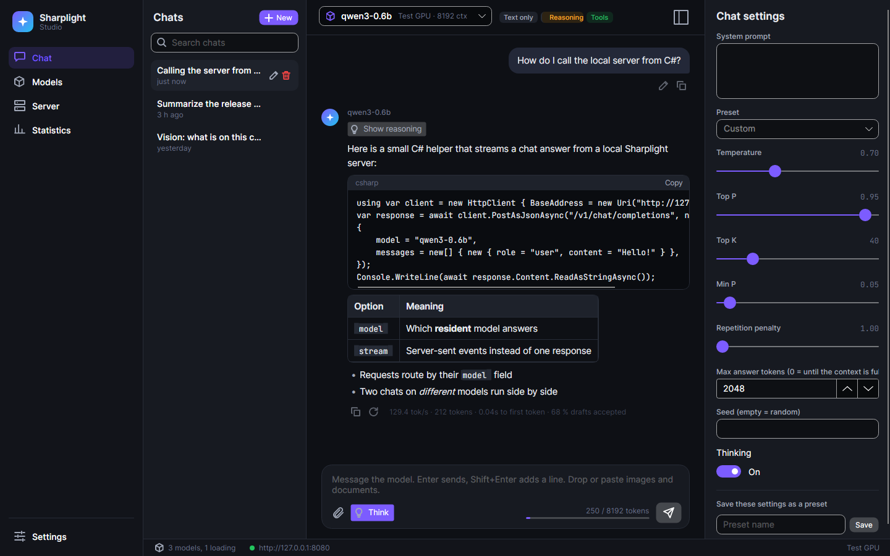

# Sharplight

An inference engine for large language models and ONNX models, written in C# for .NET 11, with a Vulkan GPU backend
(Slang compute kernels, cooperative-matrix tensor cores where available) and a CPU backend.

- **Models:** GGUF and Hugging Face checkpoints for the llama.cpp architecture families ([docs/model-support.md](docs/model-support.md)),
  ONNX models including data-dependent shapes and control flow ([docs/onnx-support.md](docs/onnx-support.md)).
- **Serving:** OpenAI- and Anthropic-compatible HTTP APIs for ASP.NET Core (`Sharplight.AspNetCore`), continuous batching,
  paged KV cache with prefix sharing, quantized KV cache ([docs/kv-cache.md](docs/kv-cache.md)),
  `Microsoft.Extensions.AI` adapters ([docs/extensions-ai.md](docs/extensions-ai.md)).
- **Model packages:** the `.slm` format stores optimized, device-independent graphs and weights, plus optional precompiled
  artifacts per execution provider (SPIR-V, driver binaries) ([docs/model-format.md](docs/model-format.md)).

Start with the [public API overview](docs/api-overview.md). Benchmarks against llama.cpp and vLLM are in
[docs/benchmarks.md](docs/benchmarks.md).

## Model compatibility

| Source | CPU | Vulkan |
|---|:-:|:-:|
| GGUF | ✓ | ✓ |
| Hugging Face (safetensors) | ✓ | ✓ |
| ONNX | ✓ | ✓ |
| `.slm` package | ✓ | ✓ |

Of the 172 architectures llama.cpp knows, 134 are supported end to end, 3 partially and
35 not yet ([docs/model-support.md](docs/model-support.md) has the full matrix). Supported (llama.cpp architecture names):

| Family | Architectures |
|---|---|
| Llama-like | `llama`, `llama4`, `mistral3`, `llama-embed`, `deci` |
| Qwen | `qwen`, `qwen2`, `qwen2moe`, `qwen3`, `qwen3moe`, `qwen2vl`, `qwen3vl`, `qwen3vlmoe` |
| Qwen hybrid | `qwen3next`, `qwen35`, `qwen35moe`, `clover_moe` |
| Gemma | `gemma`, `gemma2`, `gemma3`, `gemma3n`, `gemma4`, `gemma-embedding` |
| Phi | `phi2`, `phi3`, `phimoe` |
| Meta | `muse-glimmer`, `muse-spark` |
| NVIDIA | `nemotron`, `nemotron_h`, `nemotron_h_moe` |
| Cohere | `command-r`, `cohere2` |
| OLMo | `olmo`, `olmo2`, `olmoe` |
| Granite | `granite`, `granitemoe`, `granite_swa` |
| GLM | `chatglm`, `glm4`, `glm4moe` |
| MLA/DeepSeek-like | `mistral4`, `minicpm3`, `deepseek`, `deepseek2`, `plm`, `hy_v4` |
| MoE | `dbrx`, `exaone-moe`, `bailingmoe`, `bailingmoe2`, `dots1`, `afmoe`, `laguna`, `ernie4_5-moe`, `hunyuan-moe`, `hy_v3`, `gpt-oss`, `smallthinker`, `minimax-m2`, `mimo2`, `mellum`, `flint`, `cohere2moe`, `arctic`, `grok`, `step35`, `kolibri1`, `maple`, `maion-coder`, `beam` |
| Other dense | `plamo`, `plamo3`, `internlm2`, `minicpm`, `openelm`, `bitnet`, `exaone`, `exaone4`, `arcee`, `ernie4_5`, `paddleocr`, `hunyuan-dense`, `smollm3`, `seed_oss`, `apertus`, `pangu-embedded`, `spark2_5`, `maincoder`, `talkie`, `nanbeige`, `ricursive` |
| GPT-style | `starcoder`, `starcoder2`, `gpt2`, `gptj`, `gptneox`, `falcon`, `mpt`, `bloom`, `refact`, `baichuan`, `stablelm`, `codeshell`, `orion`, `xverse`, `jais`, `jais2` |
| SSM | `mamba`, `mamba2`, `jamba`, `falcon-h1`, `granitehybrid`, `plamo2` |
| RNN | `rwkv6`, `rwkv6qwen2`, `rwkv7`, `arwkv7` |
| Hybrid conv | `lfm2`, `lfm2moe`, `lfm3` |
| Linear-attention hybrid | `kimi-linear`, `bailingmoe3`, `minimax-01` |
| Encoder-decoder | `t5` (plus the Hugging Face-only `bart`, `mbart`) |
| Encoder | `t5encoder`, `bert`, `nomic-bert`, `modern-bert`, `neo-bert`, `jina-bert-v2`, `eurobert` |
| Multimodal | `clip` |

Weight types (CPU and Vulkan): F32, F16, BF16, Q4_0, Q4_1, Q5_0, Q5_1, Q8_0, Q2_K–Q6_K, IQ1_S/M, IQ2_XXS/XS/S, IQ3_XXS/S,
IQ4_NL/XS, TQ1_0, TQ2_0, MXFP4, NVFP4. ONNX operator coverage is in [docs/onnx-support.md](docs/onnx-support.md).

## Performance

Test system for all numbers below:

| | |
|---|---|
| GPU | NVIDIA RTX PRO 6000 Blackwell Max-Q Workstation Edition (96 GB GDDR7, 300 W limit), driver 610.57.04 |
| CPU | AMD Ryzen 9 9950X (Zen 5, 16 cores / 32 threads, AVX-512 with VNNI and BF16) |
| RAM | 96 GB DDR5 (dual channel) |
| OS / runtime | Fedora 44, Linux 7.1, .NET SDK 11.0.100; Sharplight on Vulkan or its CPU provider |
| llama.cpp | b11177, official CUDA 13, Vulkan and CPU builds |

Single stream on the GPU (Sharplight on Vulkan) against llama.cpp b11177 with its **CUDA** backend (`llama-bench -ngl 99
-fa 1`), same GGUF files, tokens per second (2026-11-13). Prefill is 512 prompt tokens. Dense rows: median of 3 runs, decode at depth 0.
Ministral and MoE rows: best of 3 runs, decode after the 512-token prompt, llama.cpp run right after on the same GPU. The GPU was
shared with a desktop session, so differences under about 5 % are noise. gpt-oss decode was updated on 2026-11-14 after
the matmul bias fusion of benchmarks section 22.

| Model | Prefill Sharplight | Prefill llama.cpp | | Decode Sharplight | Decode llama.cpp | |
|---|---:|---:|---:|---:|---:|---:|
| Llama-3.2-1B Q8_0 | 55057 | 58918 | 0.93x | 749 | 739 | 1.01x |
| Gemma-3-1B Q8_0 | 45270 | 45353 | 1.00x | 560 | 538 | 1.04x |
| Ministral-3-3B Q4_K_M | 19817 | 20666 | 0.96x | 376 | 396 | 0.95x |
| Mistral-7B Q4_K_M | 9496 | 11229 | 0.85x | 248 | 246 | 1.01x |
| Qwen3.8-27B Q8_0 | 2656 | 3058 | 0.87x | 43.9 | 48.5 | 0.90x |
| OLMoE-1B-7B Q4_K_M (MoE) | 26791 | 26541 | 1.01x | 761 | 816 | 0.93x |
| ERNIE-4.5-21B-A3B Q4_K_M (MoE) | 10405 | 10383 | 1.00x | 320 | 365 | 0.88x |
| Nemotron-3-Nano-30B-A3B Q4_K_M (hybrid MoE) | 9327 | 8464 | 1.10x | 309 | 338 | 0.91x |
| gpt-oss-20b MXFP4 (MoE) | 11831 | 17432 | 0.68x | 322 | 345 | 0.93x |

Qwen3.8-27B (hybrid gated-delta-net + attention), output tokens/s after a 16-token prompt, same GGUF files; GPU rows on the RTX
PRO 6000, CPU rows on the Ryzen 9 9950X with both engines pinned to its 16 physical cores (2026-11-13, idle machine):

| Engine / backend | Q4_K_M (16.8 GB) | Q8_0 (29.0 GB) |
|---|---:|---:|
| **Sharplight Vulkan** | **65.6** | 40.7 |
| llama.cpp CUDA | 60.4 ± 2.8 | 41.9 ± 1.2 |
| llama.cpp Vulkan | 59.4 ± 2.0 | 41.5 ± 1.0 |
| **Sharplight CPU** | **3.03** | **1.80** |
| llama.cpp CPU | 2.89 ± 0.03 | 1.69 ± 0.00 |

Deep-context decode, batched serving (with vLLM), load times and the open gaps are in [docs/benchmarks.md](docs/benchmarks.md).

## Building

```sh
dotnet build Sharplight.slnx -c Release
```

Tests are Microsoft.Testing.Platform executables: run `dotnet tests/<Project>/bin/Release/net11.0/<Project>.dll`.

## Samples

Pull a model from Hugging Face (downloaded, converted to `.slm` and precompiled) and chat with it or serve it:

```sh
dotnet run -c Release --project samples/Sharplight.Server -- run Qwen/Qwen3-0.6B-GGUF:Q8_0
dotnet run -c Release --project samples/Sharplight.Server -- serve qwen3-0.6b:q8_0 --listen http://127.0.0.1:8080
```

| Sample | Executable | What it does |
|---|---|---|
| `samples/Sharplight.Cli` | `sharplight` | Chat / generate / benchmark from the command line; pulls Hugging Face models like the server |
| `samples/Sharplight.Server` | `sharplight-server` | Serve one or several models over HTTP; search, pull and run Hugging Face models ([docs/model-hub.md](docs/model-hub.md)) |
| `samples/Sharplight.Convert` | `sharplight-convert` | Convert models to `.slm` packages, precompile, inspect |
| `samples/Sharplight.PackageViewer` | `sharplight-viewer` | Avalonia viewer for `.slm` packages (graphs, IR, weights, artifacts) |
| `samples/Sharplight.OnnxRun` | `sharplight-onnxrun` | Run an ONNX model on the CPU or Vulkan provider |

Defaults keep near-f32 accuracy; `--reduced-precision` opts in to faster f16 kernel paths where they exist.

## Sharplight Studio

A desktop app (Avalonia) to search and download Hugging Face models and convert them automatically. It chats with several
resident models at once (Markdown, reasoning, image and document attachments) and serves them over the OpenAI and Anthropic
APIs. It also records per-model speed and latency statistics.

```sh
dotnet run -c Release --project apps/Sharplight.Studio
```



Details and screenshots: [docs/studio.md](docs/studio.md).

## Roadmap

What is in progress and the performance ideas still open: [docs/roadmap.md](docs/roadmap.md).

## License

[MIT](LICENSE)
