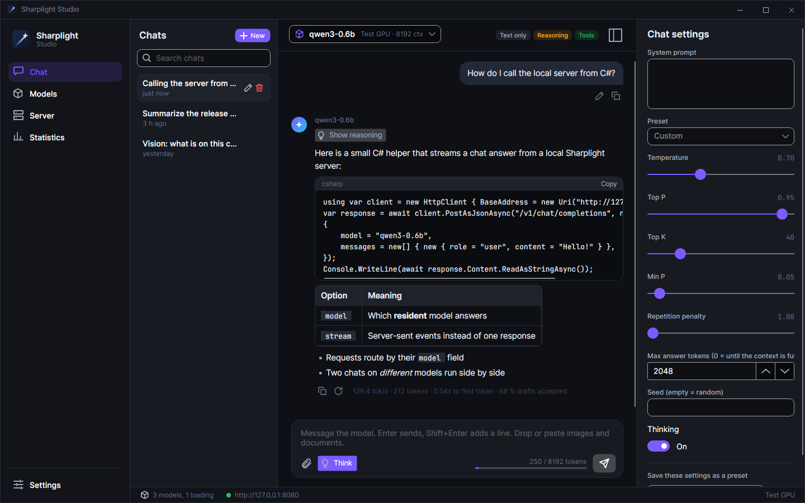

# Sharplight

An inference engine for large language models and ONNX models, written in C# for .NET 11, with a Vulkan GPU backend
(Slang compute kernels, cooperative-matrix tensor cores where available) and a CPU backend.

- **Models:** GGUF and Hugging Face checkpoints for the llama.cpp architecture families ([docs/model-support.md](docs/model-support.md)),
  ONNX models including data-dependent shapes and control flow ([docs/onnx-support.md](docs/onnx-support.md)).
- **Serving:** OpenAI- and Anthropic-compatible HTTP APIs for ASP.NET Core (`Sharplight.AspNetCore`), continuous batching,
  paged KV cache with prefix sharing, quantized KV cache ([docs/kv-cache.md](docs/kv-cache.md)),
  `Microsoft.Extensions.AI` adapters ([docs/extensions-ai.md](docs/extensions-ai.md)).
- **Model packages:** the `.slm` format stores optimized, device-independent graphs and weights, plus optional precompiled
  artifacts per execution provider (SPIR-V, driver binaries) ([docs/model-format.md](docs/model-format.md)).

Start with the [public API overview](docs/api-overview.md). Benchmarks against llama.cpp and vLLM are in
[docs/benchmarks.md](docs/benchmarks.md).

## Model compatibility

| Source | CPU | Vulkan |
|---|:-:|:-:|
| GGUF | ✓ | ✓ |
| Hugging Face (safetensors) | ✓ | ✓ |
| ONNX | ✓ | ✓ |
| `.slm` package | ✓ | ✓ |

Of the 172 architectures llama.cpp knows, 168 are supported end to end and
4 not yet ([docs/model-support.md](docs/model-support.md) has the full matrix). Supported (llama.cpp architecture names):

| Family | Architectures |
|---|---|
| Llama-like | `llama`, `llama4`, `mistral3`, `llama-embed`, `deci` |
| Qwen | `qwen`, `qwen2`, `qwen2moe`, `qwen3`, `qwen3moe`, `qwen2vl`, `qwen3vl`, `qwen3vlmoe`, `sensenova_u1` |
| Qwen hybrid | `qwen3next`, `qwen35`, `qwen35moe`, `qwen4exp`, `clover_moe` |
| Gemma | `gemma`, `gemma2`, `gemma3`, `gemma3n`, `gemma4`, `gemma-embedding`, `gemma-embedding2` |
| Phi | `phi2`, `phi3`, `phimoe` |
| Meta | `muse-glimmer`, `muse-spark` |
| NVIDIA | `nemotron`, `nemotron_h`, `nemotron_h_moe` |
| Cohere | `command-r`, `cohere2` |
| OLMo | `olmo`, `olmo2`, `olmoe` |
| Granite | `granite`, `granitemoe`, `granite_swa`, `graniteswitch` |
| GLM | `chatglm`, `glm4`, `glm4moe` |
| MLA/DeepSeek-like | `mistral4`, `mistral-large4`, `minicpm3`, `deepseek`, `deepseek2`, `deepseek32`, `glm-dsa`, `glm5-next`, `dots3note`, `plm`, `hy_v4`, `xing4_0`, `deepseek4`, `deepseek41`, `deepseek2-ocr` |
| MoE | `dbrx`, `exaone-moe`, `bailingmoe`, `bailingmoe2`, `dots1`, `afmoe`, `laguna`, `ernie4_5-moe`, `hunyuan-moe`, `hy_v3`, `gpt-oss`, `smallthinker`, `minimax-m2`, `minimax-m3`, `mimo2`, `mellum`, `flint`, `cohere2moe`, `arctic`, `grok`, `step35`, `kolibri1`, `maple`, `maion-coder`, `beam`, `grovemoe`, `k2-horizon` |
| Other dense | `plamo`, `plamo3`, `internlm2`, `minicpm`, `openelm`, `bitnet`, `exaone`, `exaone4`, `arcee`, `ernie4_5`, `paddleocr`, `hunyuan-dense`, `smollm3`, `seed_oss`, `apertus`, `pangu-embedded`, `spark2_5`, `maincoder`, `talkie`, `nanbeige`, `ricursive`, `chameleon`, `hrm_text`, `limite` |
| GPT-style | `starcoder`, `starcoder2`, `gpt2`, `gptj`, `gptneox`, `falcon`, `mpt`, `bloom`, `refact`, `baichuan`, `stablelm`, `codeshell`, `orion`, `xverse`, `jais`, `jais2` |
| SSM | `mamba`, `mamba2`, `jamba`, `falcon-h1`, `granitehybrid`, `plamo2`, `metis16` |
| RNN | `rwkv6`, `rwkv6qwen2`, `rwkv7`, `arwkv7` |
| Hybrid conv | `lfm2`, `lfm2moe`, `lfm3` |
| Linear-attention hybrid | `kimi-linear`, `kimi-k3`, `kimi-k31`, `bailingmoe3`, `minimax-01` |
| Masked diffusion | `dream`, `llada`, `llada-moe`, `rnd1` (`DiffusionGenerator`, and served by the continuous-batching engine) |
| Encoder-decoder | `t5` (plus the Hugging Face-only `bart`, `mbart`) |
| Encoder | `t5encoder`, `bert`, `nomic-bert`, `nomic-bert-moe`, `modern-bert`, `neo-bert`, `jina-bert-v2`, `jina-bert-v3`, `eurobert` |
| Multimodal | `clip`, `hunyuan_vl`, `cogvlm` |
| Speculative drafters | `eagle3`, `gemma4-assistant` (loaded as the `draft` auxiliary source of their target; MTP / NextN heads of the target itself also draft) |
| Decision models | `clef`, `vllm-decision2` (option scores of question spans through `SpanScorer`) |

Weight types (CPU and Vulkan): F32, F16, BF16, Q4_0, Q4_1, Q5_0, Q5_1, Q8_0, Q2_K–Q6_K, IQ1_S/M, IQ2_XXS/XS/S, IQ3_XXS/S,
IQ4_NL/XS, TQ1_0, TQ2_0, MXFP4, NVFP4. ONNX operator coverage is in [docs/onnx-support.md](docs/onnx-support.md).

## Performance

Test system for all numbers below:

| | |
|---|---|
| GPU | NVIDIA RTX PRO 6000 Blackwell Max-Q Workstation Edition (96 GB GDDR7, 300 W limit), driver 610.57.04 |
| CPU | AMD Ryzen 9 9950X (Zen 5, 16 cores / 32 threads, AVX-512 with VNNI and BF16) |
| RAM | 96 GB DDR5 (dual channel) |
| OS / runtime | Fedora 44, Linux 7.1, .NET SDK 11.0.100; Sharplight on Vulkan or its CPU provider |
| llama.cpp | b11177, official CUDA 13, Vulkan and CPU builds |

Single stream on the GPU (Sharplight on Vulkan) against llama.cpp b11177 with its **CUDA** backend (`llama-bench -ngl 99
-fa 1 -p 512 -n 128 -r 3`, mean of 3), same GGUF files, tokens per second (2026-11-14, benchmarks section 24). Prefill is
512 prompt tokens. Dense rows: median of 3 runs, decode at depth 0. Ministral and MoE rows: best of 3 runs, decode after
the 512-token prompt. llama.cpp ran right after Sharplight on the same GPU. The GPU was shared with a desktop session and
other jobs, so differences under about 5 % are noise; llama.cpp's own pp512 varied by up to 10 % between its three samples.
The gpt-oss row comes from the interleaved runs of section 24.3, because llama.cpp's decode samples in the table run
were disturbed (133-333 tok/s).

| Model | Prefill Sharplight | Prefill llama.cpp | | Decode Sharplight | Decode llama.cpp | |
|---|---:|---:|---:|---:|---:|---:|
| Llama-3.2-1B Q8_0 | 58843 | 54082 | 1.09x | 767 | 741 | 1.03x |
| Gemma-3-1B Q8_0 | 51922 | 40645 | 1.28x | 576 | 530 | 1.09x |
| Ministral-3-3B Q4_K_M | 20069 | 19443 | 1.03x | 385 | 377 | 1.02x |
| Mistral-7B Q4_K_M | 10456 | 11530 | 0.91x | 256 | 227 | 1.13x |
| Qwen3.8-27B Q8_0 | 3249 | 2921 | 1.11x | 43.1 | 48.0 | 0.90x |
| OLMoE-1B-7B Q4_K_M (MoE) | 30295 | 29117 | 1.04x | 817 | 808 | 1.01x |
| ERNIE-4.5-21B-A3B Q4_K_M (MoE) | 11280 | 9333 | 1.21x | 337 | 337 | 1.00x |
| Nemotron-3-Nano-30B-A3B Q4_K_M (hybrid MoE) | 9889 | 8065 | 1.23x | 326 | 309 | 1.05x |
| gpt-oss-20b MXFP4 (MoE) | 16276 | 17081 | 0.95x | 331 | 342 | 0.97x |

Qwen3.8-27B (hybrid gated-delta-net + attention), output tokens/s after a 16-token prompt, same GGUF files; GPU rows on the RTX
PRO 6000, CPU rows on the Ryzen 9 9950X with both engines pinned to its 16 physical cores (2026-11-13, idle machine):

| Engine / backend | Q4_K_M (16.8 GB) | Q8_0 (29.0 GB) |
|---|---:|---:|
| **Sharplight Vulkan** | **65.6** | 40.7 |
| llama.cpp CUDA | 60.4 ± 2.8 | 41.9 ± 1.2 |
| llama.cpp Vulkan | 59.4 ± 2.0 | 41.5 ± 1.0 |
| **Sharplight CPU** | **3.03** | **1.80** |
| llama.cpp CPU | 2.89 ± 0.03 | 1.69 ± 0.00 |

Deep-context decode, batched serving (with vLLM), load times and the open gaps are in [docs/benchmarks.md](docs/benchmarks.md).
Section 29 re-measures serving against vLLM (0.69-0.89x at 1-64 streams on the 27B FP8) and finds the sustained steps
limited by the GPU's power cap rather than by idle compute units.
Section 28 makes MTP speculative decoding reproduce plain greedy output on long prompts (verification rows now use the
single-row arithmetic), removes a barrier between the MoE expert-tile launches (gpt-oss-20b prefill +10 %), and re-runs
serving against vLLM (0.69-0.82x at 1-64 streams on the 27B FP8).
Section 24 reworked the MoE kernels: gpt-oss-20b prefill went from 0.68x to 0.95x of llama.cpp CUDA at 512 tokens and to
1.10x at 2048, and MoE decode runs 4 instead of 8 launches per layer. An opt-in bf16 delta-rule state (`--reduced-precision`)
makes 64-sequence decode steps on the 27B 9 % faster.
Section 23 loads the operands of small-batch matmuls straight into the tensor-core fragments. A decode step
of 16 sequences on the 27B takes 29.6 ms instead of 34.3 ms with FP8 weights, and 29.3 ms instead of 33.7 ms with Q8_0.
MTP speculative decoding on the FP8 model is 8 % faster.

ONNX models against onnxruntime 1.31 on the same machine (benchmarks sections 21, 25, 26 and 27), min latency in ms at
batch 1. Sharplight runs its f32-accurate default. ORT's CUDA EP is shown with its default TF32 and with TF32 off
("strict"). The CPU columns use 16 threads on both engines, from section 27 (interleaved with ORT, load average 7-34).
Section 26 fuses the attention of ONNX encoders on both providers and adds an opt-in split-f16 tensor-core GEMM
(`CompileOptions.SplitHalfMatMul`, 2-7x the f32 error), which takes vit b8 from 9.85 to 7.15 ms.
Section 27 reworks the CPU conv and parallel-loop scheduling and fuses the Q / K / V projections: on the CPU, resnet50
b1 went from 1.35x to 0.95x of ORT and segformer b1 from 2.1x to 0.92x.

| Model | Sharplight Vulkan | ORT CUDA (TF32) | ORT CUDA strict | Sharplight CPU | ORT CPU |
|---|---:|---:|---:|---:|---:|
| resnet50 | 0.82 | 1.01 | 2.12 | 5.9 | 6.2 |
| mobilenetv2 | 0.41 | 0.35 | 0.65 | 2.0 | 1.6 |
| yolov10n | 1.26 | 1.18 | 2.30 | 12.1 | 15.8 |
| bert-base (16 tokens) | 1.22 | 1.24 | 1.44 | 9.6 | 12.2 |
| vit-base | 2.47 | 1.34 | 2.46 | 19.8 | 23.0 |
| segformer-b0 | 2.88 | 2.37 | 3.43 | 38.7 | 42.1 |
| whisper-tiny encoder | 1.84 | 1.16 | 2.08 | 22.0 | 43.4 |
| mobilesam encoder | 5.89 | 6.08 | 7.98 | 143 | 219 |

## Building

```sh
dotnet build Sharplight.slnx -c Release
```

Tests are Microsoft.Testing.Platform executables: run `dotnet tests/<Project>/bin/Release/net11.0/<Project>.dll`.

## Samples

Pull a model from Hugging Face (downloaded, converted to `.slm` and precompiled) and chat with it or serve it:

```sh
dotnet run -c Release --project samples/Sharplight.Server -- run Qwen/Qwen3-0.6B-GGUF:Q8_0
dotnet run -c Release --project samples/Sharplight.Server -- serve qwen3-0.6b:q8_0 --listen http://127.0.0.1:8080
```

| Sample | Executable | What it does |
|---|---|---|
| `samples/Sharplight.Cli` | `sharplight` | Chat / generate / benchmark from the command line; pulls Hugging Face models like the server |
| `samples/Sharplight.Server` | `sharplight-server` | Serve one or several models over HTTP; search, pull and run Hugging Face models ([docs/model-hub.md](docs/model-hub.md)) |
| `samples/Sharplight.Convert` | `sharplight-convert` | Convert models to `.slm` packages, precompile, inspect |
| `samples/Sharplight.OnnxRun` | `sharplight-onnxrun` | Run an ONNX model on the CPU or Vulkan provider |

Defaults keep near-f32 accuracy; `--reduced-precision` opts in to faster f16 kernel paths where they exist.

Downloaded and converted models are stored in a `data` folder next to the executable, or in the per-user folder
(`~/.local/share/sharplight/models` on Linux) when the application directory is not writable. `--models-dir`,
`SHARPLIGHT_MODELS` or `sharplight store use user|application|DIR` choose another location; `store migrate` moves models
from the per-user folder used by earlier versions ([docs/model-hub.md](docs/model-hub.md#store)). Compiled kernels are cached
per user (`~/.local/share/sharplight/kernels`).

## Sharplight Studio

A desktop app (Avalonia) to search and download Hugging Face models and convert them automatically. It chats with several
resident models at once (Markdown, reasoning, image and document attachments) and serves them over the OpenAI and Anthropic
APIs. It also records per-model speed and latency statistics. Models go to a `data` folder next to the app by default; the
settings page switches to the per-user folder or a custom one. Its package inspector shows everything in a `.slm` file:
metadata, tokenizer, the execution graphs (drawn, as IR and as a table), weights, precompiled artifacts and the raw section
layout.

On Linux, download the AppImage from the [releases](https://github.com/infernitytech/sharplight/releases), make it
executable and run it; nothing else needs to be installed (a `.tar.gz` of the same self-contained app is attached too).
From source:

```sh
dotnet run -c Release --project apps/Sharplight.Studio
packaging/linux/build-appimage.sh <version>   # builds the AppImage into artifacts/studio
```



Details and screenshots: [docs/studio.md](docs/studio.md).

## Roadmap

What is in progress and the performance ideas still open: [docs/roadmap.md](docs/roadmap.md).

## License

[MIT](LICENSE)
