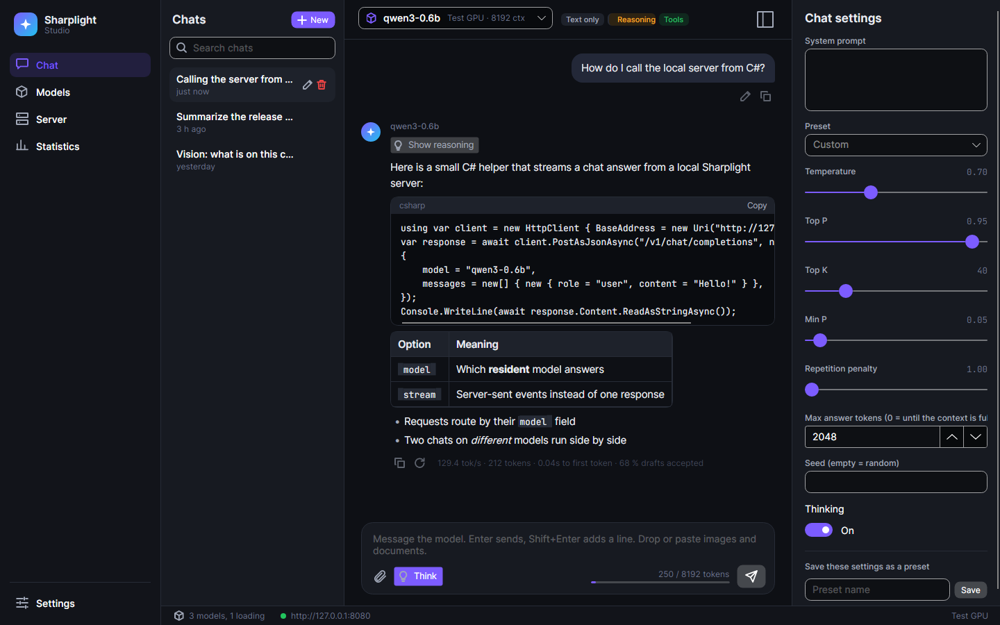
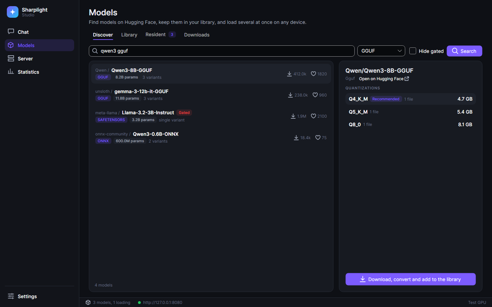
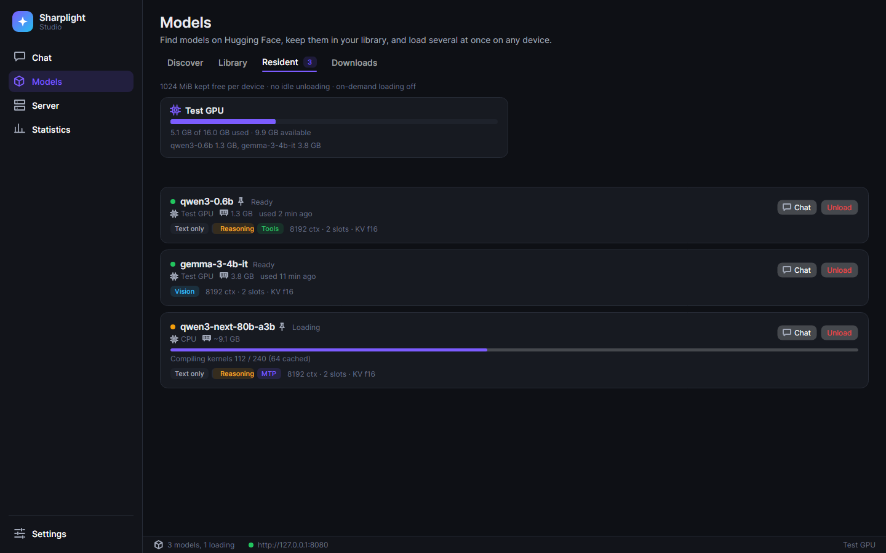
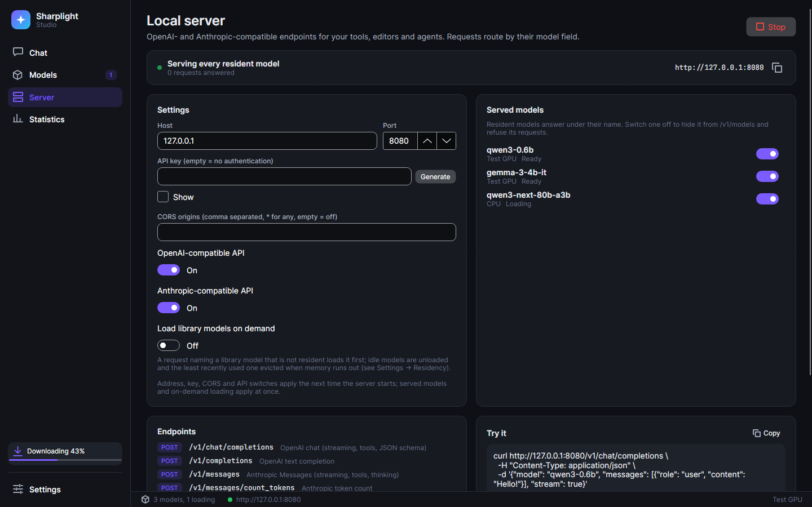
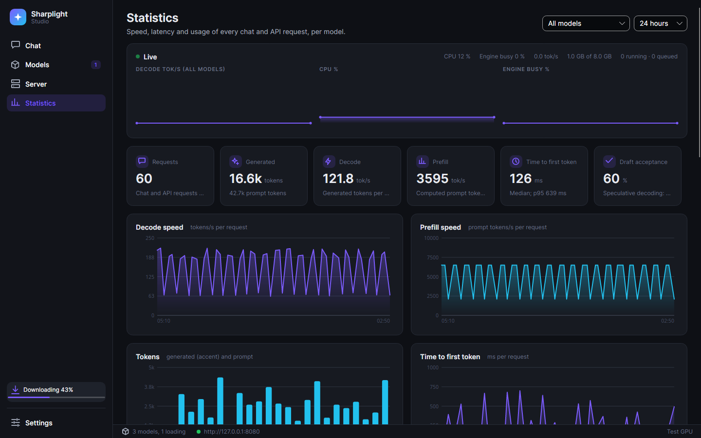
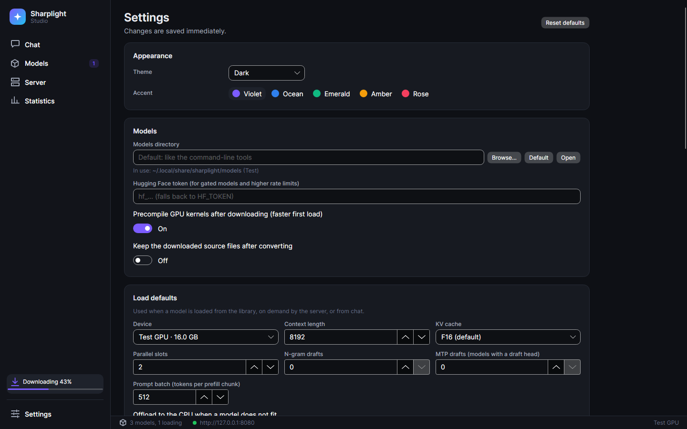

# Sharplight Studio

`apps/Sharplight.Studio` is a desktop app (Avalonia 12) for finding, downloading, running, chatting with and serving local models.
It embeds the engine and the same hosting layer as `sharplight-server`, so everything the app loads is also reachable over the
OpenAI- and Anthropic-compatible API.

```sh
dotnet run -c Release --project apps/Sharplight.Studio
dotnet run -c Release --project apps/Sharplight.Studio -- --models-dir /data/models
```



## Pages

**Chat.** Conversations are stored, one per entry in the list. Answers stream as Markdown (code blocks have a copy button, tables,
lists) and reasoning is collapsible. You can regenerate an answer, edit a question (both create versions you can page through),
stop a generation, and set the system prompt, sampling, presets and thinking per conversation. Every conversation keeps its own
model. Switching it mid-conversation applies to the next answer. Conversations keep generating in the background, so two chats on
different models run at the same time. Images and documents can be attached by drag and drop, paste or the file picker:
- Images need a model with the **Vision** badge; the others refuse them with an explanation.
- Documents (PDF, DOCX, HTML, text and code) are extracted to text and trimmed to the context window.

**Models.**



- *Discover* searches Hugging Face (format filter, gated models hidden on request) and lists a repository's quantizations with
  their sizes.
- *Library* lists the model store (the same store and resolution as the command-line tools: `--models-dir`, the setting,
  `SHARPLIGHT_MODELS`, a `models` folder next to the app, then the per-user default) and any added `.gguf`, `.slm` or `.onnx`
  files. *Load* opens the load options:
  - device;
  - context length;
  - parallel slots;
  - prompt batch;
  - KV cache type;
  - n-gram and MTP speculative drafts;
  - CPU offload;
  - the **Reduced precision** opt-in.

  Loading shows its stages (reading, building graphs, placement, kernel compilation with cached counts, weight upload) and can be
  cancelled. *Convert…* turns a GGUF, safetensors checkpoint or ONNX model into a `.slm` package.
- *Resident* shows the loaded models: state (loading / ready / busy / sleeping / failed), device, memory, last use, and load progress.
  It also shows memory per device against its budget. *Unload* drains running requests for a few seconds and then frees the model.

  
- *Downloads* run in parallel and show bytes, speed, ETA, the current file and overall progress. Conversion and kernel
  precompilation follow as separate stages. Downloads can be paused, resumed and cancelled. The queue is saved, so after a
  restart interrupted downloads resume where they stopped and paused ones stay paused. The sidebar shows running downloads on
  every page.

**Server.** Starts the embedded API on the chosen host and port, with an optional API key, CORS origins and the OpenAI and
Anthropic endpoints switched on or off separately.
- Requests route by their `model` field to any resident model, and `/v1/models` lists them. Loads and unloads apply at once,
  without a restart.
- Turning a model off hides it from the API immediately.
- With *Load library models on demand*, a request for a library model that is not resident loads it first. Idle models are
  unloaded after the configured time, and the least recently used one is evicted when memory runs out (pinned models excepted).
- The page shows a ready-to-paste `curl` request and a log of the requests.



**Statistics.** Every chat and API request is recorded per model in a local SQLite database:
- tokens;
- prefill and decode speed;
- time to first token (median and p95);
- speculative-decoding acceptance.

The dashboard filters by time range and model and charts the speeds, latency and token volumes. It also has a per-model table
and the recent requests. A live strip shows decode throughput, CPU, engine activity and device memory.



**Settings.**
- Theme (dark, light, system) and accent palette.
- Models directory and Hugging Face token (falls back to `HF_TOKEN`).
- Precompile after download, and whether to keep the source files.
- Load defaults.
- Residency:
  - memory kept free per device;
  - maximum resident models;
  - idle unload time;
  - pinning of manual loads;
  - on-demand loading.
- New-chat defaults.
- The engine's device features, each of which can be switched off to fall back to a portable path.
- **Reduced precision** (off by default) opts in to faster f16 kernel paths where the default keeps near-f32 accuracy. Outputs may
  differ slightly.



## Where things are kept

| What | Where |
|---|---|
| Settings (`settings.json`), including the download queue | `sharplight/studio` under the roaming application data directory (`~/.config` on Linux) |
| Conversations and statistics (`studio.db`) | `sharplight/studio` under the local application data directory (`~/.local/share` on Linux) |
| Models | The model store shared with the command-line tools |

`SHARPLIGHT_STUDIO_HOME` moves settings and data into one directory (portable use).

## Architecture

- **MVVM.** The app uses CommunityToolkit.Mvvm with compiled bindings. View models only talk to the services in
  `Services/` through interfaces:
  - `IModelRuntime`
  - `IHubService`
  - `IModelLibrary`
  - `IConversationStore`
  - `IStatsStore`
  - `IApiServer`
  - `IDocumentExtractor`
  - `ISystemMonitor`
  - `IPlatformServices`

  Tests run every view model against fakes of these services.
- **Runtime.** `EngineModelRuntime` owns a `ModelHost` (from `Sharplight.Llm.Serving.Hosting`, the same registry the server uses)
  and loads models through the registered providers and importers. Load progress comes from the engine's structured
  `LoadProgress` reports (`LlmLoadOptions.Progress`). Each request holds a lease on its model, so unloading and eviction wait
  for running requests.
- **Server.** `KestrelApiServer` maps the endpoints of `Sharplight.AspNetCore` over that host. Chat and API requests to the same
  model share one engine and are batched together. Stopping the server leaves the models loaded.

## Tests

`tests/Sharplight.Studio.Tests` covers:
- the pure helpers;
- the SQLite stores and settings;
- the downloads queue (pause, resume, cancel, restore after restart);
- conversations: streaming, versions, branches, stop, model switching and concurrent chats;
- the server page;
- a headless render of every page that fails on binding errors.

`RealModelTests` loads two small GGUF models (Qwen3-0.6B, SmolLM2-360M) when they are on disk. It chats with both at once and
calls the embedded server. Set `SHARPLIGHT_STUDIO_SCREENSHOTS` to a directory to save the page screenshots used here.

## Limitations

- **Images.** Image conversations run on a separate single-sequence session with the vision encoder, one request at a time. They
  are not batched with the model's text engine, and this memory is not counted in the residency budget.
- **Conversion progress.** Conversion during a download reports its log, not a percentage. Precompilation reports kernel counts
  per graph.
- **Fit check.** Whether a model fits is decided by the host's footprint estimate when it is loaded: it evicts idle models,
  offloads to the CPU when allowed, or refuses the load. The load panel does not show the estimate beforehand.
- **GPU utilisation.** The "Engine busy" chart is the share of time the engines spend stepping, not GPU utilisation read from the
  driver.
