# Sharplight Studio

`apps/Sharplight.Studio` is a desktop app (Avalonia 12) for finding, downloading, running, chatting with and serving local models.
It embeds the engine and the same hosting layer as `sharplight serve`, so everything the app loads is also reachable over the
OpenAI- and Anthropic-compatible API.

```sh
dotnet run -c Release --project apps/Sharplight.Studio
dotnet run -c Release --project apps/Sharplight.Studio -- --models-dir /data/models
```


## Window

On Linux, Studio draws its own title bar in the app's colors (light and dark): the app icon, the title, and minimize, maximize and
close buttons. Dragging the title bar moves the window, double-clicking it maximizes, the edges and corners resize, and dragging to
a screen edge snaps as usual. All of this is asked of the window manager (`_NET_WM_MOVERESIZE`), so Studio uses its own title bar
only when the window manager announces that request (KWin, Mutter and most others, on X11 and for XWayland windows); otherwise the
system frames the window. *Use the system title bar* in the settings, or `SHARPLIGHT_STUDIO_TITLE_BAR=system` (or `custom`),
overrides the choice. Other platforms use the system title bar.

The icon is embedded in the app (window and taskbar icon, sidebar logo, and the Windows executable icon). The sizes in
`apps/Sharplight.Studio/Assets/Icons` are rendered from `packaging/linux/sharplight-studio.svg` by `packaging/make-studio-icons.py`.
The X11 window class is `sharplight-studio`, the `StartupWMClass` of the desktop file, so the taskbar groups the window under its
launcher.

## Navigation

The sidebar groups the pages by the modality of what they produce, each group a collapsible header (icon and label) over its
entries; where a page is ambiguous it goes with its output:

| Group | Entries (page) | Model kinds that open there |
|---|---|---|
| **Text** | Chat; Search | text generation (also vision-language chat with images); embeddings, rerankers |
| **Images** | Generate (Image: generation and editing); Vision | image generation; classification, image embedding, detection, segmentation, depth, OCR, upscaling |
| **Video** | Generate (Video); Enhance | video generation; video enhancement (SeedVR2, also enlarges images) |
| **Audio** | Transcribe; Speak; Music & tools (Audio) | speech recognition; speech synthesis; music and audio generation, source separation, audio tagging, codecs, voice activity |
| **Models** | Library, Discover, Downloads, Loaded, Storage (the tabs of the Models page); Tasks | |

Server, Statistics and Settings are pinned to the bottom, below the running downloads. OCR stays with Vision: the Vision page reads
an image and draws what it found on it (boxes, masks, depth, the recognized lines), so its results are pictures with annotations.

The entry of the visible page (and Models tab) is highlighted and its group's icon carries the accent; showing a page, also from
the library (*Open* on a model), a Tasks card or a link, expands its group. Which page a model opens on comes from the model's kind
alone (`NavigationViewModel.ForKind`: the kinds each page runs, from the page itself). Collapsed groups are remembered in the
settings (`CollapsedNavigationGroups`). Below 1100 pixels of window width, or when folded with the button next to the logo
(`CompactNavigation`), the sidebar is a rail of group icons: each opens a flyout with the group's entries, the app-level entries
are icons with tooltips, and a dot marks a group with a badge. The arrow keys move between headers and entries (Home and End to
the ends), Left collapses a group or moves from an entry to its header, Right expands, Enter and Space open; every header and entry
has an accessible name, and the entries their description as help text and tooltip.

## Menus (macOS)

The application name is *Sharplight Studio* everywhere macOS shows it: `Application.Name`, and `CFBundleName` and
`CFBundleDisplayName` of `packaging/macos/Info.plist`. The application menu has *About Sharplight Studio* (an About dialog with the
version, license and links), *Settings…* (Cmd+,), *Check for Updates…* (opens Settings and checks now) and the standard Services,
Hide, Hide Others, Show All and Quit items; the menu bar has *File* (model library, Hugging Face search, downloads), *View* (every
page in the order of the navigation, Cmd+1 to Cmd+9) and *Help* (documentation, report an issue). They are built by `Platform/AppMenu` as Avalonia `NativeMenu`s.
Windows and Linux draw no native menu: the same pages and the Settings page are reached through the navigation as before, and the
About dialog through the same command.

## Pages

**Chat.** Conversations are stored, one per entry in the list. Answers stream as Markdown (code blocks have a copy button, tables,
lists) and reasoning is collapsible. You can regenerate an answer, edit a question (both create versions you can page through),
stop a generation, and set the system prompt, sampling, presets and thinking per conversation. Every conversation keeps its own
model. Switching it mid-conversation applies to the next answer. Conversations keep generating in the background, so two chats on
different models run at the same time. Images and documents can be attached by drag and drop, paste or the file picker:
- Images need a model with the **Vision** badge; the others refuse them with an explanation. Image conversations run on the model's
  batching engine like text ones: they are batched with every other request of the model (chat and API), their images are encoded once
  and reused by content (a follow-up question about the same picture takes its KV blocks from the prefix cache), and the vision
  encoder is loaded with the model and counted in its memory.
- Documents (PDF, DOCX, HTML, text and code) are extracted to text and trimmed to the context window.

*Voice and pictures.* Resident models of other kinds extend the chat; the *Voice and pictures* card of the chat settings picks which
one is used for each purpose (the choices are remembered in the settings, `Voice`, and a remembered model that is not resident yet
is chosen when it loads).
- **Dictation.** With a speech-to-text model resident, a microphone button appears in the composer. The first click records the
  microphone, the second stops, transcribes the recording with the chosen model (off the UI thread, through the model's task
  client) and appends the text to the message; you read it and send it yourself. Without a microphone the notice says why.
- **Read aloud.** With a text-to-speech model resident, every answer has a speaker button, and *Read answers aloud* reads each
  finished answer by itself. Markdown is not spoken (code blocks, link addresses, table and list markup are dropped). The audio is
  played while it is generated (the streaming synthesis call, so the first words start before the whole answer is synthesized);
  clicking the button again, or turning the setting off, stops it. A new answer replaces one still being read. When the model
  offers voices (Kokoro voices, the Qwen3-TTS speakers), the *Voice* choice below the model picker selects one (remembered in the
  settings, `Voice.SynthesisVoice`; a model that lacks the remembered voice reads with its default one without forgetting the choice).
- **Pictures.** With an image-generation model resident, `/image a lighthouse at dusk` (or the picture button next to the
  microphone, which uses the whole message) generates one image with the model's own defaults and shows it inline as the answer,
  with model, size, seed and time under it. The PNG is stored in the conversation (as a generated-image attachment), regenerating
  the answer makes a new version with another seed, and editing the request generates again. The request and the picture are not
  sent to the language model in later turns. The Image page stays the place for sizes, steps, samplers, image-to-image and LoRAs.

**Search.** Embeddings over a local folder of documents (see *Inference pages* below): choose a folder, *Index* it once with a
resident text embedding model (the index is stored and updated incrementally), then search by meaning, keywords or both, and *Ask* a
chat model to answer from the passages with citations. Reads PDF, Word, PowerPoint, Excel, Markdown, HTML, text and source files.

**Tasks.** One card per model kind (text generation, speech to text, text to speech, image generation, video generation, image
classification, object detection, segmentation, depth estimation, OCR, upscaling, audio, embeddings, time series, 3D, bio,
robotics) with the number of library and resident models of that kind. The engine runs text generation (the chat page), speech to
text (Transcribe), text to speech (Speak), image generation (Image), the image models (classification, embedding, object detection,
depth estimation, segmentation, OCR, upscaling: Vision) and embeddings today. The cards of the runnable kinds open their page; the other kinds say
*Not yet supported* and their buttons lead to the library filtered to that kind and to Discover filtered to that model type. When
the engine gains a kind, its card opens a page of its own, built from the shared pieces described under *Inference pages* below.

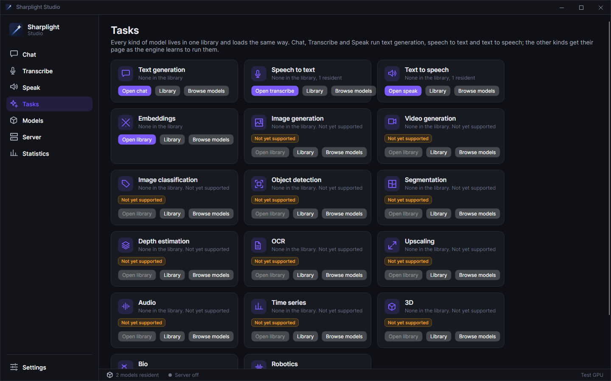

**Models.**

- **Verified models.** Discover opens on the verified-model catalog ([verified-catalog.md](verified-catalog.md)) whenever it has models
  of the selected model type; the *Verified models* / *Hub search* buttons above it switch modes (the choice then sticks for the session).
  Every model in it was run from download to output and compared with a reference implementation, and installs use exactly the files and
  commit that were verified, so they are sure to download and run. The list is grouped by task (with counts) and filtered by text and
  *Fits this machine*; each model shows its verification (result, reference, date, providers), license, gated and partial badges and
  notes, and its variants (quantization and format) with the download size, the files and repository, an estimated fit on this
  machine's GPU and system memory and an *Installed* badge. The recommended variant is preselected unless it does not fit, then the first
  that fits. *Download and install* queues the variant in *Downloads* with its companions (text encoders, VAE, vocoder, vision projector,
  listed under *Installed with*): they are downloaded in the same install and built into the same package, so the Image, Video and
  Speak pages load the model without choosing companion files. The catalog is built into Studio and replaced by a newer published copy
  (`https://download.sharplight.dev/catalog/verified-models.json`, checked once a day, kept as `verified-models.json` next to
  `studio.db`) when that is valid; offline the built-in or kept copy is used. `SHARPLIGHT_STUDIO_CATALOG_URL` changes the address (empty
  turns the download off).

  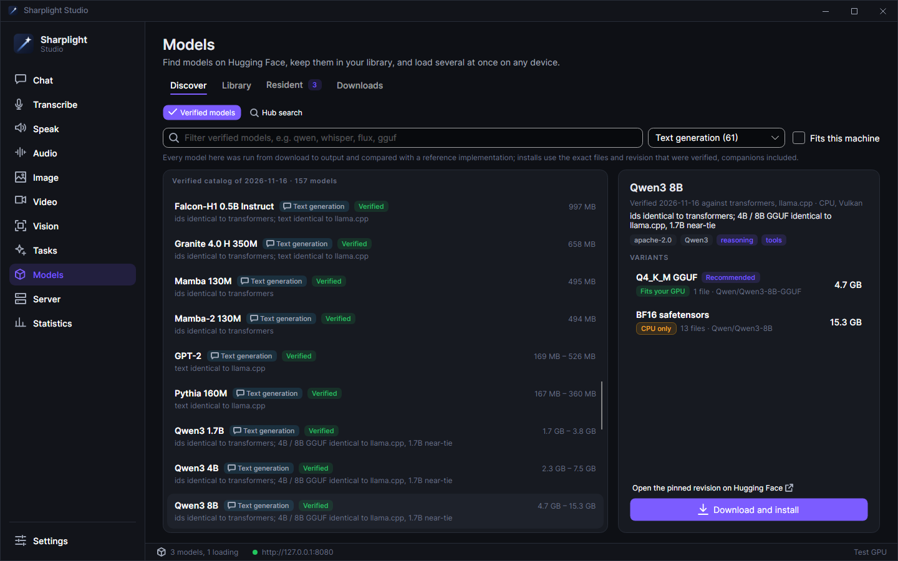
  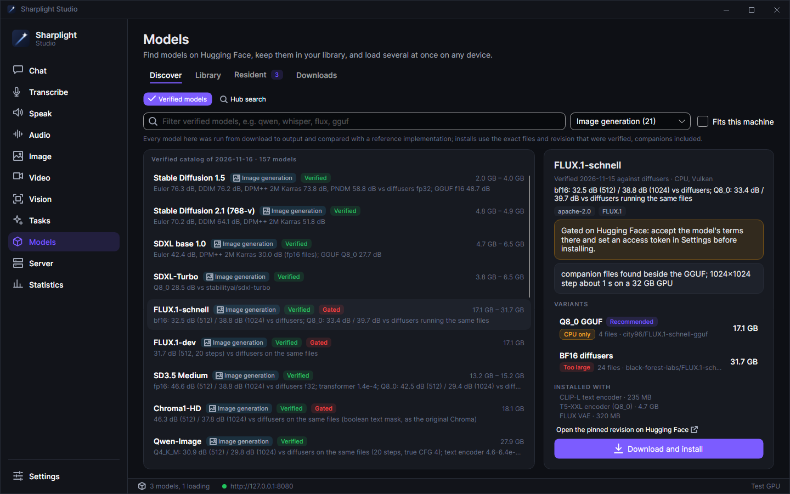

- **Sharplight feed.** The third Discover source, next to *Verified models* and *Hub search*, lists the packages of Sharplight's model
  feed ([model-feed.md](model-feed.md)): preconverted `.slm` files with signed manifests that install without conversion. Each row shows
  the name and variant, the task, the version, the size, a *Verified* badge (the package is listed in the signed index; the install
  verifies it again), a fit badge for this machine and *Installed* / *Update available*. The fit badge plans the package with the
  default load settings and one slot from the feed's memory figures (weights, KV bytes per token scaled to the default KV cache type and
  the default context, overhead) like the load panel: on the default device with the resident models and the reserve counted, or split
  over the GPUs, else with CPU offload (*Fits*, *Fits after unloading*, *CPU offload ~40 %*, *Too large*; its tooltip has the figures). The
  details of a package that is one variant of a model (the feed's model groups, built from the verified catalog's variant ladders) list
  *Variants of this model*, smallest first, with size, quality tier, *Recommended* and each variant's fit; a click shows that variant. The list is filtered by text, task and *Fits this machine*. A package whose requirements
  this Studio or engine does not meet, or that the publisher withdrew, is listed but cannot be installed and says why; a deprecated one
  carries the publisher's note.
  - *Download and install* resolves the package and its required dependencies (semantic versions, e.g. a voice-activity model), reads
    their manifests, verifies every signature and digest, downloads the package files with resume (the partial file is kept when you cancel
    or the connection drops; installing again continues after the chunks that verified) and checks every chunk and the whole file against
    the manifest's SHA-256. Only then is the package moved into the model store of the current storage mode (`<store>/sharplight/<id>/default`,
    next to a `manifest.json` that records the package, version and channel) and listed in the library as a ready-to-load `.slm`, with a
    *Feed x.y.z* badge. Progress, cancel and retry are shown above the list.
  - A failed signature, expired or older index, digest or hash is shown as an error and nothing is installed or listed from that feed:
    *The feed failed verification and was not used*, or *Not installed: verification failed* for a manifest or file.
  - **Updates.** After the listing is read (when the Models page opens), the library marks stored feed packages for which the channel lists
    a newer version (*Update 1.1.0*); the button downloads and verifies the new version next to the old one and replaces the package file in
    one step only when that succeeded, so a failed or cancelled update leaves the installed version untouched. A model that is resident
    keeps running its old copy until it is unloaded.
  - **Offline.** Every verified document of the last successful listing is kept (`feed-cache` next to `studio.db`, per feed and channel). When
    the feed cannot be reached the list is built from it, through the same signature and digest checks, and the page says so (an index that
    expired meanwhile is accepted only in this case); without an earlier visit the page says that nothing is cached. Installing needs
    the network. The accepted index sequence of every feed is kept in `feed-state.json`, so an older index is refused (rollback).
  - **Settings > Models > Sharplight model feed** has the channel (*Stable*, or *Unstable* for packages before they are promoted; changing it reloads the
    list) and the feed address (default `https://download.sharplight.dev/models`; another feed or a local folder works, but its signatures are
    always checked against the Sharplight root key embedded in Studio, `tools/model-feed/keys/sharplight-feed.pub.pem`).
  - All network and file work (listing, hashing, downloading, moving) runs off the UI thread; the services are `IFeedService` (`FeedService` over
    `Sharplight.ModelFeed`, registered with `AddStudioFeed()`) and the view models `FeedCatalogViewModel` and `FeedInstallViewModel`.

- **Managing many models.** The Library and the *Storage* tab keep a large collection under control. All file work (measuring, deleting, copying,
  exporting, importing) runs off the UI thread with a progress bar and a Cancel button, never follows links, stays inside the storage
  location in effect (portable, system or custom), and leaves no half-written file when cancelled. The service is `IModelMaintenance`
  (`ModelMaintenanceService`); the view models are `StorageViewModel` and the partial files of `LibraryViewModel`.
  - **Disk usage.** *Storage* shows one card per location (model store, Studio data, caches, logs) with the volume's total and free space
    (a warning below 10 % free) and what Studio uses there: models, precompiled artifacts stored in packages, downloads in progress, the kernel
    cache (compiled kernels, CUDA PTX and cubin, SPIR-V device stages), shader sources, media and other caches, logs, outputs and run histories.
    It also lists the biggest models. Each library card has *Size details*: weights, attachments, the precompiled artifacts per provider and
    device, unused space and the definition. The library sorts by name, size, last used, or not used for longest.
  - **Cleanup.** Delete a model, remove only its precompiled artifacts (the package is compacted, the model stays and rebuilds them when
    precompiled), clear the kernel, shader or media cache, and remove failed or partial downloads. *Select* in the library ticks models for bulk
    delete or bulk artifact removal. Every action first asks with a message that states the space it frees ("Delete 3 models? This frees
    12.4 GB."). A resident model is never deleted or rewritten: the library says to unload it first (the service checks the runtime, not only the
    card, and a model being precompiled counts the same); in a bulk action resident models are skipped and named. A file added from outside the
    store is only removed from the list. Partial downloads are not removed while a download or feed install is running.
  - **Updates.** *Update all (n · size)* updates every feed package that has a newer version, one after the other, with an overall progress bar
    weighted by download size and Cancel; each update is the same verified atomic swap as a single update, a failed one leaves that model as it was
    and the others continue. *Settings > Models* has an optional daily check of the feed (`CheckModelUpdates`, every
    `ModelUpdateIntervalHours`, last check `LastModelUpdateCheck`); the number of models with a newer version is a badge on the Library entry of the
    navigation (added to the running downloads) and on the Library tab.
  - **Last used.** Every load is recorded in `model-usage.json` next to `studio.db` (by model path, also loads by API clients); the card shows
    *Used 3 days ago* or *Never loaded*. Models not loaded for 90 days (counted from the day they were added when never loaded) are suggested in the
    library and on *Storage*; *Review* ticks them.
  - **Export and import.** *Export .slm* (context menu of a card) copies the package to a standalone file, with or without its precompiled
    artifacts (the lean file is stripped and compacted). *Import .slm…*, *Import folder…* and dropping files or folders on the library read each
    package with the package reader first (a folder is searched two levels deep); valid ones are listed with their size and, after confirming,
    copied into the model store (`imported/<name>`) and registered, broken or non-package files are reported with the reason and never added.


- **Filters.** The filter bar above the results picks the model type, format, quantization, size, license, gating and sort order.
  Every choice is saved in the settings (`Discover` in the settings file) and *Reset filters* clears them.
  - *Model type* maps the Hub's pipeline tags and library names to the groups below. A group with several tags is searched once
    per tag and the answers are merged, so a type is never half of its tags.
  - *Format*: GGUF, safetensors, Diffusers, ONNX, whisper.cpp (`ggml-*.bin`), `.slm` (the Hub's `gguf`, `safetensors`,
    `diffusers`, `onnx`, `ggml` and `slm` tags) or PyTorch checkpoints (`.pth`, `.pt`, `.ckpt`, `pytorch_model*.bin`; the Hub has no
    tag for them, so the results are filtered by their files). A repository whose weights are only in a format Sharplight does not
    read says which (*NeMo archives (.nemo): not supported*, CTranslate2, Core ML, OpenVINO, TensorFlow / Keras, TFLite, Flax,
    PaddlePaddle, pickled `.pkl`) instead of *No model files*; one that is in the verified catalog points to its one-click install.
  - *Quantization* (`Q2` to `Q8`, `IQ`, `F16`, `BF16`, `FP8`, `MXFP4`, `NVFP4`) matches the start of a name segment of the
    repository's quantization labels (`Q4` matches `Q4_K_M` and `q4f16`, not `IQ4_XS`) or a checkpoint's quantization method.
  - *Size* (under 1B, 1B to 4B, 4B to 14B, 14B to 40B, over 40B parameters) and *Fits this machine* use the parameter count the
    Hub reports. *Fits* compares the smallest likely download (about 0.55 bytes per parameter for GGUF and ONNX, 2 for a bf16
    checkpoint, 1 for FP8) with the larger of all GPUs together and the system memory. It is approximate, and repositories
    without a parameter count always pass.
  - *License* (the Hub's license tag), *Gated and open / Hide gated / Only gated* and *Sort* (most downloaded, trending, most
    liked, recently updated, newest).
  - The Hub applies model type, format, license and sort; the others filter the results locally, so changing them does not ask the
    Hub again and the page says how many models the filters hide. With no search text and a filter set, or another sort order chosen,
    the Hub's listing in that order is shown.

  | Model type | Hub pipeline tags | Library names |
  |---|---|---|
  | Text generation | `text-generation`, `text2text-generation`, `fill-mask`, `summarization`, `translation`, `conversational` | |
  | Vision-language | `image-text-to-text`, `visual-question-answering`, `video-text-to-text`, `any-to-any` | |
  | Speech to text | `automatic-speech-recognition` | `whisper.cpp`, `faster-whisper` |
  | Text to speech | `text-to-speech`, `text-to-audio` | |
  | Image generation | `text-to-image`, `image-to-image`, `unconditional-image-generation` | `diffusers` |
  | Video generation | `text-to-video`, `image-to-video`, `video-to-video` | |
  | Image classification | `image-classification`, `video-classification`, `zero-shot-image-classification` | |
  | Object detection | `object-detection`, `zero-shot-object-detection` | |
  | Segmentation | `image-segmentation`, `mask-generation`, `keypoint-detection` | |
  | Depth estimation | `depth-estimation` | |
  | OCR | `image-to-text`, `document-question-answering`, `visual-document-retrieval`; vision-language models named like OCR models | |
  | Upscaling | `image-to-image` repositories named like upscalers (`upscale`, `esrgan`, `super-resolution`, `swinir`, `supir`) | |
  | Audio | `audio-classification`, `audio-to-audio`, `voice-activity-detection`, `zero-shot-audio-classification` | |
  | Embeddings and retrieval | `feature-extraction`, `sentence-similarity`, `text-ranking`, `image-feature-extraction` | `sentence-transformers` |
  | Time series | `time-series-forecasting` | `timesfm`, `chronos` |
  | 3D | `text-to-3d`, `image-to-3d` | |
  | Bio | embedding repositories named like protein, molecule and genomics models | `biopython` |
  | Robotics | `robotics` | `lerobot` |
  | Other | every other tag (tabular, reinforcement learning, classic NLP) and repositories without a tag | |

  The mapping is `ModelTasks` in `Sharplight.Hub`; the Studio side (`ModelKindCatalog`) maps a task to the kind of a model
  description and says whether the engine runs it.

  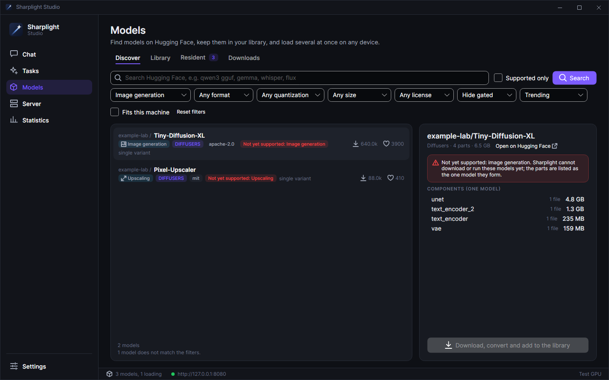

- **Per-type highlights.** Choosing a model type shows that type's *Trending*, *New* and *Most downloaded* models (every format, one
  listing per section, cached for six hours per type in `discover-highlights-<type>.json`). The default highlights (no type chosen)
  stay the supported language models. A type's highlights include models Sharplight cannot run, marked *Not yet supported: &lt;kind&gt;*;
  *Supported only* hides them and the page then says why it is empty.

  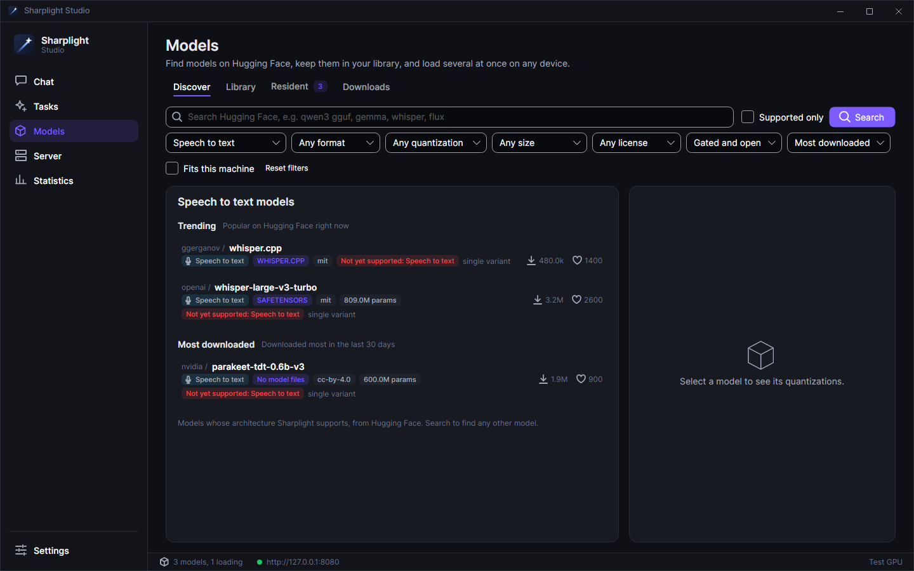

- **Multi-component repositories** are one model and download as one. A Diffusers repository (`model_index.json` and one folder per
  component: `unet`, `transformer`, `vae`, `text_encoder`, ...; Stable Diffusion 1.x / 2.x / XL, FLUX.1, Wan 2.1 T2V and Wan 2.2 TI2V)
  shows its components with their weight sizes. The download plans the file set: `model_index.json`, every used component's
  configuration, tokenizer and scheduler files and one weight variant per component (safetensors only; the `.bin`, `.ckpt`, ONNX
  and Flax copies, EMA duplicates, the safety checker's weights and folders `model_index.json` does not list are left out). When the
  repository has half-precision files the details offer *fp16* (the default, the smaller) and *full* precision with their planned
  download sizes. The files go through the normal resumable download into one model folder and are converted to one `.slm`
  package of the model's task kind (image or video generation), which the Image and Video pages load. A whisper.cpp repository lists
  its `ggml-*.bin` files by quantization and downloads the one you pick (default a small quantized base model); `.slm`
  repositories list their packages. Pipelines the engine cannot load (the importer judges them from `model_index.json`'s
  pipeline class and components, e.g. Stable Diffusion 3, image-conditioned Wan, repositories with only `.bin` weights) say why in
  the details and offer no download; the language-model fit estimate does not apply to them.
- **Gated repositories.** A gated result carries a *Gated* badge and its details say what to do: accept the terms on Hugging Face
  and add an access token in the settings (or that the token is used). The token (the *Hugging Face token* setting, else
  `HF_TOKEN`) is optional and is sent to huggingface.co only, never to the hosts a download is redirected to. Studio has no
  operating-system keyring abstraction yet, so the setting is kept in the settings file as plain text; the settings page says so.
- Before anything is searched, *Discover* shows highlighted models in three sections: *Trending*, *New* (created in the last few
  months) and *Most downloaded*. They come from the Hub's listings (trending, likes and downloads, GGUF and safetensors,
  text-generation and image-text-to-text) and keep only repositories whose badge is *Supported*. The answer is kept for six hours in
  `discover-highlights.json` next to `studio.db`, so opening Discover again or restarting does not ask the Hub again, and an older answer
  is shown while the Hub cannot be reached.

  
  

- *Supported only* hides repositories and quantizations whose compatibility badge is not *Supported*, and says how many it hid.
  The choice is kept in the settings.

  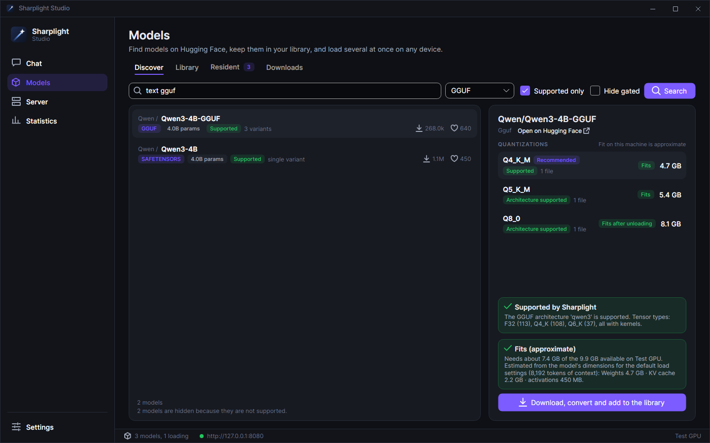
  

- *Discover* searches Hugging Face (format filter, gated models hidden on request) and lists a repository's quantizations with
  their sizes. Each quantization gets an approximate fit badge for this machine (*Fits*, *Fits on 2 GPUs*, *Fits after unloading*,
  *CPU offload ~40 %*, *Too large*), and the selected one's verdict is explained above the download button (it never blocks the
  download). The estimate takes the download size as weights and sizes the KV cache for the default load settings from the
  model's dimensions: the start of a GGUF file (a range request) or the checkpoint's `config.json`. Without them it assumes a
  generous share of the weights.
- Discover also says whether a model is likely to import and run, from the same metadata reads (nothing extra is downloaded). The
  verdicts are *Supported*, *Partially supported*, *Unsupported architecture &lt;name&gt;*, *Unsupported weight format &lt;type&gt;*,
  *Projector* (an mmproj file, loaded with its language model), *Checked at import* (ONNX) and *Unknown* (the metadata could not be
  read). Each search result gets a badge from what the Hub's search reports (the GGUF architecture, or a checkpoint's `model_type`
  and quantization method), and results that are likely not to import are listed after the others. Each quantization gets a badge
  too, with the reason in its tooltip, and the selected one's verdict is in the box above the download button. Downloading always
  stays possible.

  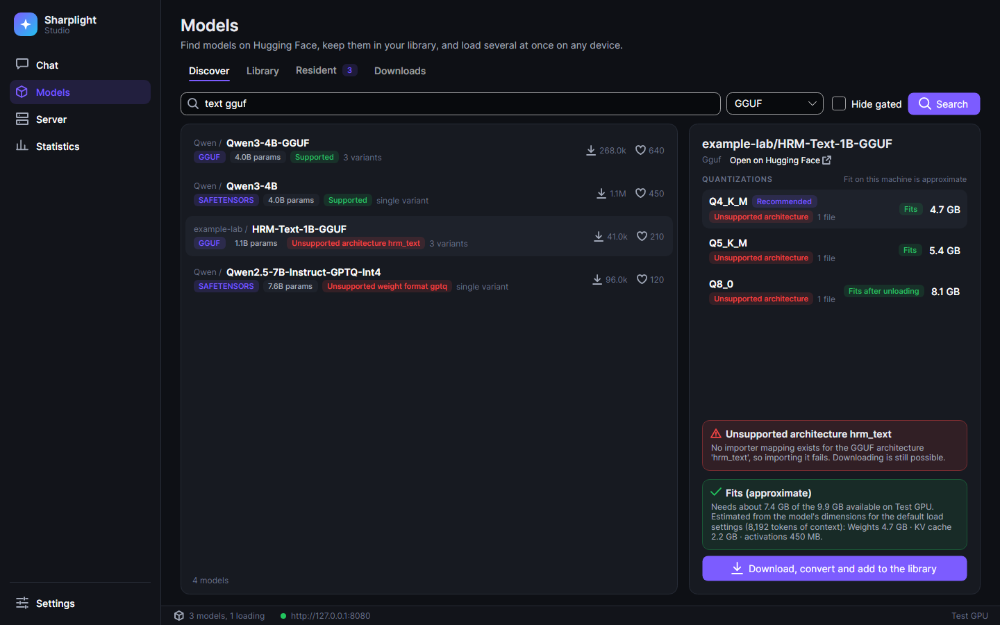

  The checks come from the importers, not from lists in Studio:
  - GGUF: `general.architecture` against the registered mappings (`GgufSupport`). Partial support is what a mapping declares (none
    does at the moment). When the recommended quantization is opened, or another one is selected, its whole tensor table is read too (of every shard of a split GGUF): a prefix of up to
    64 MiB per file, fetched in steps. Every ggml type id must be known and have CPU kernels
    (`CpuExecutionProvider.SupportsWeightType`). Every provider falls back to the CPU, so a type without CPU kernels, such as `Q8_K`,
    cannot load. The header then goes through the importer's own mapping steps (`GgufSupport.Validate`): the mapping's feature and
    hyper-parameter checks (`IGgufArchitectureMapping.Validate`, which the importer runs too) and the canonical name of every tensor.
    A tensor the mapping does not know gives *Unsupported variant of &lt;architecture&gt;*. When part of a tensor table lies beyond
    what was read, the verdict is *Unknown*, never *Supported*.
  - Hugging Face checkpoints: the `model_type` against the mappings (`HfSupport`), and the quantization in `config.json` (and
    ModelOpt's `hf_quant_config.json`). FP8 (block scales, compressed-tensors with 8-bit float weights, ModelOpt FP8) and MXFP4 for
    gpt-oss are read. GPTQ, AWQ, bitsandbytes, MLX, integer or 4-bit compressed-tensors, ModelOpt NVFP4 and similar packed formats
    are not, and the importer now rejects them with that reason. A method that is not known gives *Unknown*.
  - ONNX: the opset imports (domain and version) are read by skipping the graph by its length (`OnnxOpsetScanner`), usually in one
    or two range requests. Operators are checked when the model is imported.
- *Library* lists the model store (resolved like the command-line tools: `--models-dir`, `SHARPLIGHT_MODELS`, the setting,
  then the `models` folder of the storage location) and any added `.gguf`, `.slm` or `.onnx` files, for every kind of model in one list.
  Every entry carries a kind badge (an icon and the kind's name). The kind is the one the `.slm` model description names (a package
  without a description is a text-generation model; an embedding package is shown as *Embeddings*). Files that have no description
  are guessed from the file (GGUF files and checkpoint folders are language models, except GGUF files of the `whisper` architecture
  and whisper.cpp ggml files, whatever their extension, which recognize speech, and the image models listed under *Image*) and the
  badge's tooltip says so; a download
  that is not converted yet shows the kind inferred from the Hub's pipeline tag. The kind filter above the list (shown once the
  library holds more than one kind) lists the kinds present with their counts. A kind the engine cannot run yet is badged *Not yet
  supported* and its *Load* button is disabled. Loading, unloading and residency are the same mechanism for every kind.
  *Precompile* (per `.slm` model, also in the context menu) compiles the model for every execution provider and device available
  on this machine through the providers' two-stage contract (portable code such as SPIR-V, then the driver's device code; identical
  GPUs on the same driver share one set; the CPU has nothing to precompile and says so) with the default load settings, and writes
  the result into the package in place (crash-safe append; a failure or cancellation leaves the file unchanged). It is disabled,
  with the reason in its tooltip, while the model is resident (the package is in use), and a model being precompiled cannot be
  loaded meanwhile (also not on demand by API clients). The card shows progress per provider and device (kernel counts for the
  portable stage) and then a summary with sizes, sharing and skipped providers; the entry's size and *Precompiled* badge, and an
  open inspector of the package, are read again afterwards. *Load* opens the load options:

  - device;
  - context length;
  - parallel slots;
  - prompt batch;
  - KV cache type;
  - n-gram and MTP speculative drafts;
  - CPU offload;
  - the **Reduced precision** opt-in.

  Below the options, a memory estimate follows every change: the engine's footprint (weights, KV cache, activations) computed
  from the model's graph for these settings (`LlmModel.EstimateFootprint`, as the load sizes itself: with one slot the single-sequence
  session with its window-sized caches, with the chosen KV cache type), against each device's free and total memory and the residency
  reserve. The heading says whether the model *Fits on the GPU* (or *in system memory*, *on 2 GPUs*), fits after unloading other models
  (naming them, and whether they unload by themselves), *Fits with CPU offload* (with the share that would run on the CPU, against
  system memory; *Needs CPU offload* while offload is off), or *Does not fit*. For a mixture-of-experts model whose offload moves only
  routed experts (what goes to the CPU is no more than the experts' weights, which the engine offloads first) it says *CPU expert
  offload*: attention and the shared layers stay on the GPU. With *Read experts from disk* on (offered as a suggestion for a mixture-of-experts model that fits
  neither GPU nor system memory), a model whose offloaded part is larger than system memory is *Runs with experts from disk (slow)*: the
  panel says how many GB of experts stay on disk and gives a rough decode speed, the drive's read speed (3 GB/s assumed, the engine
  measures it only once loaded) over the bytes a token reads from disk (experts per token / experts of the part on disk, every read a
  cache miss, so a lower bound). The longest context *with CPU offload* is sized without experts on disk.

  Under *Context and KV cache* the panel shows how far the load could go, each row applied with a click: the longest context that fits on
  the device (*Up to 131,072 tokens on &lt;GPU&gt;*), the longest that fits with CPU offload when that is longer, and, when the model fits,
  what the other KV cache type changes (*Q8_0 KV cache · needs about 19.4 GB (1.7 GB less)*; the row is left out for models whose cache
  rows stay F16). When the configured context is already the longest, a line says so (*32,768 tokens is the longest context that fits on
  the GPU.*, or *The model's full context fits*). The contexts tried are the powers of two from 2,048 up to the context the model was
  trained for (128K when unknown) plus the configured one; a binary search needs a few estimates of the already-read model. Suggestions
  when it does not fit (turning on offload, smaller KV cache, one slot, splitting over all GPUs, a smaller quantization in the library)
  apply with a click. With several GPUs the device list also offers *All GPUs (split)*, which splits the layers in proportion to their
  free memory.

  Models load with one parallel slot by default (a single-sequence session; raise *Parallel slots* for concurrent API clients, each slot
  holding its own cache). Example, Gemma 4 31B Q4_K_M with one slot: weights and state 20.7 GiB at 32K and 28.2 GiB at 128K (23.0 GiB
  with a q8_0 cache); the estimate adds the activation bound of the 512-row prompt batch (about 3.1 GiB), so the panel shows 23.8 GiB at
  32K and 31.6 GiB at 128K (26.2 GiB with q8_0): on a 32 GB card 128K fits with a q8_0 cache or with CPU offload.

  **Memory figures.** Every fit estimate (load panel, Discover's verified list, Hub search and feed) reads the devices' live figures
  through one shared watch (`DeviceMemoryWatch`): free memory with other applications' use taken off, the memory Studio could hold once
  its own models are unloaded, system memory within the container's cgroup limit, unified memory of integrated GPUs, as the providers
  report them. The figures are read again when the load panel or Discover opens, after models load or unload (at most once a second), and
  every 5 seconds while one of them is visible; a change of more than 64 MiB re-plans the open panel and re-rates the Discover badges.

  

  Loading shows its stages (reading, building graphs, placement, kernel compilation with cached counts, weight upload) and can be
  cancelled. *Convert…* turns a GGUF, safetensors checkpoint or ONNX model into a `.slm` package.

  When a download's conversion or a load fails because of the model, the error starts with the reason: *Unsupported architecture
  &lt;name&gt;* or *Unsupported weight format &lt;type&gt;*. The reason comes from the importer's error
  (`UnsupportedArchitectureException`, `UnsupportedWeightFormatException`). Otherwise Studio reads the file itself: a GGUF header and
  tensor table, a checkpoint's `config.json`, or a package's stored weight types.

  *Inspect* (on a `.slm` card or in its context menu) opens the **package inspector**. *Open .slm file…* opens a package from
  anywhere. The inspector reads only the section table, the definition and the weight and artifact indexes, never weight data,
  so a 30 GB package opens in a fraction of a second. It shows everything in the file:
  - *Overview*: the model (architecture, parameters, graphs, nodes, context length), the package file (format version, sizes by
    section kind, reclaimable bytes), the source and conversion (repository, variant, revision, source format and files), the
    tokenizer (model, vocabulary, merges, special tokens), the chat template and the states.
  - *Graphs*: one tab per graph with its inputs, outputs and op histogram, and three views of it. The **graph** view is a layered
    dataflow drawing that pans, zooms and finds nodes, colored by op category; selecting a node shows its attributes, its inputs
    (type, shape, producer or weight), its outputs and its consumers. The **IR** view is the `--dump-graph` text with search,
    go-to-producer and consumers. The **nodes** view is a filterable table (`op:` filters by op). All three share the selection.
  - *Weights*: name, type, shape, bits per element, size and offset, sortable and filterable, with totals per type.
  - *Artifacts*: the precompilation stages per provider (portable code per device profile, device code per device and driver),
    and every precompiled set with what it was built for (code target, features, limits, device name and identity, driver, kernel
    ABI), its entries (key, content hash, size, offset) and where it sits in the file.
  - *Metadata*: the definition's properties and metadata, filterable, with the full value of the selected entry.
  - *Sections*: the whole file in offset order (header, every section, the section table and unused gaps). Sections of a kind
    this version does not know are listed raw with their size and offset; the other sections still open.

  Lists and the graph drawing are virtualized, so a graph with 100,000 nodes stays responsive.

  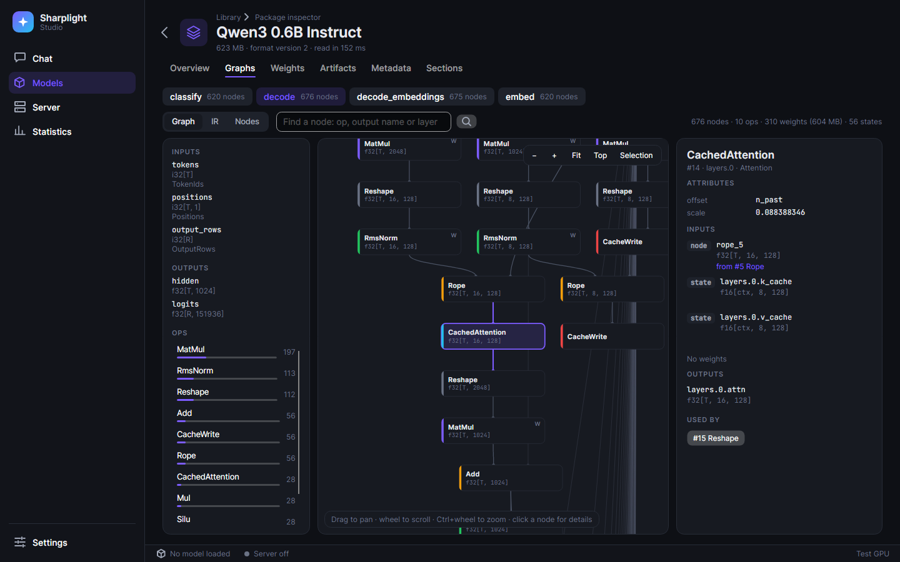
- *Resident* shows the loaded models: state (loading / ready / busy / sleeping / failed), device, memory, last use, and load progress.
  It also shows memory per device against its budget. *Unload* drains running requests for a few seconds and then frees the model.

  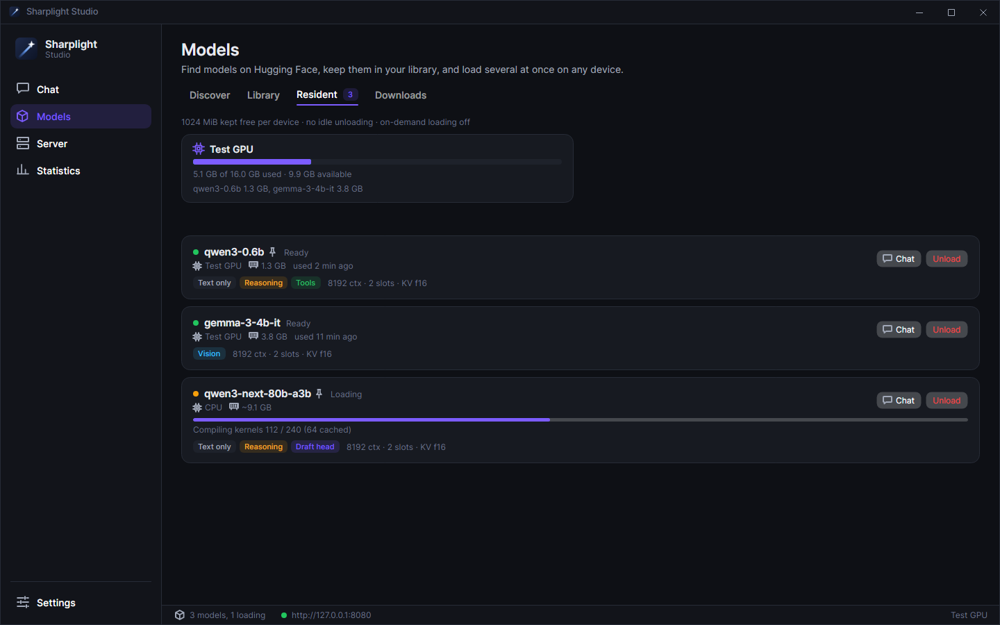
- *Downloads* run in parallel and show bytes, speed, ETA, the current file and overall progress. Conversion and kernel
  precompilation follow as separate stages. Downloads can be paused, resumed and cancelled. The queue is saved, so after a
  restart interrupted downloads resume where they stopped and paused ones stay paused. The sidebar shows running downloads on
  every page.

**Server.** Starts the embedded API on the chosen host and port, with an optional API key, CORS origins and the OpenAI and
Anthropic endpoints switched on or off separately.
- Requests route by their `model` field to any resident model, and `/v1/models` lists them. Loads and unloads apply at once,
  without a restart. Every resident kind that the engine's serving layer has an endpoint for is reachable, not only chat:

  | Model kind | Endpoint |
  |---|---|
  | Text generation | `/v1/chat/completions`, `/v1/completions` (OpenAI), `/v1/messages`, `/v1/messages/count_tokens` (Anthropic) |
  | Speech to text | `POST /v1/audio/transcriptions`, `POST /v1/audio/translations` (multipart WAV upload, `json`, `text`, `srt`, `vtt` or `verbose_json`) |
  | Text to speech | `POST /v1/audio/speech` (`{"model", "input", "voice", "speed", "instructions", "response_format"}`; `instructions` describes the voice or the style for models that take one (VoxCPM2, OmniVoice, CosyVoice 3); `wav`, or `pcm` streamed while it is generated) |
  | Image generation | `POST /v1/images/generations` (`prompt`, `n`, `size`, `steps`, `guidance_scale`, `seed`, `sampler`; base64 PNG) |
  | Embeddings | `POST /v1/embeddings` |
  | Reranking | `POST /v1/rerank` (also `/v2/rerank`, `/rerank`) for a reranking model on the host; Studio cannot load one yet |

  The *Endpoints* list names, under every endpoint, the served models that answer on it (and a note when none is resident), and
  every model in *Served models* shows its own endpoints; the other kinds (vision, video, audio) are marked as not served over HTTP.
  A model of another kind than the endpoint's is refused with its name, an unknown or switched-off one is a 404.
- Turning a model off hides it from the API immediately.
- With *Load library models on demand*, a request for a library model that is not resident loads it first. Idle models are
  unloaded after the configured time, and the least recently used one is evicted when memory runs out (pinned models excepted).
- The page shows a ready-to-paste `curl` request and a log of the requests.


**Statistics.** Every chat and API request is recorded per model in a local SQLite database:
- tokens;
- prefill and decode speed;
- time to first token (median and p95);
- speculative-decoding acceptance.

The dashboard filters by time range and model and charts the speeds, latency and token volumes. It also has a per-model table
and the recent requests. A live strip shows decode throughput, CPU, engine activity and device memory.


**Settings.** The page is split into tabs, the last one used is remembered, and *Check for Updates…* and the "Storage settings"
button open *Updates* and *Storage*:
*General* (appearance, audio devices, new-chat defaults), *Storage*, *Models* (model store, Hugging Face token, download and
compilation-cache options), *Engine* (load defaults, residency, device features), *Updates* and *Data and about*.
- Theme (dark, light, system) and accent palette.
- Storage: where Studio and the engine keep everything they write (settings, history and outputs, models, compiled kernels,
  caches, logs). **Portable** (a `data` folder next to the AppImage, the install folder or the app bundle), **System folders**
  (XDG folders on Linux, AppData on Windows, `~/Library` on macOS) or a **Custom folder** picked with a folder dialog. The card shows
  the location in use and why (with a notice when a portable or custom folder could not be used), and the folder of every kind of
  file now and with the selected location (read-only). To change it, choose *Move*, *Copy* or *Start fresh*, optionally *Keep the
  models where they are*, then *Change location*. The files are copied and verified with progress and can be cancelled; the new
  location is recorded and used after *Restart now*, and moved originals are deleted at that start. `SHARPLIGHT_HOME` locks the
  location. See [storage.md](storage.md).
- Model store: **with the other data** (the `models` folder of the storage location, the default), the **system folder**
  (`~/.local/share/sharplight/models` on Linux, shared with the command-line tools of the user), or a **custom folder** picked with
  a folder dialog. The page shows the store in use and why (for example "Default: portable storage"), and *Open folder* opens
  it. `--models-dir` and `SHARPLIGHT_MODELS` take precedence.
- Hugging Face token (falls back to `HF_TOKEN`).
- Precompile after download (for every GPU and execution provider on this machine, as the library's *Precompile* does), and
  whether to keep the source files.
- Compilation cache: keep compiled kernels and the driver pipeline cache in the artifact store of the storage location, so models that are not
  precompiled (GGUF, Hugging Face, ONNX) load fast from the second time on. It holds the same artifact sets as a precompiled `.slm`
  and is consulted after the package's own sets. On by default; off reads and writes no store files. See
  [model-format.md](model-format.md#the-per-user-artifact-store).
- Load defaults.
- Residency:
  - memory kept free per device;
  - maximum resident models;
  - idle unload time;
  - pinning of manual loads;
  - on-demand loading.
- New-chat defaults.
- *Use the system title bar* (see [Window](#window)).
- **Compute devices** (on a machine with a GPU): one row per physical GPU with its memory, the provider in use and, on an NVIDIA GPU that Vulkan
  and CUDA both drive, a picker: *Automatic*, *Vulkan* or *CUDA*. See [CUDA and the provider per GPU](#cuda-and-the-provider-per-gpu).
- The engine's device features, each of which can be switched off to fall back to a portable path.
- **Reduced precision** (off by default) opts in to faster f16 kernel paths where the default keeps near-f32 accuracy. Outputs may
  differ slightly.


The header's *Reset defaults* button shares the right edge of the cards below it (and the left edge of the title with the cards), also
in a narrow window:

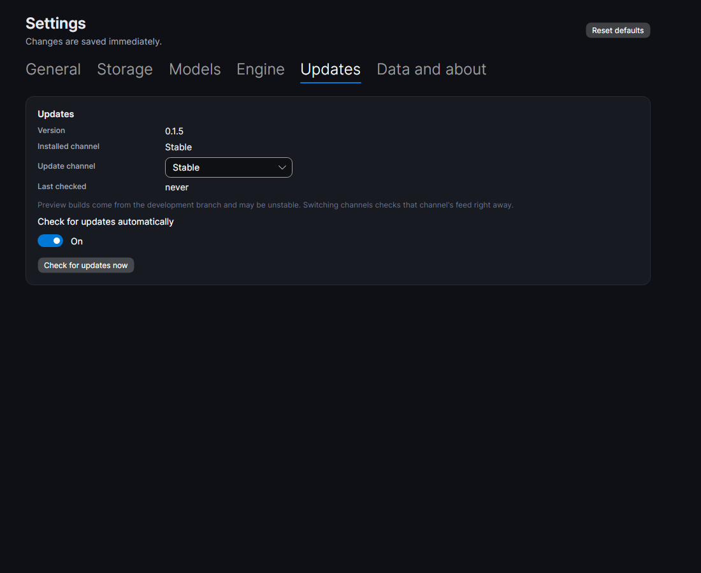
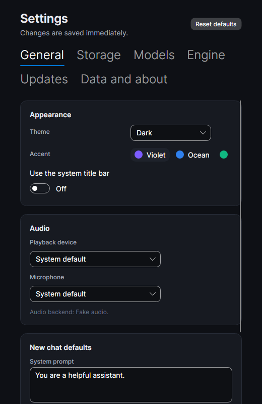

## First start

A new user is chatting within a minute without knowing anything about Hugging Face. On the first start (no model resident, an empty library
and `FirstRunDone` not yet set in the settings) Studio opens the **welcome flow** instead of the Models page. The same flow is behind **Get a
model** on the chat page, which offers it whenever no model is loaded (a banner and the empty conversation); it is a page of its own, not
listed in the navigation.

1. *Your machine.* The GPU (name and memory of the largest one; without a GPU the page says models run on the CPU), the system memory and the
   free disk space where models are stored (the model store of the current storage mode).
2. *Recommended for you.* One to three packages from the Sharplight feed (stable channel, see *Sharplight feed* above) that fit: a **chat model**
   sized to the GPU (or to the CPU without one), then optionally **speech to text** (ticked) and a **text embedding model** (not ticked). Each shows
   its description, where it runs and the memory it needs, the download size (the package and its required dependencies, such as the voice
   detector of a speech model) and an estimated download time at an assumed connection speed. The total follows the ticks.
3. **Get started** installs the ticked packages one after the other through the feed installer (signatures and SHA-256 verified, resumable), with one
   progress bar for the downloads and the load, loads the chat model on the best GPU with one slot, marks the flow done and opens a **new chat** with the
   model selected and an example question in the message box (not sent). A failed or interrupted install shows the reason and the button reads
   *Try again* (it resumes). **Skip, browse models myself** leads to Discover and the flow is not offered again on start.

*Offline.* The recommendation is made from the last verified listing (the feed cache) and says so; installing then needs the network and fails
with a clear message and *Try again*. Without a saved listing the page explains that the feed could not be reached and offers *Try again* and *Skip*.
*No GPU.* The chat model must fit within a CPU budget (40 % of system memory, at most 3 GiB by default), so a small model is chosen and a note says
answers are slower. When no chat model fits the memory or the disk, the page says which.

**The recommendation service.** `StarterRecommender` (`Services/FirstRun`) is pure: a listing, a `MachineProfile` (from the engine's devices by
`MachineProfiler`) and the preferences give the same answer. It names no model id. A package qualifies for a role by the feed's metadata (`model.kind`,
`model.tasks`, not yanked or deprecated, requirements met by this Studio and engine, required dependencies listed), must fit the memory budget (the
feed's memory figure for one slot, else the file size; GPU memory times `gpuMemoryFraction`, or the CPU budget, whichever is larger), the free disk
(minus a reserve) and the role's download limit. Candidates are ordered by the rank of the first `prefer` fragment found in the package's family, name,
architecture or id, then by memory (largest first), so the best-ranked family wins and is as large as the machine allows.

The ranking and limits are the JSON resource `Assets/starter-models.json` (the roles with their kind, task, `prefer` fragments, preselection and
download limit, the assumed download speed, the memory fractions, the CPU cap, the disk reserve and the example prompts). A file `starter-models.json`
in the settings folder replaces it (an unreadable or role-less file is ignored); comments are allowed.

## Inference pages

Every model kind gets a page built from the same blocks, so they look and behave alike: the **frame** (`InferenceFrame`) has the
model picker on top, the page's own workspace in the middle, the run queue below it and a side panel with three tabs:
*Parameters*, *History* and *Outputs*. A page is a view model derived from `InferencePageViewModel` (the chat is the one page that
predates the frame and keeps its conversation list; it uses the same `ModelPickerViewModel` and residency). The blocks live in
`ViewModels/Inference` and `Views/Inference`:

| Block | What it does |
|---|---|
| Model picker (`ModelPickerViewModel`) | The resident models of the page's kind; follows loads and unloads and keeps the choice while the model stays resident. No model: a hint with *Library* and *Find a model*. |
| Parameter panel (`ParameterPanelViewModel<TOptions>`) | One control per field of the task's options type (choice, slider, switch, text), `Options` maps the values to the type (for example `SpeechRecognitionOptions`), and a page can hide parameters the chosen model does not use. Presets: built-in ones ship with the page, *Save* stores the values under a name; presets and the values of the last run are JSON (`presets.json` in the page's directory) and come back when the page opens. |
| Run queue (`RunQueueViewModel`) | Runs one after the other per model (a second run on the same model waits, runs on different models overlap), with progress, status and a cancel button for queued and running runs. Finished runs stay listed until cleared. |
| History (`RunHistoryViewModel`) | Every completed or failed run of the page (up to 200), newest first, kept in `history.json`; *Show again* restores the result and the parameters, delete asks twice. Cancelled runs are not kept. |
| Outputs gallery (`OutputGalleryViewModel`) | The completed runs with their files (`outputs/<run>/`), metadata chips (language, audio length, speed, voice), and *Open*, *Export* (a save dialog) and *Delete* for every item. |
| Export (`Exporter`) | The save dialog and the write, shared by the page's own export buttons and the gallery. |

Pages keep their data under the data directory of the app (`pages/<page>/`, see *Where things are kept*). Loading a speech model
goes through the load panel of the library, like any other model: the runtime registers it on the same `ModelHost` as the chat
models (kind `Task`), so it counts against the memory budget, is evicted and unloaded when idle like the others, reloads on demand
and shows in the *Resident* list, whose button opens the page of the model's kind. A page asks the model for its task client
(`ILoadedModel.AcquireClientAsync<TClient>`), which holds a lease while the run lasts.

**Transcribe** (speech to text, `ISpeechRecognizer`). The input is an audio file (WAV, FLAC, MP3, Ogg Vorbis or Ogg Opus; choose, or drop it on the page) or a recording from
the microphone. A file that cannot be decoded is refused with a note. The options are the language (or detection), transcribe or translate to English, timestamps (segments
or none), beam size, conditioning on the previous text and an initial prompt; presets *Fast*, *Accurate* and *Long recording*. The
segments appear with their times while the model decodes (the streaming call reports progress by the end of the last segment), and
the transcript can be copied or exported as `.txt`, `.srt` or `.vtt`. Every run keeps `transcript.txt`, `.srt`, `.vtt` and
`transcript.json` in its outputs. Whisper (Hugging Face, whisper.cpp `.bin`, the transcribe.cpp `whisper-*.gguf` files of the
handy-computer repositories, whisper.cpp files published as `.gguf`, `.slm`) and Distil-Whisper models work. Candle's whisper GGUF
files (Hugging Face tensor names with the tokenizer in a separate file) are refused on load with a message that says to use the
whisper.cpp or transcribe.cpp files of the same model.

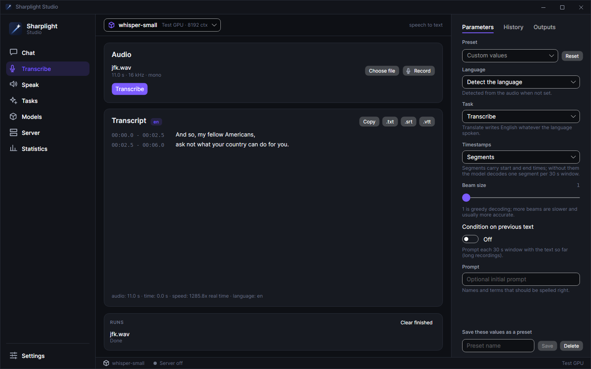

**Speak** (text to speech, `ISpeechSynthesizer`). Type the text, optionally choose a voice (the choice appears when the model offers
voices), the speed and the sampling (temperature, top-k, top-p, repetition penalty, seed; presets *Natural*, *Deterministic* and
*Expressive*). The result plays in the app, can be saved as WAV or opened in the system's audio program, and is kept as
`speech.wav`. *Play while generating* uses the streaming call and plays each segment as it arrives (the segments are decoded one by
one, so the sound differs slightly from a whole-text pass). OuteTTS is a language model plus the WavTokenizer decoder: when you load
an OuteTTS GGUF, the load panel asks for the vocoder file (a `.slm` package made with the vocoder needs none).

What the page offers follows what the chosen model's client says it can do (`SpeechModelTraits`: its canonical architecture and the
`ISpeechLanguageList` it implements):

- *VibeVoice-1.5B* and *Sesame CSM-1B* speak a script of lines `Speaker N: ...`. An *Add a turn* button writes the next label; every speaker of the
  script gets a row in the *Speakers* card with a voice choice: the model's own voice, one of its built-in voices (CSM: 0 and 1), a saved voice, or
  (VibeVoice) a *Reference recording* (a WAV file and, optionally, its words), from which the voice is made for the run. VibeVoice speaks the whole
  script in one request with `SpeechSynthesisOptions.SpeakerVoices`; CSM has no script input, so the page speaks the turns one after the other
  (the speaker's built-in voice, a 0.3 s pause between turns). The single *Voice* choice is hidden for these models.
- *Diffusion steps* and *Guidance* appear for models with a diffusion head (VibeVoice; defaults 10 and 1.3) and go to `DiffusionSteps` and `GuidanceScale`.
- *OmniVoice* shows a *Language* picker with its 600+ languages (the names of `ISpeechLanguageList`) and a *Voice design* box (for example
  "female, young adult, british accent", sent as `Instructions`; a reference recording or a saved voice replaces it). Its licence notice is
  shown above the page (see *Licence notices*).
- *Dia* is written as a dialogue with the tags `[S1]` and `[S2]` at the start of each turn and non-verbal sounds in parentheses (`(laughs)`); the hint under the text box says so
  (`SpeechModelTraits.SpeakerTags`). It has no separate voice per speaker: one *Reference recording* with its words (written with the same tags) gives the voices of both speakers.


**Transcribe and speakers.** A model that tells speakers apart (VibeVoice-ASR) returns segments with `TranscriptionSegment.Speaker`. The page then
shows a coloured speaker badge on every segment (one colour per speaker, in the order they first speak), a line "2 speakers: Speaker 0, Speaker 1"
under the transcript, and the exports carry the speakers: `.txt` has one line per turn (consecutive segments of the same speaker joined) that starts with
"Speaker 1: ", `.srt` prefixes each cue with the label, `.vtt` uses voice spans (`<v Speaker 1>text`). A bare number becomes "Speaker N"; other labels are
shown as they are. `transcript.json` of a run stores the speaker, so *Show again* restores them. Models without speakers export as before.

**Audio** (`audio-codec`, `voice-activity`, `audio-embedding`, `music-generation`, `audio-generation`, `audio-separation`). The mode follows the kind of the
chosen model. In the music mode, a diffusion model (ACE-Step 1.5 turbo, kind `audio-generation`, `IAudioGenerator`) shows a *Lyrics* box (section tags
such as `[verse]` and `[chorus]`; empty is an instrumental) next to the prompt, and the parameters *Duration* (limited by the model's `MaxDuration`),
*Seed*, *Steps* and *Shift* (0 uses the model's own values: 8 steps for turbo), and *Lyrics language*. *Guidance* is shown only for models that are not
distilled (an id with `turbo` hides it), and the token-sampling controls (*Greedy*, *Temperature*, *Top-k*) belong to MusicGen only and are hidden. The
lyrics are kept in the run's history. The library recognizes the ACE-Step checkpoint folder, which has no `config.json` of its own: a folder with an
`acestep-v15-*` transformer folder (with its `config.json`), a `vae` folder and a `Qwen3-Embedding*` text-encoder folder is an audio-generation model
(`ModelInspector.IsAceStepFolder`); a `config.json` with `model_type` `vibevoice` is speech synthesis, or speech recognition when its architecture names
ASR, and `csm`, `omnivoice` and `dia` (also the original Dia checkpoint's `config.json`, which has no `model_type` but a `data` section with the delay pattern) are speech synthesis.

**Licence notices.** A verified-catalog entry whose licence is `other` or a non-commercial one (`cc-by-nc-*`, `*-non-commercial-*`: OmniVoice, XTTS,
Depth Anything 3 large, FLUX dev) shows its notes prominently: in Discover's *Verified* detail as a warning callout "Read the licence before you use this
model", on every inference page while that model is chosen (found through the model's catalog key or repository, `LicenseNotices.ForModelAsync`), and
in the library's status line when it loads. An entry with such a licence and no notes shows a general line.

**Accepting licence terms before a download.** Every download path asks first when the model's licence is restrictive: the verified catalog (Discover
*Verified*, from the entry's `licenseNotice` or a licence that is not permissive), Hub downloads (a non-permissive Hub licence tag, or a gated repository),
model-feed installs (a licence that is not permissive, a gated or non-commercial one), and with them the first-run starter models and *Update all* (they
install through the feed). The one list of permissive licences is `CatalogLicenses.IsPermissive` (Apache-2.0, MIT, ISC, Unlicense, CC0, CC-BY-4.0, CC-BY-SA-4.0,
CDLA-Permissive-2.0, BSL-1.0, Zlib and every `bsd-*`); a model with no recorded licence is not asked about. The dialog (`LicenseDialogViewModel`, in the
main window) shows the model, the licence name, the notice text, *Read the full licence* (the licence link of the feed package, else the model's Hub page)
and *Accept* / *Cancel*; Cancel downloads nothing (a feed install is shown as cancelled and *Retry* asks again). `ILicenseGate` queues the requests and
shows one at a time, and the acceptance is stored per model in the settings (`AcceptedLicenses`: key, licence, a fingerprint of the licence and notice,
date; keys are the catalog entry id, `feed:<package>` or `hub:<repository>`), so it is asked once; a changed licence or notice asks again. A model whose
terms were accepted does not show the dismissible notice after the download (`LicenseNotices.IsHandled`).

**Image** (image generation, `IImageGenerator`). Type a prompt and optionally a negative prompt; the parameters are the size, steps,
guidance, sampler (`Samplers`: Euler, Euler Karras, Euler ancestral, DDIM, PNDM, DPM++ 2M, DPM++ 2M Karras), the seed (empty is random,
a number repeats the picture), the number of images (the seeds follow each other) and *Live preview*; presets *Fast* and *Quality*.
The streaming call reports every denoising step to the run queue and, every few steps, a low-resolution preview that the page shows
while the picture takes shape. An *Input image* (choose or drop) makes the run image to image, with a *Strength* slider that appears
with it; adding a *Mask* (bright areas are regenerated, the rest is kept) makes it inpainting, which the engine supports. The
results are PNG files that carry the prompt and parameters as text chunks (`parameters` in the style of other generators, plus
`Prompt`, `Negative prompt`, `Seed`, `Steps`, `Guidance`, `Sampler`, `Size`, `Model`), kept in the outputs gallery with thumbnails
next to `parameters.json`. *Save PNG*, *Use as input*, *Reuse seed* and *Reuse prompt* act on the shown image; the gallery's *Reuse
parameters* (every page has it) sets the parameters, the prompt and the result of a past run, with the seed that run actually used.
Stable Diffusion 1.x, 2.x and XL work (diffusers folders, single-file `.safetensors` / `.ckpt`, stable-diffusion.cpp GGUF, including
the SDXL and SDXL-Turbo GGUF files of the Hub), and FLUX.1-schnell / -dev (diffusers folders, original single files, city96 /
stable-diffusion.cpp GGUF). A FLUX file that holds only the transformer (the usual GGUF downloads) needs its text encoders and VAE:
the load panel shows *Text encoder (CLIP-L)*, *Text encoder 2 (T5-XXL)* and *VAE* fields, filled with the files found beside it or
in the sibling `clip` / `text_encoders` / `vae` folders (recognized by their tensors), and passes them as auxiliary files; a `.slm`
converted from it holds them. When a distilled model is chosen (SDXL-Turbo, SDXL-Lightning, FLUX.1-schnell: default guidance of 1 or
less; FLUX.1-dev: guidance embedded instead of classifier-free), the page sets steps and guidance to the model's defaults
(SDXL-Turbo and FLUX.1-schnell: 4 steps without guidance; FLUX.1-dev: 28 steps, guidance 3.5) and says so; choosing a regular model
afterwards restores 20 steps and guidance 7.5. SD3 and the other diffusion transformers are listed as image models, and loading one
says "Not supported yet: Stable Diffusion 3 (diffusion transformer)". A file that holds only the UNet, or an SDXL UNet
without its second text encoder, fails on load naming what is missing; a `.slm` converted from an SDXL GGUF by an earlier version
(without the second encoder) fails on load asking to import the original file again.


*Viewer.* The result is shown in a zoom and pan viewer (`ImageViewer`, shared control `ZoomPanView`): the mouse wheel and a pinch
zoom around the pointer, dragging pans, a double click toggles fit and 100 %, the buttons give zoom out, zoom in, Fit and 100 %,
and with the viewer focused `+`, `-`, `0` (fit), `1` (100 %) and the arrow keys work. The bitmap is decoded on a worker thread
beforehand, so drawing is one transformed blit; far zoom shows single pixels.

*Gallery.* Every generated image is kept: the PNG (with the prompt and parameters as text metadata) and a JSON sidecar (prompt,
negative prompt, model, seed, steps, guidance, size, sampler, LoRAs, seconds, the parameter panel's values) go to
`<data folder>/generations/images/yyyy-MM-dd/<id>.png` and `<id>.json`, in the data folder of the storage mode in use
(portable, system or custom; see Settings). The sidecars are the index, so files copied in or removed by hand are picked up at the
next start. Below the result a strip shows all images, newest first (virtualized, thumbnails decoded lazily on worker threads, two
at a time, the latest 400 kept), with a filter by prompt text and by model. Clicking one shows it large; *Reuse settings* fills the
prompts, seed, size, steps, guidance and the other parameters (and chooses the model when it is loaded), *Copy prompt*, *Open
folder* (the file manager), *Save as…* and *Delete* (asks to click again) act on the selected image. The history and outputs tabs
of the side panel keep working as before (the last 200 runs).

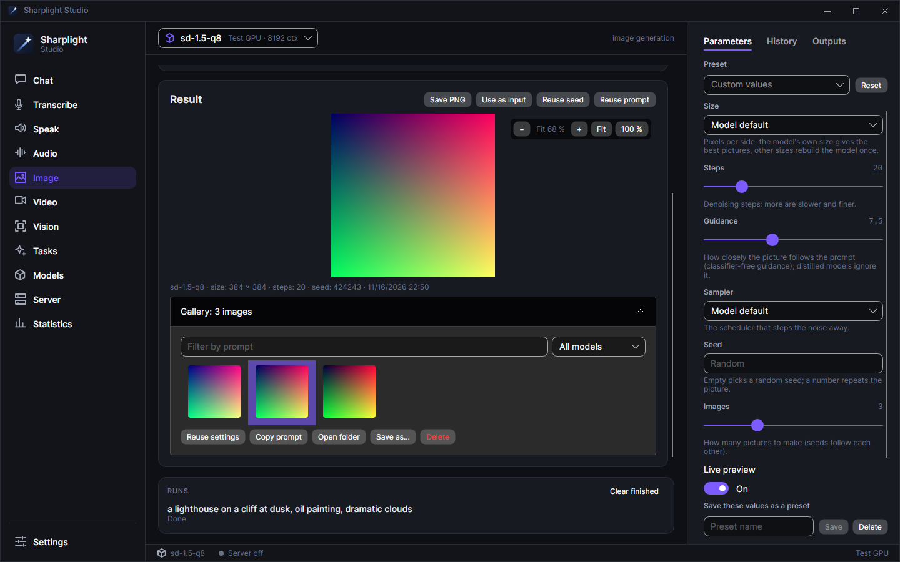

**Search** (text embeddings). The input is a folder; *Index* reads every supported document in it (up to 5,000; `.git`, `.hg`, `.svn`
and `node_modules` folders are skipped), cuts the text into overlapping passages (*Passage length* and *Overlap* in characters, cut at
paragraph, sentence or word ends where possible, and **never across a structural boundary**), embeds them in batches with the chosen
model and stores the result.

- *Formats.* Markdown (sections under `#` headings; fenced code is never a heading), HTML (text only: scripts, styles, comments and tags
  are dropped; sections under `<h1>`..`<h6>`), PDF (one section per page), DOCX (sections under Title and Heading paragraphs, tables as
  `| cell | cell |` rows), PPTX (one section per slide, with the speaker notes), XLSX (one section per sheet, one line per row) and plain
  text and source code (`.cs`, `.py`, `.js`, `.rs`, `.go`, `.sql`, ... and files such as `Dockerfile`). A passage keeps its page, slide or
  sheet number, its line in the file (Markdown, text and source) and the heading it stands under, and the heading is embedded with the
  passage. Libraries, all permissive: PdfPig 0.1.16 (Apache-2.0) for PDF, DocumentFormat.OpenXml 3.5.1 (MIT) for DOCX, PPTX and XLSX;
  Markdown, HTML, text and source use no library. There is no copyleft code in the path (no GPL or AGPL, no MuPDF or similar).
- *Limits.* A file above its limit is skipped and listed as unreadable with the reason (it is tried again when it changes): 16 MB for
  text, Markdown, HTML and source, 128 MB for PDF and Office files, 3,000 PDF pages, slides or sheets per file, 20 million characters,
  500,000 cells per sheet and at most 4,000 passages per file. Office files are zip packages: before a part is read the package is
  refused when it has more than 10,000 parts, unpacks to more than 512 MB in total, or has a part above 8 MB compressed more than
  200 to 1 (zip bombs); a damaged file is reported, not fatal.
- *Stored index.* Each folder's index is one compact binary file, `indexes/<hash of the folder>.slsx`, in the Search page's folder of
  the storage mode's data folder (`pages/search`; see *Storage modes*): the model's id, the passage settings, every file's
  fingerprint (relative path, size, modification time, SHA-256), and every passage with its position and text and its embedding as
  16-bit floats (about 2 bytes per dimension). It is written to a temporary file and moved into place, so an interrupted write never
  damages the last index; a damaged or unknown file is ignored and the folder is indexed again. Choosing the folder (or restoring a
  search from the history) loads its index in the background; a search then needs no indexing, also after a restart.
- *Incremental updates.* *Index* on an indexed folder only works on what changed: a file whose size and modification time match is
  kept; one with another time is hashed and re-embedded only when its content changed (a touched file keeps its passages); new files are
  embedded; files that are gone are dropped. The run's history entry lists how many were added, changed and removed. The index belongs to
  one embedding model and one passage setting: choosing another model (the hint says to index again) or changing *Passage length* or
  *Overlap* embeds everything again.
- *Progress, cancel and resume.* Indexing is a run of the queue (never on the UI thread): progress per document, *Cancel*, and
  history. The index is stored every 25 files and when a run is cancelled, so the next *Index* resumes after the files already done
  (they are unchanged).
- *Watch.* With *Keep the index up to date while this page is open* on, the folder is watched; two seconds after the last change an
  incremental update runs (when nothing else is running and an index of the chosen model exists; else it waits for the queue to be
  idle). Leaving the page stops the watcher; coming back checks the folder once.
- *Search modes.* *Semantic* ranks by cosine similarity of the embeddings (the question is embedded with the model's `query` prompt when
  it has one). *Keyword* ranks by BM25 (k1 1.2, b 0.75, lower-cased letter and digit words) and does not use the model. *Hybrid* takes
  the top 50 of each ranking and combines them by reciprocal rank fusion (`sum 1 / (60 + rank)`), which finds paraphrases and exact
  names, numbers and error codes together. The score shown is the cosine similarity (semantic), the share of the best BM25 score
  (keyword) or of the best possible fused score (hybrid); the reranker's own score when reranked.
- *Results.* Each result shows its rank (`[1]`), score, file (relative to the folder), its place (`page 3`, `slide 2 · Results`,
  `line 41 · Install`, `sheet 1 · Prices`) and the passage with the words of the question highlighted. *Open* opens the document in
  the system's default program; where a program that takes a position is installed it opens at the place: VS Code (`code --goto
  file:line`) for text, Markdown and source lines, Okular or Evince for PDF pages. Other viewers (and Word, PowerPoint, Excel) open at the
  start. *Copy* puts the passage on the clipboard.
- *Ask.* With a chat model resident (the *Chat model* picker appears), *Ask* runs the search as above, then the chat model answers from
  the top *Results* passages: they are numbered `[1]`, `[2]`, ... in the prompt with their file and place, as many as fit the model's
  context, and the model is told to use only them and to cite them. The answer streams into the *Answer* card (a run of the queue like
  any other, so the page stays responsive and *Cancel* stops it); the `[n]` it cites become buttons under the answer that mark the
  passage in the list. The answer and its mode are kept with the run, so the history shows it again.
  Reasoning is off for the answer; the sampling is fixed (temperature 0.2, at most 700 tokens).

Indexing and searching are runs of the queue (progress per document, cancel, history), the history restores a past search with its
parameters, and every search keeps `results.json` in the outputs. Presets *Precise*, *Balanced* and *Context*.
With a reranking model resident (kind *Reranker*, e.g. ms-marco-MiniLM-L6-v2, bge-reranker or Qwen3-Reranker), the *Rerank results*
switch appears: a search then takes the nearest 4x *Results* passages (at least 20) from the index (from the chosen mode), scores each
against the question with the reranker (a cross-encoder reads both together) and lists the best of them by the reranker's score; the
run records the reranker in its metadata. The same model answers `/v1/rerank` (also `/v2/rerank`, `/rerank`) of the embedded server.

**Vision** (one page for `image-classification`, `image-embedding`, `object-detection`, `depth-estimation`, `image-segmentation`, `ocr` and `image-upscaling`; the mode follows the
kind of the chosen model, and the parameters that do not apply are hidden). Choose or drop an image (PNG through the engine's codec,
JPEG, WebP, BMP and GIF through the platform's decoders).

- *Classification* lists the top-k classes with score bars.
- *Embedding* models with a text tower (CLIP, SigLIP) score *candidate labels* zero-shot (comma or line separated, put into a
  *label template* such as `a photo of {}`); without labels, or for a model without a text tower, the page shows the image's vector
  (length and first values, normalized or not).
- *Detection* draws the boxes with labels and scores. The model is asked with a score floor of 0.05, so the *Score threshold* slider
  shows more or fewer objects afterwards without a new run; *Export PNG* and *Export JSON* follow the threshold.
- *Depth* shows the depth map beside the image, in grayscale or with the turbo, viridis or inferno color map (changed without a new
  run, optionally inverted).

- *Segmentation* (SAM 2) starts from the middle of the image. Click the image to add a point (left button or plain click keeps the
  object, right button or Ctrl-click excludes a region), or choose the *Box* tool and drag a box; every prompt re-runs only the cheap
  mask stage on the already encoded image. The best mask is overlaid in color and every candidate mask is listed with its score; the
  *Mask* option shows another candidate instead. *Clear prompt* starts over.
- *OCR* (TrOCR, text recognition of a line of text) shows the recognized text, which can be selected and copied.
- *Upscaling* (Real-ESRGAN) shows the original and the enlarged image with a comparison slider (original left of the divider,
  upscaled right of it). Large images are cut into overlapping tiles that are blended; the *Tile size* and *Tile padding* options
  trade memory against seams, and the run reports the progress per tile. *Export PNG* writes the upscaled image.

Every run keeps `result.json` (plus `annotated.png`, `depth.png`, `overlay.png` or `upscaled.png`) in the outputs; the history restores the result and the
parameters, also when the original image is gone (the stored PNGs are shown then). Annotated images are drawn by Studio itself
with a small built-in font (upper-case letters, digits and basic punctuation).

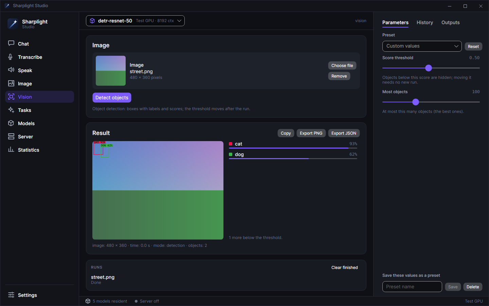 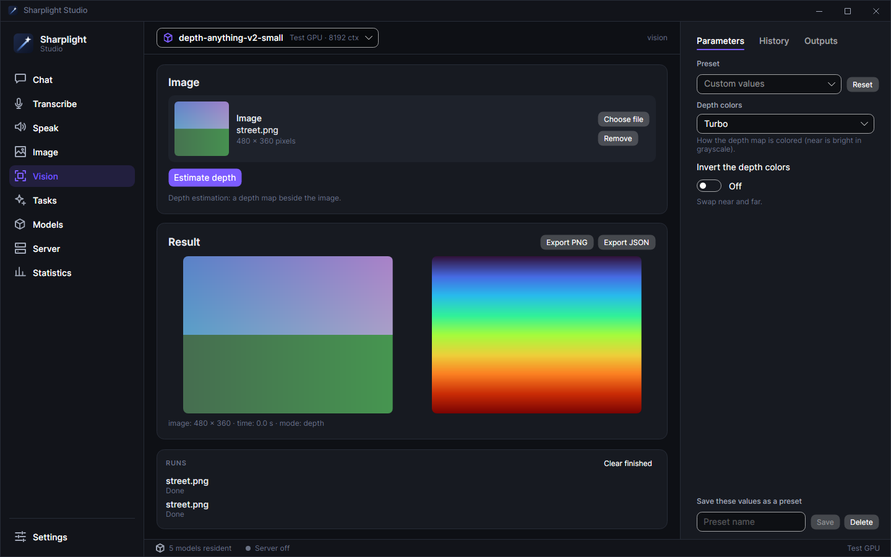
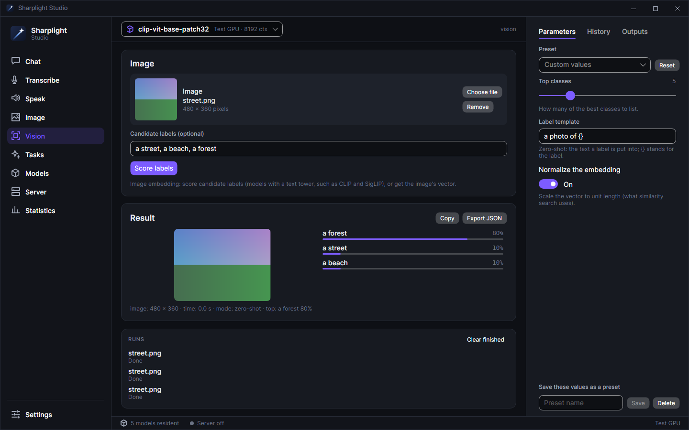
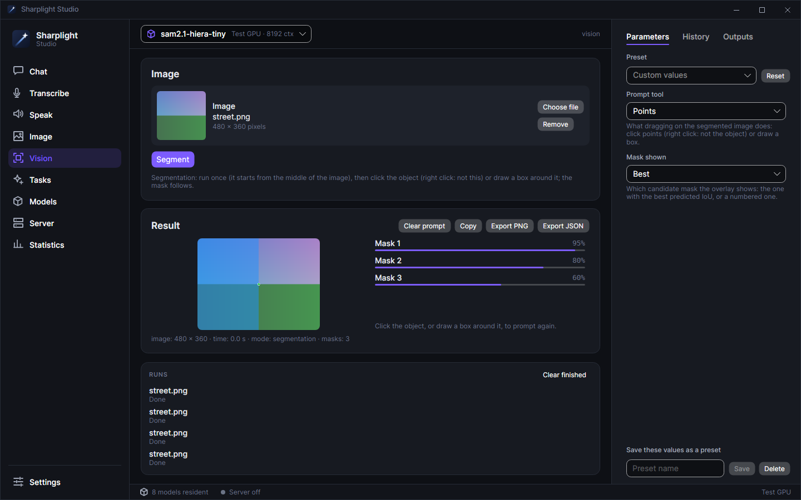 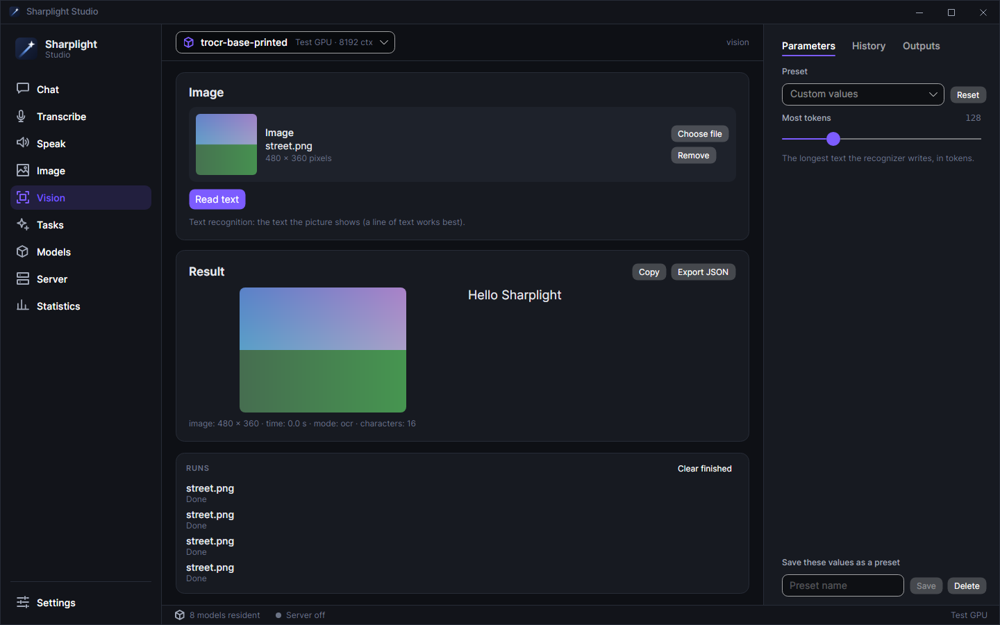
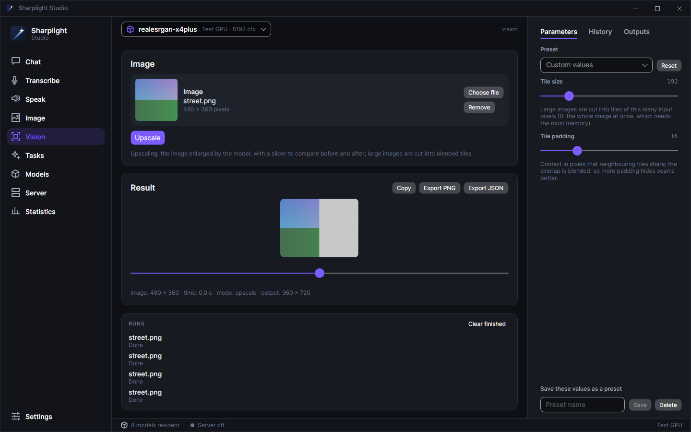

*Embedding and reranking models* are recognized without a package: a Hugging Face folder by its `config.json` (an encoder `...Model`
architecture of a BERT-like type, a sentence-transformers `modules.json` or "embed" in the name: embeddings; an encoder
`...ForSequenceClassification` with one label, or "rerank" in the name: reranker; a Qwen3-TTS configuration: text to speech) and a
GGUF file by its architecture (`bert`, `nomic-bert`, `jina-bert-*`; a ranking `pooling_type` or "rerank" in the name: reranker). A
package whose graphs include `classify` is a reranker. They load through the load panel without context and cache settings.

The library recognizes the image models without a package: a diffusers folder (`model_index.json`), a single-file checkpoint (its
safetensors header or GGUF tensor table names the UNet, or a GGUF names a diffusion transformer such as FLUX; a `.ckpt` only by its
name), and Hugging Face vision checkpoints by the
architecture of their `config.json` (`...ForImageClassification`, `...ForObjectDetection`, `...ForDepthEstimation`, CLIP, SigLIP and
DINOv2 as embedding models, SAM 2 as segmentation, a TrOCR vision-encoder-decoder as OCR) and Real-ESRGAN / SwinIR upscalers
(`.pth` files and folders by name, safetensors by their tensor names). These kinds load through the same load panel, simplified to the device (no context, batching or KV
cache), and the *Tasks* cards and the library's *Load* open the right page.

**Video player.** The Video page plays a clip in `VideoView`, an ordinary Avalonia control (an `ImageViewer`: fit, zoom, pan), not a
native media window, so it clips and scrolls with the page and stays below dialogs and flyouts (a native child window would always draw
above the UI). Frames are held in memory (the generated frames, or a stored video decoded with the bundled FFmpeg on a worker thread
when its gallery entry is opened) and converted to bitmaps on the thread pool into two alternating `WriteableBitmap`s; the UI thread only
swaps the source, and a frame that arrives while another converts replaces it, so a slow machine drops frames instead of stalling.
Pacing follows a wall clock, not the tick count: late frames are skipped and the video never slows down. Controls: play and pause, a
seek slider, previous and next frame, loop and the time. A clip with an audio track plays it through the audio output of the Settings
(restarted at the new position after a seek; the picture and the sound start from the same clock).

Not supported yet: video models (the cards say so), a painting tool for masks (a mask is a file),
and diffusers pipelines with a transformer instead of a UNet (Flux, SD3: the loader reports it).

The side panel's *History* and *Outputs* tabs:

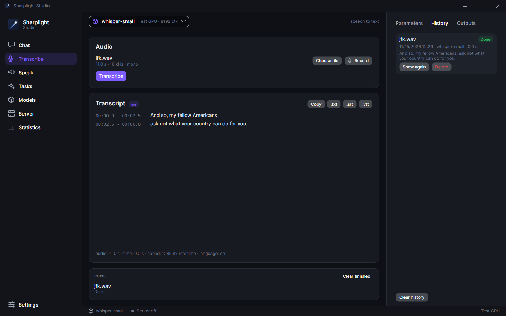 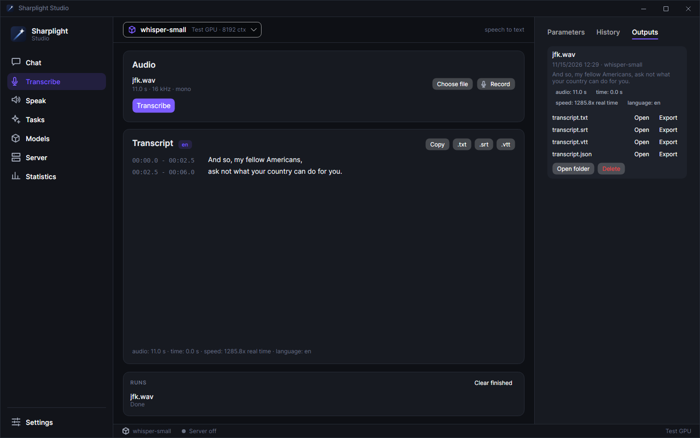

**Microphone and playback.** Studio plays and records through `Sharplight.Audio`, Sharplight's own native audio library
(miniaudio device I/O: WASAPI, Core Audio, PulseAudio/PipeWire, ALSA, JACK; decoding of WAV, FLAC, MP3, Ogg Vorbis and Ogg Opus), which
ships with the app for all five platforms; no program of the system is needed. The Settings page has an *Audio* card with the playback
device and the microphone (default: the system's); a device that is gone falls back to the default. Recordings are mono 16 kHz WAV files.
Without an audio backend or device (servers, containers) recording is disabled (audio files still work) and the speech result is saved
and opened with the system player instead of played in the app. Playback and recording are tested through fakes and, on Linux, with the
library's null backend; the real backends were not exercised on this machine (it has no audio device).

## Installing and updating

Studio is published for Windows x64 and ARM64, Linux x64 and ARM64, and macOS ARM64 (Apple Silicon), self-contained (no .NET
needed), as [Velopack](https://velopack.io) packages:

| Platform | Install with | Also |
|---|---|---|
| Windows | `SharplightStudio-<rid>-<channel>-Setup.exe` | portable zip |
| Linux | `SharplightStudio-<rid>-<channel>.AppImage` (updates itself in place) | `sharplight-studio-<version>-<rid>.tar.gz` |
| macOS | `.pkg` installer (the `.app` bundle) | zip |

The macOS and Windows packages are not signed yet (Windows SmartScreen and macOS Gatekeeper warn on first start); signing hooks are in
`packaging/pack-studio.sh` and `.github/workflows/studio.yml`. On macOS the Vulkan provider needs MoltenVK, which is not part of
the package yet, so the app runs on the CPU provider.

**CUDA.** The Linux packages (x64 and ARM64) and the Windows x64 packages include the CUDA execution provider (`Sharplight.Cuda`) and NVIDIA's runtime
compiler (NVRTC, redistributed under the CUDA Toolkit EULA, `Sharplight.Cuda.Runtime`) with the floating-point headers it compiles against, NVIDIA's
`LICENSE-NVIDIA-CUDA.txt` and `THIRD-PARTY-NOTICES-Cuda.md`; the NVIDIA driver supplies the rest. macOS and Windows on ARM have no NVIDIA driver and
get none of it. `packaging/pack-studio.sh` publishes with the runtime identifier (`StudioCuda` in the project file decides, `-p:StudioCuda=false` leaves it
out), copies the license and the notice and runs `packaging/check-cuda.sh`, which fails when a CUDA runtime lacks a file or another runtime carries one.

Measured on a linux-x64 publish of this branch (the publish without the native audio and FFmpeg libraries, so the absolute sizes are lower than a release's;
the difference is what CUDA adds), packed with vpk 1.2.161:

| | without CUDA | with CUDA | CUDA adds |
|---|---:|---:|---:|
| AppImage | 118.9 MB | 164.5 MB | 45.6 MB |
| Velopack full package (`.nupkg`, also the Windows Setup.exe's payload) | 117.6 MB | 162.9 MB | 45.3 MB |
| `tar.gz` | 115.9 MB | 161.1 MB | 45.2 MB |
| installed folder (MiB) | 267 | 376 | 109 |

The package cost is accepted (owner decision of 2026-11-19). The Windows x64 files are about 96 MB installed (NVRTC 91 MB); the ARM64 Linux ones about 105 MB
([cuda.md](cuda.md#package-sizes)).

**Channels.** Every build belongs to one of ten update channels, `<rid>-stable` (built from `release/*` branches) and `<rid>-unstable`
(built from `main`), for `win-x64`, `win-arm64`, `linux-x64`, `linux-arm64` and `osx-arm64`, for example `win-x64-stable` or
`osx-arm64-unstable`. An installed app checks the channel it was installed from until you pick another one: *Settings > Updates > Update
channel* switches between **Stable** and **Preview (unstable)**, is saved in the settings (`UpdateChannel`) and re-checks the
chosen feed at once. The page shows the installed channel and the selected one. A channel that has no release yet shows "No stable
release yet" instead of an error. When the chosen channel is behind the running version (preview to stable), Studio asks first:
*Downgrade* downloads the older release like an update, *Stay on the current version* keeps the running one until the channel
catches up. Portable and other builds that cannot update disable the selector.

**Updates.** Studio checks for a new version at startup and every six hours (*Settings > Updates > Check for updates automatically*).
When one is found, a dialog shows the version and its release notes (Markdown), then *Download and install* (with progress; Velopack
downloads a delta package when it can) and *Restart to update*, or *Later*. The Settings section shows the current version,
the installed and the selected channel, the automatic check switch, *Check for updates now* and the time of the last check. Builds that were not installed with
Velopack (`dotnet run`, a plain build) show "updates unavailable for this build" and never check.

**Update feed.** The packages are served from a public URL (Cloudflare R2 on a custom domain, see `docs/releasing.md`). The URL is
taken from, in this order:

1. the environment variable `SHARPLIGHT_STUDIO_UPDATE_URL`;
2. the `UpdateUrl` entry of the settings file;
3. the URL baked into the build: MSBuild property `StudioUpdateUrl` (assembly metadata `StudioUpdateUrl`). CI sets it from the
   repository variable `STUDIO_UPDATE_URL` (official builds: `https://download.sharplight.dev/studio`). A local build has none.

Without a URL the update checks are disabled, and the Settings section says so. All channels share that one folder; each has its
own `releases.<channel>.json` feed.

## Smoke mode

`sharplight-studio --smoke [--smoke-report FILE]` starts the real services without a window (settings, storage, the log file, the update
and feed services, the engine with every provider and format), then runs `Services/Smoke/SmokeRunner`:

1. lists the devices (a CPU device must exist; with `--smoke-provider`, also a device of that provider);
2. lists the Sharplight model feed (verified, not from the cache) and finds `whisper-tiny`;
3. installs it with its Silero VAD companion into the model store of the storage in effect;
4. writes a short synthetic WAV and decodes it with the native audio library;
5. loads the package on the CPU, or on a device of the provider `--smoke-provider <name>` names (`cuda`, `vulkan`; the report's `Provider`);
6. transcribes the WAV once (the text is not checked, the whole path must run), then unloads.

The first failing step ends the run. The JSON report (`Version`, `Os`, `Storage`, `Devices`, `Package`, `Steps`, `Passed`, `Error`)
goes to the file, to standard output and, by default, to `smoke-report.json` in the log folder; the steps are in `studio.log`. Exit code 0
means passed, 1 failed; a run is limited to ten minutes. CI runs it against the published packages of every OS
([releasing.md](releasing.md#published-build-smoke-test)); `SmokeRunnerTests` runs the runner over fakes. The published-build smoke script repeats the run with
`--smoke-provider cuda` where `nvidia-smi` finds a GPU (the Linux x64 and Windows x64 builds); the GitHub-hosted runners have none, so the step prints a
notice and is skipped there (`SMOKE_CUDA=1` makes a missing GPU a failure, `0` skips the step).

## CUDA and the provider per GPU

An NVIDIA GPU is listed twice, once by the Vulkan provider and once by the CUDA provider (where the package has it and the driver is usable). The two
entries share one identity (the device UUID: Vulkan writes it as hex, CUDA as a dashed GUID, both are compared without dashes and case), so Studio treats
them as one physical GPU with two providers:

- The device lists (load options, Settings > Engine > Load defaults) show both, told apart by the provider: *NVIDIA RTX ... (Vulkan)* and
  *NVIDIA RTX ... (CUDA)*. A GPU with a single provider is listed as before.
- **Vulkan is the default.** Providers register in the order Vulkan, CPU, CUDA, and the device list puts the entry of the chosen provider first, so the first
  entry, the default device and every load that names no provider run on Vulkan.
- **Settings > Engine > Compute devices** has a picker per GPU: *Automatic* (Vulkan until per-device data says CUDA is faster: `IProviderPerformanceHints`
  is the hook, `NoProviderHints` the current implementation), *Vulkan* or *CUDA*. The choice is saved by GPU identity (`DeviceProviders` in the settings), moves
  the default device to that GPU's entry of the chosen provider, and applies at once to loads that do not pick a device entry themselves. The load options
  of a model can still pick either entry. A model split over all GPUs uses one entry per GPU, all of the first GPU's provider.
- **Fallback.** CUDA is skipped, and Vulkan used, with a note on the GPU's row (and a warning line in `studio.log`), when: the NVIDIA driver supports an
  older CUDA than 13.0 (the PTX of the shipped NVRTC needs driver R580 or newer: "update the NVIDIA driver"); the CUDA provider is unavailable on this
  machine (no `libcuda.so.1` / `nvcuda.dll`, a failed `cuInit`, no GPU of compute capability 7.5 or later), noted on NVIDIA GPUs only; opening the CUDA
  device fails; or a load on CUDA fails (kernel compilation or loading: the model is loaded again on Vulkan and the load panel says so). A failed CUDA is
  not tried again for that GPU until Studio restarts.
- **Memory.** The fit estimates and the device memory list ask the provider in use; the entry of the other provider shows the same memory and opens no
  second context.
- **Precompile.** The library's *Precompile* (and the option after a download) runs the providers' two-stage contract for the CUDA devices as for the
  others: PTX for the GPU's compute capability (needs NVRTC, no GPU), then a cubin from the driver's JIT for the device. The package inspector's
  *Artifacts* tab lists the stages as `provider=cuda`: `kind=ptx` (code tier, target `ptx_<compute capability>`) and `kind=cubin` (binary tier, matched on GPU
  name and CUDA driver version). A package precompiled for CUDA loads on a machine without NVRTC.

## Where things are kept

Everything follows the storage location chosen in *Settings > Storage* (portable, system or custom; the full table per mode and
platform is in [storage.md](storage.md)). `<config>`, `<data>` and `<cache>` are the folders of that location: for example
`~/.config/sharplight`, `~/.local/share/sharplight` and `~/.cache/sharplight` on Linux in system mode, or `data/config`, `data` and
`data/cache` next to the AppImage in portable mode.

| What | Where |
|---|---|
| Settings (`settings.json`), including the download queue, and the optional `starter-models.json` | `<config>/studio` |
| Conversations and statistics (`studio.db`), last-used times of models (`model-usage.json`), Discover's highlights (`discover-highlights.json`) and verified catalog (`verified-models.json`) | `<data>/studio` |
| Inference pages: parameter presets, run history and output files (`pages/<page>/`) | `<data>/studio/pages` |
| Models | The model store: `<data>/models` by default, else the folder chosen on the *Models* card; converted local models go to `converted/` in it by default |
| Compiled kernels, extracted shader sources | `<cache>/artifacts`, `<cache>/shaders`, shared by every tool |
| Logs | `<logs>` (`<data>/logs` in portable and custom mode) |

The mode is known before the settings load. A `sharplight.portable` file next to the package selects portable mode. A pointer file
in the system configuration folder selects a custom folder. `SHARPLIGHT_HOME` overrides both. `SHARPLIGHT_STUDIO_HOME` moves only
Studio's own settings and data into one directory (tests, side-by-side profiles). `SHARPLIGHT_MODELS` and `--models-dir` move only
the models, and `SHARPLIGHT_COMPILATION_CACHE` only the compiled kernels.

"Next to the package" means the file or folder the user sees, never the place the app runs from: for the AppImage the folder of the
`.AppImage` file (`$APPIMAGE`; the read-only image mounted at `$APPDIR` is never used), for the macOS app the folder that contains the
`.app` bundle (not `Contents/MacOS`), for a Velopack install (Windows, portable zip) the install root next to `Update.exe` (not its
`current` folder, which every update replaces), else the folder of the executable (tar.gz). The choice is recorded by the
`sharplight.portable` file in that folder, written when the change is applied, so the next start finds it before reading anything
else. Until Studio restarts, the settings are already saved to the new location (never again to the old one); everything else moves
at the restart. A portable folder that cannot be written (read-only or system-wide installation, a folder that is not writable) is
refused with the reason when it is chosen; if it becomes unwritable later, Studio falls back to the system folders and the Storage
card says so.

When the model store in effect is empty while another store has models, Studio offers once to keep using that store or to move or
copy the models into the new one. The other store can be the system store, or the `data` folder next to the app where earlier
versions kept them.

## Architecture

- **MVVM.** The app uses CommunityToolkit.Mvvm with compiled bindings. View models only talk to the services in
  `Services/` through interfaces:
  - `IModelRuntime`
  - `IHubService`
  - `IModelLibrary`
  - `IConversationStore`
  - `IStatsStore`
  - `IApiServer`
  - `IDocumentExtractor`
  - `ISystemMonitor`
  - `IPlatformServices`
  - `IPageStorage` (per-page presets, history and output files), `IAudioPlayer` and `IAudioRecorder` (the system's audio programs)
  - `IUpdateService` (the Velopack wrapper, registered through `Microsoft.Extensions.DependencyInjection`)

  Tests run every view model against fakes of these services.
- **Runtime.** `EngineModelRuntime` owns a `ModelHost` (from `Sharplight.Llm.Serving.Hosting`, the same registry the server uses)
  and loads models through the registered providers and importers. Load progress comes from the engine's structured
  `LoadProgress` reports (`LlmLoadOptions.Progress`). Each request holds a lease on its model, so unloading and eviction wait
  for running requests.
- **Server.** `KestrelApiServer` maps the endpoints of `Sharplight.AspNetCore` over that host with `ServeHostModels` on: the audio,
  speech, image and retrieval endpoints look the model up in the host per request (task models are `ModelKind.Task` instances
  holding their clients, text embedders `ModelKind.Embedding`) and lease it for the request, so loads, unloads, idle unloading and
  the served switch apply without remapping. Chat and API requests to the same model share one engine and are batched together.
  Stopping the server leaves the models loaded. Text embedding models are loaded by the runtime with `TaskModelLoader` (kind `text-embedding`)
  (`Sharplight.Hosting`), the same loaders `sharplight serve` uses.

## Tests

`tests/Sharplight.Studio.Tests` covers:
- the pure helpers;
- the SQLite stores and settings;
- the downloads queue (pause, resume, cancel, restore after restart);
- sizing (`SizingTests`, mocked device figures): the candidate contexts and the binary search, a sliding-window model on a 32 GB card
  (32K, the longest context on the GPU and with offload, the Q8_0 saving), CPU expert offload against layer offload, sizing on the CPU,
  the memory watch (a read on open, periodic reads while watched, only changes beyond 64 MiB reported, a read after a load) and the
  panel re-planning when the figures move; the feed's variant ladder with per-variant fits that follow the memory (`FeedCatalogTests`);
  `SizingRealModelTests` sizes Gemma 4 31B Q4_K_M and OLMoE from the files (no device), and with `SHARPLIGHT_STUDIO_GPU_SIZING=1`
  loads Gemma on the GPU and checks that the load holds no more than the estimate;
- fit estimates: the planner (unloading, offload, system memory, split GPUs), the load panel's estimate and suggestions, and the
  download badges;
- the title bar choice (own or system), and Discover's highlights (sections, filtering, the cache and its lifetime) and the
  *Supported only* filter;
- the header-only import check on the header of a Gemma 4 mixture-of-experts GGUF (every tensor of the table, compared with the
  importer on the same header);
- compatibility checks before downloading, on the tiny GGUFs and Hugging Face configs under `~/models` when present (an unmapped
  architecture, an mmproj projector, real quantized tensor tables read from a prefix, synthetic `Q8_K` and
  unknown type ids, quantized checkpoints, ONNX opsets read behind the graph), the result order, the per-quantization badges and the
  library's import errors;
- the `--smoke` runner over a fake feed and runtime (steps, the first failing step, no CPU device, the JSON report);
- update checks and the update dialog: auto and manual checks, up-to-date and failure messages, *Later*, download progress and
  restart (against a fake update service), the feed URL precedence, and a headless render of the dialog;
- conversations: streaming, versions, branches, stop, model switching and concurrent chats;
- the server page, including which models are listed under which endpoint, and a real embedded server over a model host with
  speech, image and embedding models (every endpoint, models loaded after the start, the served switch, a model of another kind);
- chat with voice and pictures over fake task clients (dictation into the prompt, read aloud with streaming playback and without
  markup, the `/image` command stored with the conversation and kept from the language model, regeneration, remembered model
  choices) and the Search page (indexing, ranking, restoring a past search, a model switch, a failing embedder, the chunker, the stored
  index and its incremental updates, BM25 and rank fusion, hybrid mode, highlighting and places, Ask with citations, watching), the
  document parsers (one test per format over generated fixtures, size limits and zip bombs) and, over the real all-MiniLM-L6-v2, a
  generated corpus in seven formats;
- the shared inference blocks (presets saved as JSON and restored, the run queue's one-run-per-model order and cancellation, history and
  gallery persistence with open, export and delete) and the Transcribe and Speak pages over fake task clients (streamed segments, `.txt` /
  `.srt` / `.vtt` export, cancel and failure, microphone, voices, streaming playback, no-player fallback);
- a headless render of every page that fails on binding errors;
- `NavigationTests`: every runnable kind opens its page under the expected group and expands it, every page is listed once, the Models tabs
  follow the tab strip, collapsed groups and the folded rail are remembered, and the headless window shows the groups (wide) or the rail
  (narrow) in both themes, with the arrow keys, a collapsed group and a rail flyout (`studio-nav-*.png`);
- `PageScreenshotTests`: one screenshot test per page (and the Search page after a hybrid Ask, with highlighted passages and cited answer), per Models tab and Discover source (Verified, Sharplight feed, Hub search) and per
  Settings tab, in the light and the dark theme at 1440 and 900 px wide, over demo data and a local test feed. Each fails on binding
  errors and on controls that are clipped or painted over their neighbours (`LayoutChecker`) and saves
  `studio-page-<page>-<theme>-<width>.png` to `SHARPLIGHT_STUDIO_SCREENSHOTS` (default `page-screenshots` next to the test binaries).
  There are no golden images; the PNGs are for a human to look at. The `screenshots` job of `studio.yml` runs this class on every push and
  pull request and uploads the PNGs as the artifact `studio-page-screenshots`. Run it locally with
  `dotnet run --project tests/Sharplight.Studio.Tests -c Release -- -class "Sharplight.Studio.Tests.PageScreenshotTests"`;
  `docs/studio-published-test.md` records the round that drove the published AppImage by hand;
- the Sharplight feed over a local test feed (listing, install with dependencies, resume of a partial download, update that keeps the old version
  until the new one verified, a tampered index, manifest and package file, an untrusted root, offline use of the cached listing including an expired
  index, channel switching) and its views (headless render, layout checks at three window sizes, binding errors), plus one test against the live feed that
  installs the whisper-tiny and silero-vad packages, checks the library entry and loads whisper-tiny through the engine (skipped without network);
- the first-run flow: the recommendation (8, 24 and 32 GB of VRAM, a small GPU, CPU only with little and with more memory, offline, disk limits, withdrawn
  and deprecated packages, a missing dependency, the preferences file and its fallback), the welcome view model over a local test feed (detection,
  install of chat and speech with the voice detector, load, new chat with the example, skip, offline with and without a saved listing, a failed install
  that resumes, no GPU, the start page choice, the chat page's *Get a model*), and one test against the live feed that runs the flow with Qwen3-0.6B
  (skipped without network). The welcome page and the chat page without a model are in `PageScreenshotTests` too;
- model management (`ModelMaintenanceTests`, `ModelUsageTests`, `LibraryCleanupViewModelTests`, `StorageViewModelTests`, `ModelUpdateTests`): on real files in temporary
  stores, the usage overview and size breakdown, deletion safety (resident and precompiling models refused, files outside the store kept, nothing outside the
  store removed), partial-download cleanup, cache clearing, artifact removal, the `.slm` export (with and without artifacts) and import round trip, import
  validation of broken files and folders, cancellation without leftovers, last-used tracking, the confirmations and their freed-space text, bulk actions,
  the unused-model suggestion, update all with a failing package, and the periodic check with its badge; `PageScreenshotTests` renders the Storage tab and
  the library with selection, size details and a confirmation;
- the package inspector: every tab of a small package, a view for every section kind the format defines, unknown sections
  listed raw, the linked graph, IR and node selection, the graph layout, and a 100,000-node graph that stays virtualized.

`GgufRealModelTests` takes the GGUF and whisper.cpp files people download (transcribe.cpp whisper GGUF, a whisper.cpp file named
`.gguf`, large-v3-turbo, the SDXL-Turbo GGUF) through library recognition, the runtime and the Transcribe / Image pages, and checks that
FLUX GGUF files are listed as image models and named as not supported yet. `SpeechRealModelTests` loads `ggml-tiny.en.bin` (transcribes `jfk.wav` on the Transcribe page) and OuteTTS with its WavTokenizer
vocoder (speaks on the Speak page) through the real runtime, when the files are on disk. `StudioEndToEndRealTests` drives the chat, Search and server features on real models headlessly (skipped when a model is missing): voice chat
(the microphone path with a fake device delivering `jfk.wav`, whisper-tiny dictation, a Qwen3-0.6B answer, Kokoro reading it aloud), the
voice choice of Qwen3-TTS CustomVoice, `/image` with tiny-random-SD (PNG stored, kept out of the next turn), Search over text files with
all-MiniLM-L6-v2 and reranking with ms-marco-MiniLM-L6-v2, and the embedded server answering transcriptions, speech, image generations,
embeddings and rerank over HTTP. `StudioSpeechPagesRealTests`, `StudioVisionAudioRealTests`, `StudioImageVideoPagesRealTests` and `StudioModelsPageRealTests` do the same for the other inference pages
(all skipped when a model is missing, driven through the view models on the real runtime and the fake audio device, with `jfk.wav` and the COCO picture of two cats and
two remote controls as inputs):
- Audio models of 2026-11-19 (`AudioModelsPageTests`, over fakes: ACE-Step, VibeVoice, CSM, OmniVoice and VibeVoice-ASR are too big for the suite): the diffusion music mode
  and its visible parameters, the ACE-Step / VibeVoice / CSM / OmniVoice folder kinds on small fixture folders, the script speakers and per-speaker voices,
  the CSM turn-by-turn path, the OmniVoice language and design controls, speakers in the Transcribe view and exports, and the licence notices.
  `PageScreenshotTests.AudioModelPage_*` renders these states in both themes and at two sizes.
- Transcribe: whisper-tiny.en, Qwen3-ASR-0.6B and Parakeet; segment timestamps are ordered and inside the recording, and the saved `.srt` / `.vtt` files and the
  gallery copy carry the same cues as the page.
- Speak: Kokoro and Qwen3-TTS CustomVoice; the voice list, playing while generating through the fake speaker, and the WAV export.
- Vision: ViT ranks cat labels first; DETR and RT-DETR find both cats (one left, one right) and a remote, the overlay differs from the input and a higher threshold
  hides objects without a new run; Depth Anything V2 gives a colored map with a real range; SAM2 gives masks of object size; TrOCR reads the printed line.
- Audio: EnCodec and Mimi round trip `jfk.wav` (more codebooks reconstruct better), Silero VAD finds the speech, MusicGen-small makes a short clip.
- Image: seed reuse reproduces a picture, the gallery outlives the page, an input picture makes image to image and a mask makes inpainting. Video: tiny Wan and
  tiny LTX give frames; the MP4 export is checked when the native video layer is installed (skipped otherwise).
- Models: installs the five feed packages (chat, embedding, reranker, speech, voice activity) from the live feed, checks the library kind of each (a chat
  package is never a reranker; a cross-encoder declared `embeddings` by an older package is refined to a reranker because it has a classify graph and no decode
  graph), the kind filter, load and unload through the load panel, and the residency list; a theory checks the inspector's kind for 20 real model folders.
The CUDA provider in Studio: `ProviderSelectionTests` (the selector and the Engine settings view model over fake Vulkan / CUDA / CPU providers: one physical GPU
from two UUID spellings, Automatic is Vulkan, the performance-hint hook, an explicit choice beating it, a driver older than CUDA 13, an unavailable CUDA on NVIDIA and
on other vendors, failover and "not tried again", the picker saving by GPU and the default device following), `CudaRealModelTests` (Qwen3-0.6B loaded and chatting
on the CUDA device of a headless runtime, Vulkan first in the list; and a fake CUDA provider whose device fails to open, which hands the load to the provider behind
it, notes it and is not tried again; skipped without the model or a CUDA device), `PackagingTests` (the project references the CUDA provider for linux-x64,
linux-arm64 and win-x64 only, `StudioCuda` evaluates to true / false for the five runtimes, `packaging/check-cuda.sh` accepts the right file set for the three runtimes,
names each missing file and rejects any CUDA file for osx-arm64 and win-arm64; `SHARPLIGHT_STUDIO_PUBLISH` and `SHARPLIGHT_STUDIO_PUBLISH_RID` point it at a real publish
directory), `PageScreenshotTests.EngineSettings_WithCudaDevices_*` (the Compute devices card with CUDA chosen, with a driver too old, and with CUDA unavailable, both
themes, two sizes).
`RealModelTests` loads two small GGUF models (Qwen3-0.6B, SmolLM2-360M) when they are on disk. It chats with both at once and
calls the embedded server. Set `SHARPLIGHT_STUDIO_SCREENSHOTS` to a directory to save the page screenshots used here. With
`SHARPLIGHT_INSPECTOR_PACKAGES` (a list of `.slm` paths, separated like `PATH`), the inspector renders every tab of those
packages in both themes.

## Limitations

- **Conversion progress.** Conversion during a download reports its log, not a percentage. Precompilation reports kernel counts
  per graph.
- **Fit estimates.** The load panel's estimate is the engine's own, but free memory can change before the load (other
  applications; the figures are read again every 5 seconds while the panel is open). Its activation figure is the engine's upper bound
  for the prompt batch (about 3 GiB for Gemma 4 31B at 512 rows). Download badges are approximate: they know the file sizes and, where
  readable, the attention dimensions, not the exact graph. The feed's memory figures are those of the plain graph (a row per position in
  every cache), so the feed overstates sliding-window models that the session path sizes with window rings (Gemma 4, gpt-oss).
- **KV cache types.** F16, Q8_0, Q4_0 and F32 are offered on every device; quantized caches have kernels on the CPU, Vulkan and CUDA
  (docs/kv-cache.md), and a cache whose rows are not whole 32-value blocks stays F16 (the panel then shows no saving).
- **Compatibility checks.** They are likely verdicts, not guarantees: a GGUF header that maps can still fail on something only its
  tensor data shows. Quantizations other than the recommended one share the architecture's verdict until they are selected and
  their tensor tables are read. A tensor table beyond 64 MiB from the start of a file is not read (the verdict is *Unknown*). ONNX
  operators are not checked before import.
- **Audio formats and devices.** Microphone and playback depend on a sound server or driver being present
  (see *Microphone and playback*); the real device backends were only tested through the null backend. Speech runs are not counted in the statistics page.
- **Voice, pictures and search.** Dictation transcribes after the recording stops (it does not stream while you speak), the voice
  of read-aloud is the model's default (no voice choice in the chat), pictures in the chat use the model's default size and steps,
  and Search has no OCR (a scanned PDF without a text layer has no passages), reads no legacy formats (`.doc`, `.ppt`, `.xls`, `.odt`)
  and opens a document at its page or line only through VS Code, Okular or Evince. Studio loads text embedding models but not reranking models yet, so `/v1/rerank` is
  mapped but answers only for a reranker on a host that has one. `/v1/audio/speech` answers `wav` and `pcm`, not `mp3`.
- **Title bar.** Studio's own title bar is used on Linux only, where the window manager moves and resizes windows on request.
- **GPU utilisation.** The "Engine busy" chart is the share of time the engines spend stepping, not GPU utilisation read from the
  driver.
