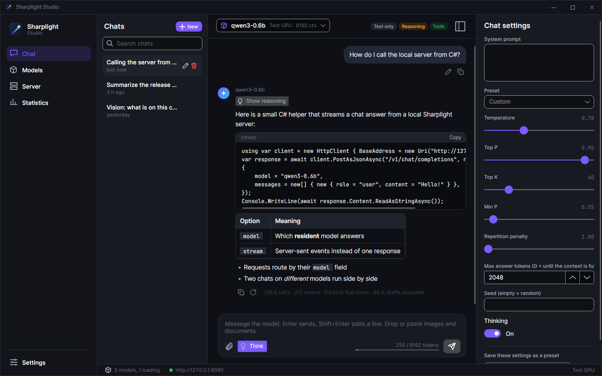
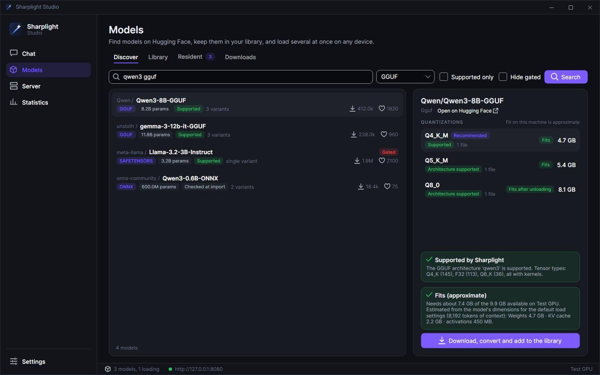
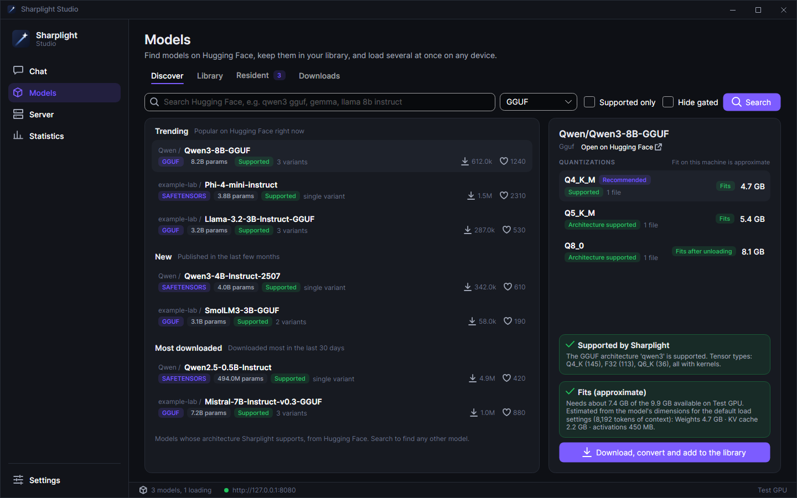
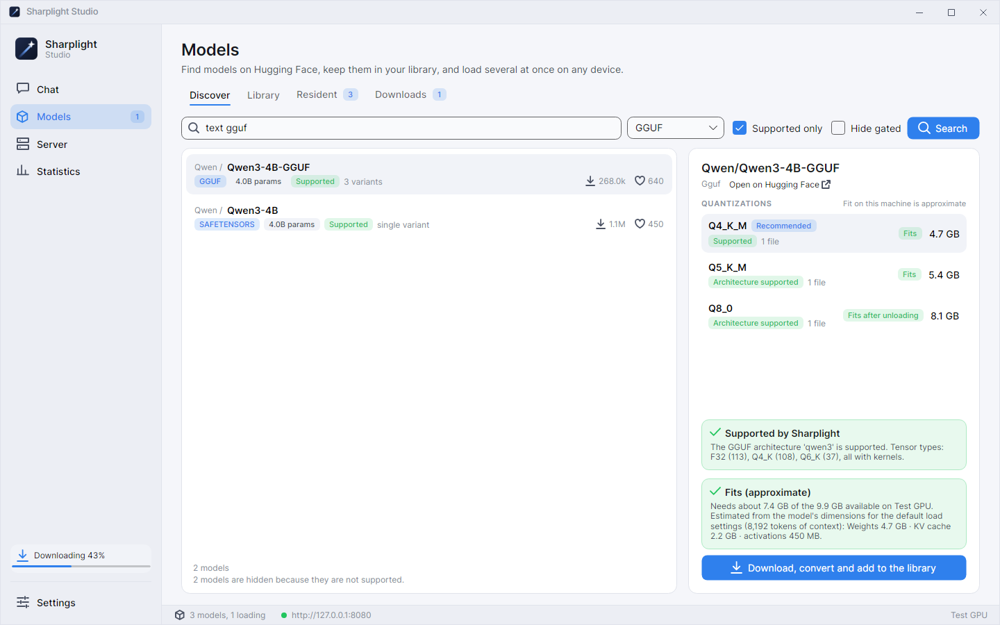
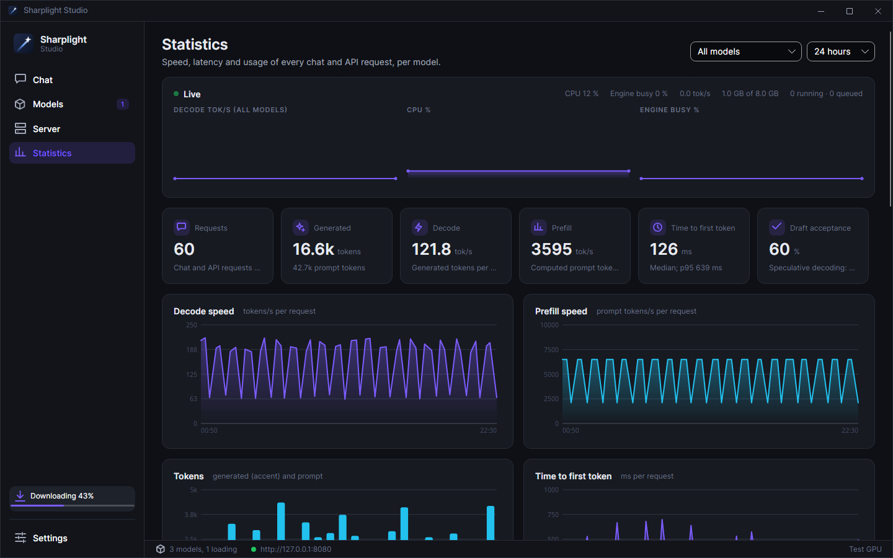

# Sharplight Studio

`apps/Sharplight.Studio` is a desktop app (Avalonia 12) for finding, downloading, running, chatting with and serving local models.
It embeds the engine and the same hosting layer as `sharplight-server`, so everything the app loads is also reachable over the
OpenAI- and Anthropic-compatible API.

```sh
dotnet run -c Release --project apps/Sharplight.Studio
dotnet run -c Release --project apps/Sharplight.Studio -- --models-dir /data/models
```



## Window

On Linux, Studio draws its own title bar in the app's colors (light and dark): the app icon, the title, and minimize, maximize and
close buttons. Dragging the title bar moves the window, double-clicking it maximizes, the edges and corners resize, and dragging to
a screen edge snaps as usual. All of this is asked of the window manager (`_NET_WM_MOVERESIZE`), so Studio uses its own title bar
only when the window manager announces that request (KWin, Mutter and most others, on X11 and for XWayland windows); otherwise the
system frames the window. *Use the system title bar* in the settings, or `SHARPLIGHT_STUDIO_TITLE_BAR=system` (or `custom`),
overrides the choice. Other platforms use the system title bar.

The icon is embedded in the app (window and taskbar icon, sidebar logo, and the Windows executable icon). The sizes in
`apps/Sharplight.Studio/Assets/Icons` are rendered from `packaging/linux/sharplight-studio.svg` by `packaging/make-studio-icons.py`.
The X11 window class is `sharplight-studio`, the `StartupWMClass` of the desktop file, so the taskbar groups the window under its
launcher.

## Pages

**Chat.** Conversations are stored, one per entry in the list. Answers stream as Markdown (code blocks have a copy button, tables,
lists) and reasoning is collapsible. You can regenerate an answer, edit a question (both create versions you can page through),
stop a generation, and set the system prompt, sampling, presets and thinking per conversation. Every conversation keeps its own
model. Switching it mid-conversation applies to the next answer. Conversations keep generating in the background, so two chats on
different models run at the same time. Images and documents can be attached by drag and drop, paste or the file picker:
- Images need a model with the **Vision** badge; the others refuse them with an explanation.
- Documents (PDF, DOCX, HTML, text and code) are extracted to text and trimmed to the context window.

**Models.**



- Before anything is searched, *Discover* shows highlighted models in three sections: *Trending*, *New* (created in the last few
  months) and *Most downloaded*. They come from the Hub's listings (trending, likes and downloads, GGUF and safetensors,
  text-generation and image-text-to-text) and keep only repositories whose badge is *Supported*. The answer is kept for six hours in
  `discover-highlights.json` next to `studio.db`, so opening Discover again or restarting does not ask the Hub again, and an older answer
  is shown while the Hub cannot be reached.

  
  

- *Supported only* hides repositories and quantizations whose compatibility badge is not *Supported*, and says how many it hid.
  The choice is kept in the settings.

  
  

- *Discover* searches Hugging Face (format filter, gated models hidden on request) and lists a repository's quantizations with
  their sizes. Each quantization gets an approximate fit badge for this machine (*Fits*, *Fits on 2 GPUs*, *Fits after unloading*,
  *CPU offload ~40 %*, *Too large*), and the selected one's verdict is explained above the download button (it never blocks the
  download). The estimate takes the download size as weights and sizes the KV cache for the default load settings from the
  model's dimensions: the start of a GGUF file (a range request) or the checkpoint's `config.json`. Without them it assumes a
  generous share of the weights.
- Discover also says whether a model is likely to import and run, from the same metadata reads (nothing extra is downloaded). The
  verdicts are *Supported*, *Partially supported*, *Unsupported architecture &lt;name&gt;*, *Unsupported weight format &lt;type&gt;*,
  *Projector* (an mmproj file, loaded with its language model), *Checked at import* (ONNX) and *Unknown* (the metadata could not be
  read). Each search result gets a badge from what the Hub's search reports (the GGUF architecture, or a checkpoint's `model_type`
  and quantization method), and results that are likely not to import are listed after the others. Each quantization gets a badge
  too, with the reason in its tooltip, and the selected one's verdict is in the box above the download button. Downloading always
  stays possible.

  

  The checks come from the importers, not from lists in Studio:
  - GGUF: `general.architecture` against the registered mappings (`GgufSupport`). Partial support is what a mapping declares (none
    does at the moment). When the recommended quantization is opened, or another one is selected, its whole tensor table is read too (of every shard of a split GGUF): a prefix of up to
    64 MiB per file, fetched in steps. Every ggml type id must be known and have CPU kernels
    (`CpuExecutionProvider.SupportsWeightType`). Every provider falls back to the CPU, so a type without CPU kernels, such as `Q8_K`,
    cannot load. The header then goes through the importer's own mapping steps (`GgufSupport.Validate`): the mapping's feature and
    hyper-parameter checks (`IGgufArchitectureMapping.Validate`, which the importer runs too) and the canonical name of every tensor.
    A tensor the mapping does not know gives *Unsupported variant of &lt;architecture&gt;*. When part of a tensor table lies beyond
    what was read, the verdict is *Unknown*, never *Supported*.
  - Hugging Face checkpoints: the `model_type` against the mappings (`HfSupport`), and the quantization in `config.json` (and
    ModelOpt's `hf_quant_config.json`). FP8 (block scales, compressed-tensors with 8-bit float weights, ModelOpt FP8) and MXFP4 for
    gpt-oss are read. GPTQ, AWQ, bitsandbytes, MLX, integer or 4-bit compressed-tensors, ModelOpt NVFP4 and similar packed formats
    are not, and the importer now rejects them with that reason. A method that is not known gives *Unknown*.
  - ONNX: the opset imports (domain and version) are read by skipping the graph by its length (`OnnxOpsetScanner`), usually in one
    or two range requests. Operators are checked when the model is imported.
- *Library* lists the model store (resolved like the command-line tools: `--models-dir`, `SHARPLIGHT_MODELS`, the setting,
  then the `data` folder next to the app) and any added `.gguf`, `.slm` or `.onnx` files. *Load* opens the load options:
  - device;
  - context length;
  - parallel slots;
  - prompt batch;
  - KV cache type;
  - n-gram and MTP speculative drafts;
  - CPU offload;
  - the **Reduced precision** opt-in.

  Below the options, a memory estimate follows every change: the engine's footprint (weights, KV cache, activations) computed
  from the model's graph for these settings, against each device's free and total memory and the residency reserve. It says
  whether the model fits, fits after unloading other models (naming them, and whether they unload by themselves), needs CPU
  offload (with the share that would run on the CPU, against system memory), or does not fit at all. Suggestions (shorter
  context, smaller KV cache, one slot, turning on offload, splitting over all GPUs, a smaller quantization in the library) apply
  with a click. With several GPUs the device list also offers *All GPUs (split)*, which splits the layers in proportion to their
  free memory.

  

  Loading shows its stages (reading, building graphs, placement, kernel compilation with cached counts, weight upload) and can be
  cancelled. *Convert…* turns a GGUF, safetensors checkpoint or ONNX model into a `.slm` package.

  When a download's conversion or a load fails because of the model, the error starts with the reason: *Unsupported architecture
  &lt;name&gt;* or *Unsupported weight format &lt;type&gt;*. The reason comes from the importer's error
  (`UnsupportedArchitectureException`, `UnsupportedWeightFormatException`). Otherwise Studio reads the file itself: a GGUF header and
  tensor table, a checkpoint's `config.json`, or a package's stored weight types.

  *Inspect* (on a `.slm` card or in its context menu) opens the **package inspector**. *Open .slm file…* opens a package from
  anywhere. The inspector reads only the section table, the definition and the weight and artifact indexes, never weight data,
  so a 30 GB package opens in a fraction of a second. It shows everything in the file:
  - *Overview*: the model (architecture, parameters, graphs, nodes, context length), the package file (format version, sizes by
    section kind, reclaimable bytes), the source and conversion (repository, variant, revision, source format and files), the
    tokenizer (model, vocabulary, merges, special tokens), the chat template and the states.
  - *Graphs*: one tab per graph with its inputs, outputs and op histogram, and three views of it. The **graph** view is a layered
    dataflow drawing that pans, zooms and finds nodes, colored by op category; selecting a node shows its attributes, its inputs
    (type, shape, producer or weight), its outputs and its consumers. The **IR** view is the `--dump-graph` text with search,
    go-to-producer and consumers. The **nodes** view is a filterable table (`op:` filters by op). All three share the selection.
  - *Weights*: name, type, shape, bits per element, size and offset, sortable and filterable, with totals per type.
  - *Artifacts*: every precompiled set (code and binary tiers per provider) with the profile it was built for (code target,
    features, limits, device and driver identity), its entries (key, content hash, size, offset) and where it sits in the file.
  - *Metadata*: the definition's properties and metadata, filterable, with the full value of the selected entry.
  - *Sections*: the whole file in offset order (header, every section, the section table and unused gaps). Sections of a kind
    this version does not know are listed raw with their size and offset; the other sections still open.

  Lists and the graph drawing are virtualized, so a graph with 100,000 nodes stays responsive.

  
- *Resident* shows the loaded models: state (loading / ready / busy / sleeping / failed), device, memory, last use, and load progress.
  It also shows memory per device against its budget. *Unload* drains running requests for a few seconds and then frees the model.

  
- *Downloads* run in parallel and show bytes, speed, ETA, the current file and overall progress. Conversion and kernel
  precompilation follow as separate stages. Downloads can be paused, resumed and cancelled. The queue is saved, so after a
  restart interrupted downloads resume where they stopped and paused ones stay paused. The sidebar shows running downloads on
  every page.

**Server.** Starts the embedded API on the chosen host and port, with an optional API key, CORS origins and the OpenAI and
Anthropic endpoints switched on or off separately.
- Requests route by their `model` field to any resident model, and `/v1/models` lists them. Loads and unloads apply at once,
  without a restart.
- Turning a model off hides it from the API immediately.
- With *Load library models on demand*, a request for a library model that is not resident loads it first. Idle models are
  unloaded after the configured time, and the least recently used one is evicted when memory runs out (pinned models excepted).
- The page shows a ready-to-paste `curl` request and a log of the requests.


**Statistics.** Every chat and API request is recorded per model in a local SQLite database:
- tokens;
- prefill and decode speed;
- time to first token (median and p95);
- speculative-decoding acceptance.

The dashboard filters by time range and model and charts the speeds, latency and token volumes. It also has a per-model table
and the recent requests. A live strip shows decode throughput, CPU, engine activity and device memory.



**Settings.**
- Theme (dark, light, system) and accent palette.
- Model store: **application folder** (`data` next to the app, the default), **user folder** (`~/.local/share/sharplight/models`
  on Linux, shared with the command-line tools of the user) or a **custom folder** picked with a folder dialog. The page shows the
  store in use and why (for example "Default: application folder", or "Default: user folder, the application folder is not
  writable" for a read-only install), and *Open folder* opens it. `--models-dir` and `SHARPLIGHT_MODELS` take precedence.
- Hugging Face token (falls back to `HF_TOKEN`).
- Precompile after download, and whether to keep the source files.
- Load defaults.
- Residency:
  - memory kept free per device;
  - maximum resident models;
  - idle unload time;
  - pinning of manual loads;
  - on-demand loading.
- New-chat defaults.
- *Use the system title bar* (see [Window](#window)).
- The engine's device features, each of which can be switched off to fall back to a portable path.
- **Reduced precision** (off by default) opts in to faster f16 kernel paths where the default keeps near-f32 accuracy. Outputs may
  differ slightly.


## Where things are kept

| What | Where |
|---|---|
| Settings (`settings.json`), including the download queue | `sharplight/studio` under the roaming application data directory (`~/.config` on Linux) |
| Conversations and statistics (`studio.db`), Discover's highlights (`discover-highlights.json`) | `sharplight/studio` under the local application data directory (`~/.local/share` on Linux) |
| Models | The model store: `data` next to the app by default, else the folder chosen in the settings (see above); converted local models go to `converted/` in it by default |
| Compiled kernels | `sharplight/kernels` under the local application data directory (`~/.local/share` on Linux), shared by every tool |

When the model store in effect is empty while the user folder (the default of earlier versions) has models, Studio offers once to
keep using the user folder or to move or copy the models into the new store.

`SHARPLIGHT_STUDIO_HOME` moves settings and data into one directory (portable use).

## Architecture

- **MVVM.** The app uses CommunityToolkit.Mvvm with compiled bindings. View models only talk to the services in
  `Services/` through interfaces:
  - `IModelRuntime`
  - `IHubService`
  - `IModelLibrary`
  - `IConversationStore`
  - `IStatsStore`
  - `IApiServer`
  - `IDocumentExtractor`
  - `ISystemMonitor`
  - `IPlatformServices`

  Tests run every view model against fakes of these services.
- **Runtime.** `EngineModelRuntime` owns a `ModelHost` (from `Sharplight.Llm.Serving.Hosting`, the same registry the server uses)
  and loads models through the registered providers and importers. Load progress comes from the engine's structured
  `LoadProgress` reports (`LlmLoadOptions.Progress`). Each request holds a lease on its model, so unloading and eviction wait
  for running requests.
- **Server.** `KestrelApiServer` maps the endpoints of `Sharplight.AspNetCore` over that host. Chat and API requests to the same
  model share one engine and are batched together. Stopping the server leaves the models loaded.

## Tests

`tests/Sharplight.Studio.Tests` covers:
- the pure helpers;
- the SQLite stores and settings;
- the downloads queue (pause, resume, cancel, restore after restart);
- fit estimates: the planner (unloading, offload, system memory, split GPUs), the load panel's estimate and suggestions, and the
  download badges;
- the title bar choice (own or system), and Discover's highlights (sections, filtering, the cache and its lifetime) and the
  *Supported only* filter;
- the header-only import check on the header of a Gemma 4 mixture-of-experts GGUF (every tensor of the table, compared with the
  importer on the same header);
- compatibility checks before downloading, on the tiny GGUFs and Hugging Face configs under `~/models` when present (an unmapped
  architecture, an mmproj projector, real quantized tensor tables read from a prefix, synthetic `Q8_K` and
  unknown type ids, quantized checkpoints, ONNX opsets read behind the graph), the result order, the per-quantization badges and the
  library's import errors;
- conversations: streaming, versions, branches, stop, model switching and concurrent chats;
- the server page;
- a headless render of every page that fails on binding errors;
- the package inspector: every tab of a small package, a view for every section kind the format defines, unknown sections
  listed raw, the linked graph, IR and node selection, the graph layout, and a 100,000-node graph that stays virtualized.

`RealModelTests` loads two small GGUF models (Qwen3-0.6B, SmolLM2-360M) when they are on disk. It chats with both at once and
calls the embedded server. Set `SHARPLIGHT_STUDIO_SCREENSHOTS` to a directory to save the page screenshots used here. With
`SHARPLIGHT_INSPECTOR_PACKAGES` (a list of `.slm` paths, separated like `PATH`), the inspector renders every tab of those
packages in both themes.

## Limitations

- **Images.** Image conversations run on a separate single-sequence session with the vision encoder, one request at a time. They
  are not batched with the model's text engine, and this memory is not counted in the residency budget.
- **Conversion progress.** Conversion during a download reports its log, not a percentage. Precompilation reports kernel counts
  per graph.
- **Fit estimates.** The load panel's estimate is the engine's own, but free memory can change before the load (other
  applications), and the vision tower of an image conversation is not counted. Download badges are approximate: they know the
  file sizes and, where readable, the attention dimensions, not the exact graph.
- **Compatibility checks.** They are likely verdicts, not guarantees: a GGUF header that maps can still fail on something only its
  tensor data shows. Quantizations other than the recommended one share the architecture's verdict until they are selected and
  their tensor tables are read. A tensor table beyond 64 MiB from the start of a file is not read (the verdict is *Unknown*). ONNX
  operators are not checked before import.
- **Title bar.** Studio's own title bar is used on Linux only, where the window manager moves and resizes windows on request.
- **GPU utilisation.** The "Engine busy" chart is the share of time the engines spend stepping, not GPU utilisation read from the
  driver.
