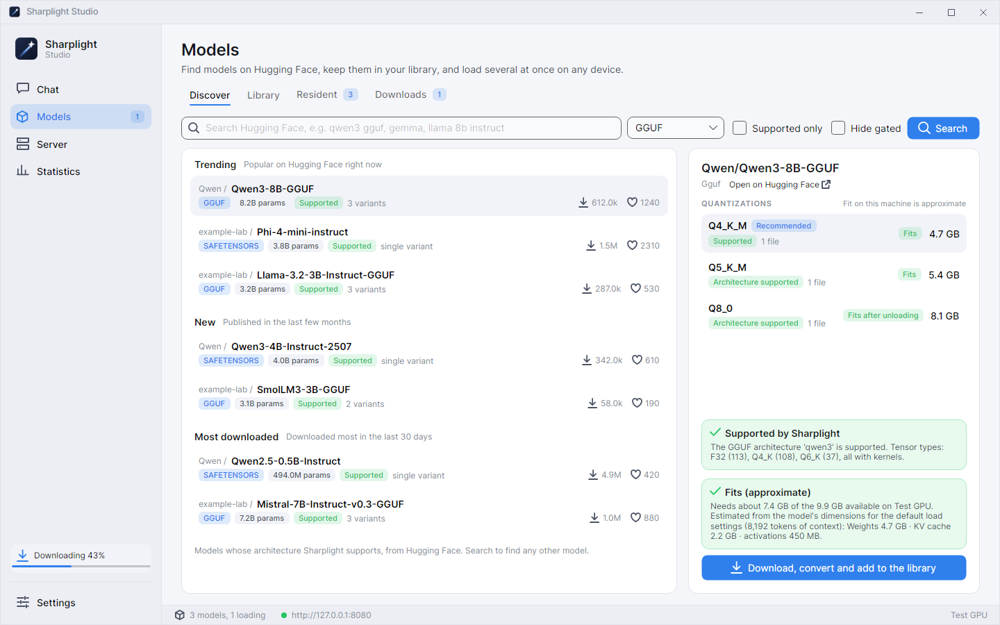
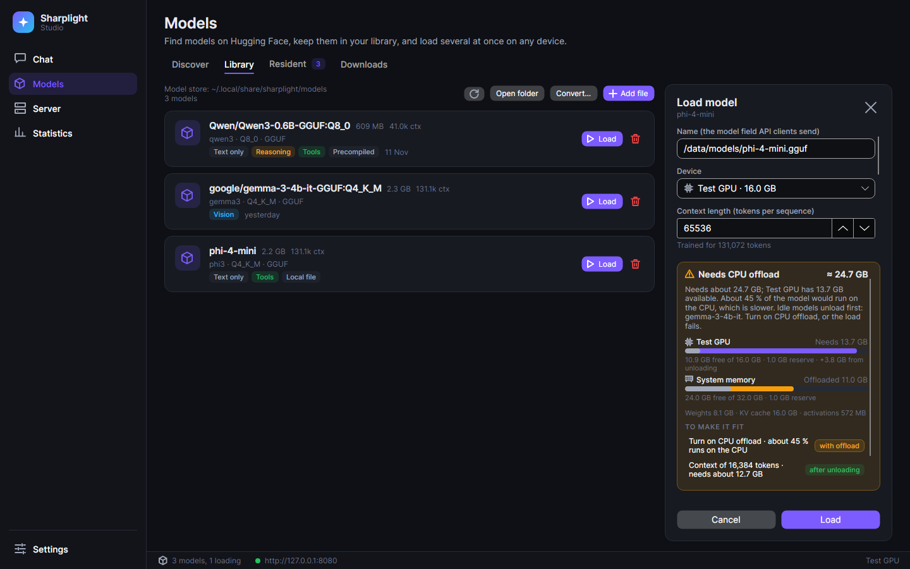
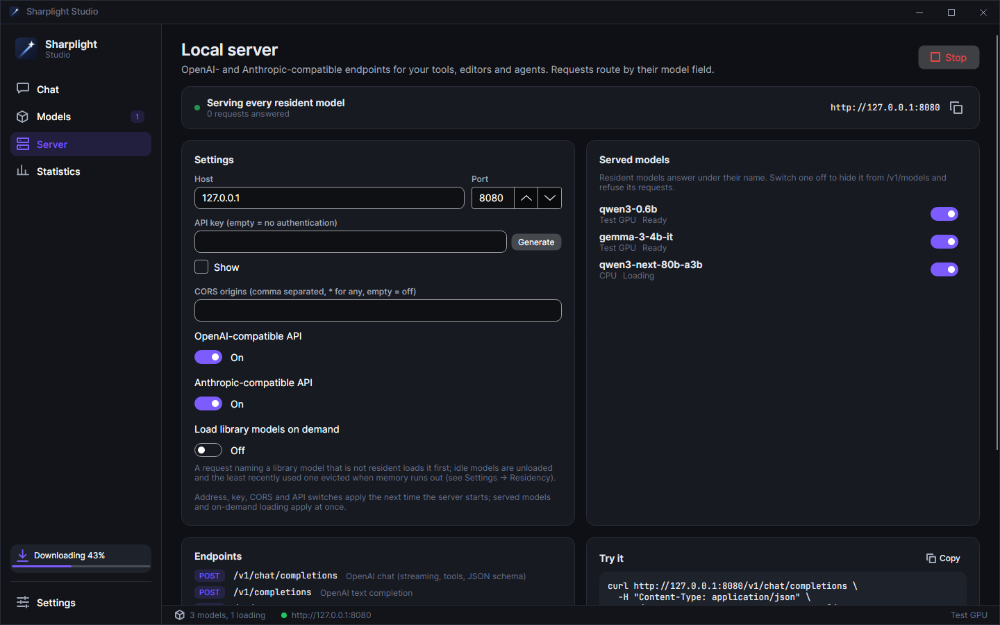
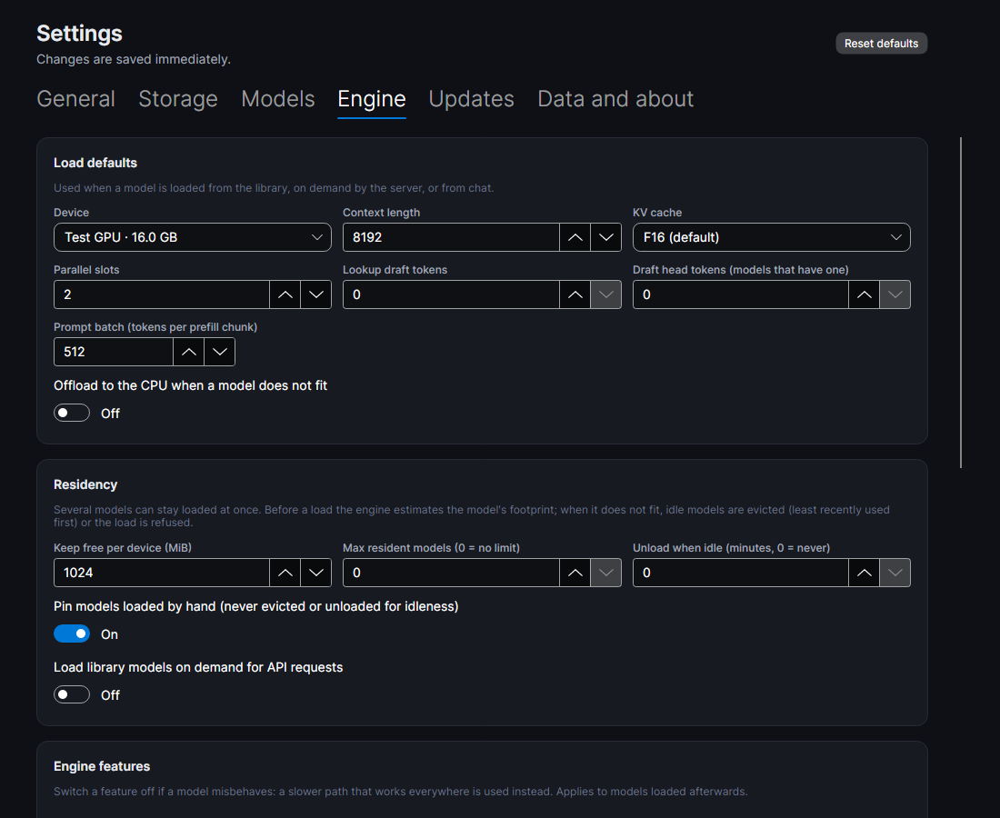
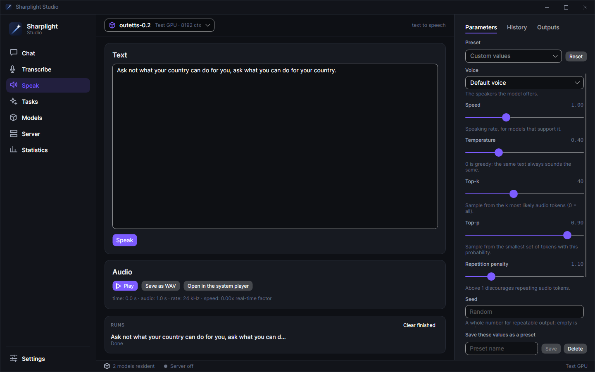
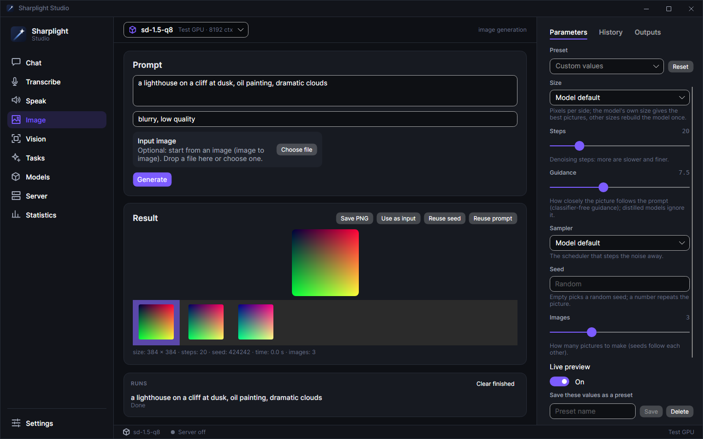

# Sharplight Studio

`apps/Sharplight.Studio` is a desktop app (Avalonia 12) for finding, downloading, running, chatting with and serving local models.
It embeds the engine and the same hosting layer as `sharplight-server`, so everything the app loads is also reachable over the
OpenAI- and Anthropic-compatible API.

```sh
dotnet run -c Release --project apps/Sharplight.Studio
dotnet run -c Release --project apps/Sharplight.Studio -- --models-dir /data/models
```


## Window

On Linux, Studio draws its own title bar in the app's colors (light and dark): the app icon, the title, and minimize, maximize and
close buttons. Dragging the title bar moves the window, double-clicking it maximizes, the edges and corners resize, and dragging to
a screen edge snaps as usual. All of this is asked of the window manager (`_NET_WM_MOVERESIZE`), so Studio uses its own title bar
only when the window manager announces that request (KWin, Mutter and most others, on X11 and for XWayland windows); otherwise the
system frames the window. *Use the system title bar* in the settings, or `SHARPLIGHT_STUDIO_TITLE_BAR=system` (or `custom`),
overrides the choice. Other platforms use the system title bar.

The icon is embedded in the app (window and taskbar icon, sidebar logo, and the Windows executable icon). The sizes in
`apps/Sharplight.Studio/Assets/Icons` are rendered from `packaging/linux/sharplight-studio.svg` by `packaging/make-studio-icons.py`.
The X11 window class is `sharplight-studio`, the `StartupWMClass` of the desktop file, so the taskbar groups the window under its
launcher.

## Pages

**Chat.** Conversations are stored, one per entry in the list. Answers stream as Markdown (code blocks have a copy button, tables,
lists) and reasoning is collapsible. You can regenerate an answer, edit a question (both create versions you can page through),
stop a generation, and set the system prompt, sampling, presets and thinking per conversation. Every conversation keeps its own
model. Switching it mid-conversation applies to the next answer. Conversations keep generating in the background, so two chats on
different models run at the same time. Images and documents can be attached by drag and drop, paste or the file picker:
- Images need a model with the **Vision** badge; the others refuse them with an explanation.
- Documents (PDF, DOCX, HTML, text and code) are extracted to text and trimmed to the context window.

**Tasks.** One card per model kind (text generation, speech to text, text to speech, image generation, video generation, image
classification, object detection, segmentation, depth estimation, OCR, upscaling, audio, embeddings, time series, 3D, bio,
robotics) with the number of library and resident models of that kind. The engine runs text generation (the chat page), speech to
text (Transcribe), text to speech (Speak), image generation (Image), the image models (classification, embedding, object detection,
depth estimation: Vision) and embeddings today. The cards of the runnable kinds open their page; the other kinds say
*Not yet supported* and their buttons lead to the library filtered to that kind and to Discover filtered to that model type. When
the engine gains a kind, its card opens a page of its own, built from the shared pieces described under *Inference pages* below.


**Models.**


- **Filters.** The filter bar above the results picks the model type, format, quantization, size, license, gating and sort order.
  Every choice is saved in the settings (`Discover` in the settings file) and *Reset filters* clears them.
  - *Model type* maps the Hub's pipeline tags and library names to the groups below. A group with several tags is searched once
    per tag and the answers are merged, so a type is never half of its tags.
  - *Format*: GGUF, safetensors, Diffusers, ONNX, whisper.cpp (`ggml-*.bin`) or `.slm` (the Hub's `gguf`, `safetensors`,
    `diffusers`, `onnx`, `ggml` and `slm` tags).
  - *Quantization* (`Q2` to `Q8`, `IQ`, `F16`, `BF16`, `FP8`, `MXFP4`, `NVFP4`) matches the start of a name segment of the
    repository's quantization labels (`Q4` matches `Q4_K_M` and `q4f16`, not `IQ4_XS`) or a checkpoint's quantization method.
  - *Size* (under 1B, 1B to 4B, 4B to 14B, 14B to 40B, over 40B parameters) and *Fits this machine* use the parameter count the
    Hub reports. *Fits* compares the smallest likely download (about 0.55 bytes per parameter for GGUF and ONNX, 2 for a bf16
    checkpoint, 1 for FP8) with the larger of all GPUs together and the system memory. It is approximate, and repositories
    without a parameter count always pass.
  - *License* (the Hub's license tag), *Gated and open / Hide gated / Only gated* and *Sort* (most downloaded, trending, most
    liked, recently updated, newest).
  - The Hub applies model type, format, license and sort; the others filter the results locally, so changing them does not ask the
    Hub again and the page says how many models the filters hide. With no search text and a filter set, or another sort order chosen,
    the Hub's listing in that order is shown.

  | Model type | Hub pipeline tags | Library names |
  |---|---|---|
  | Text generation | `text-generation`, `text2text-generation`, `fill-mask`, `summarization`, `translation`, `conversational` | |
  | Vision-language | `image-text-to-text`, `visual-question-answering`, `video-text-to-text`, `any-to-any` | |
  | Speech to text | `automatic-speech-recognition` | `whisper.cpp`, `faster-whisper` |
  | Text to speech | `text-to-speech`, `text-to-audio` | |
  | Image generation | `text-to-image`, `image-to-image`, `unconditional-image-generation` | `diffusers` |
  | Video generation | `text-to-video`, `image-to-video`, `video-to-video` | |
  | Image classification | `image-classification`, `video-classification`, `zero-shot-image-classification` | |
  | Object detection | `object-detection`, `zero-shot-object-detection` | |
  | Segmentation | `image-segmentation`, `mask-generation`, `keypoint-detection` | |
  | Depth estimation | `depth-estimation` | |
  | OCR | `image-to-text`, `document-question-answering`, `visual-document-retrieval`; vision-language models named like OCR models | |
  | Upscaling | `image-to-image` repositories named like upscalers (`upscale`, `esrgan`, `super-resolution`, `swinir`, `supir`) | |
  | Audio | `audio-classification`, `audio-to-audio`, `voice-activity-detection`, `zero-shot-audio-classification` | |
  | Embeddings and retrieval | `feature-extraction`, `sentence-similarity`, `text-ranking`, `image-feature-extraction` | `sentence-transformers` |
  | Time series | `time-series-forecasting` | `timesfm`, `chronos` |
  | 3D | `text-to-3d`, `image-to-3d` | |
  | Bio | embedding repositories named like protein, molecule and genomics models | `biopython` |
  | Robotics | `robotics` | `lerobot` |
  | Other | every other tag (tabular, reinforcement learning, classic NLP) and repositories without a tag | |

  The mapping is `ModelTasks` in `Sharplight.Hub`; the Studio side (`ModelKindCatalog`) maps a task to the kind of a model
  description and says whether the engine runs it.

  

- **Per-type highlights.** Choosing a model type shows that type's *Trending*, *New* and *Most downloaded* models (every format, one
  listing per section, cached for six hours per type in `discover-highlights-<type>.json`). The default highlights (no type chosen)
  stay the supported language models. A type's highlights include models Sharplight cannot run, marked *Not yet supported: &lt;kind&gt;*;
  *Supported only* hides them and the page then says why it is empty.

  

- **Multi-component repositories** are one model. A Diffusers repository (`model_index.json` and one folder per component:
  `unet`, `vae`, `text_encoder`, ...) shows its components with their weight sizes (the safetensors copy counted once, half-precision
  duplicates left out), a whisper.cpp repository lists its `ggml-*.bin` files by size and quantization, `.slm` repositories their
  packages. Their kinds are not supported by the engine yet, so the badge reads *Not yet supported: &lt;kind&gt;* with the kind named
  and the details say why the download is not offered; nothing is hidden silently. Only the language-model estimates (fit) exist
  today; other kinds show their total size.
- **Gated repositories.** A gated result carries a *Gated* badge and its details say what to do: accept the terms on Hugging Face
  and add an access token in the settings (or that the token is used). The token (the *Hugging Face token* setting, else
  `HF_TOKEN`) is optional and is sent to huggingface.co only, never to the hosts a download is redirected to. Studio has no
  operating-system keyring abstraction yet, so the setting is kept in the settings file as plain text; the settings page says so.
- Before anything is searched, *Discover* shows highlighted models in three sections: *Trending*, *New* (created in the last few
  months) and *Most downloaded*. They come from the Hub's listings (trending, likes and downloads, GGUF and safetensors,
  text-generation and image-text-to-text) and keep only repositories whose badge is *Supported*. The answer is kept for six hours in
  `discover-highlights.json` next to `studio.db`, so opening Discover again or restarting does not ask the Hub again, and an older answer
  is shown while the Hub cannot be reached.

  
  

- *Supported only* hides repositories and quantizations whose compatibility badge is not *Supported*, and says how many it hid.
  The choice is kept in the settings.

  
  

- *Discover* searches Hugging Face (format filter, gated models hidden on request) and lists a repository's quantizations with
  their sizes. Each quantization gets an approximate fit badge for this machine (*Fits*, *Fits on 2 GPUs*, *Fits after unloading*,
  *CPU offload ~40 %*, *Too large*), and the selected one's verdict is explained above the download button (it never blocks the
  download). The estimate takes the download size as weights and sizes the KV cache for the default load settings from the
  model's dimensions: the start of a GGUF file (a range request) or the checkpoint's `config.json`. Without them it assumes a
  generous share of the weights.
- Discover also says whether a model is likely to import and run, from the same metadata reads (nothing extra is downloaded). The
  verdicts are *Supported*, *Partially supported*, *Unsupported architecture &lt;name&gt;*, *Unsupported weight format &lt;type&gt;*,
  *Projector* (an mmproj file, loaded with its language model), *Checked at import* (ONNX) and *Unknown* (the metadata could not be
  read). Each search result gets a badge from what the Hub's search reports (the GGUF architecture, or a checkpoint's `model_type`
  and quantization method), and results that are likely not to import are listed after the others. Each quantization gets a badge
  too, with the reason in its tooltip, and the selected one's verdict is in the box above the download button. Downloading always
  stays possible.

  

  The checks come from the importers, not from lists in Studio:
  - GGUF: `general.architecture` against the registered mappings (`GgufSupport`). Partial support is what a mapping declares (none
    does at the moment). When the recommended quantization is opened, or another one is selected, its whole tensor table is read too (of every shard of a split GGUF): a prefix of up to
    64 MiB per file, fetched in steps. Every ggml type id must be known and have CPU kernels
    (`CpuExecutionProvider.SupportsWeightType`). Every provider falls back to the CPU, so a type without CPU kernels, such as `Q8_K`,
    cannot load. The header then goes through the importer's own mapping steps (`GgufSupport.Validate`): the mapping's feature and
    hyper-parameter checks (`IGgufArchitectureMapping.Validate`, which the importer runs too) and the canonical name of every tensor.
    A tensor the mapping does not know gives *Unsupported variant of &lt;architecture&gt;*. When part of a tensor table lies beyond
    what was read, the verdict is *Unknown*, never *Supported*.
  - Hugging Face checkpoints: the `model_type` against the mappings (`HfSupport`), and the quantization in `config.json` (and
    ModelOpt's `hf_quant_config.json`). FP8 (block scales, compressed-tensors with 8-bit float weights, ModelOpt FP8) and MXFP4 for
    gpt-oss are read. GPTQ, AWQ, bitsandbytes, MLX, integer or 4-bit compressed-tensors, ModelOpt NVFP4 and similar packed formats
    are not, and the importer now rejects them with that reason. A method that is not known gives *Unknown*.
  - ONNX: the opset imports (domain and version) are read by skipping the graph by its length (`OnnxOpsetScanner`), usually in one
    or two range requests. Operators are checked when the model is imported.
- *Library* lists the model store (resolved like the command-line tools: `--models-dir`, `SHARPLIGHT_MODELS`, the setting,
  then the `models` folder of the storage location) and any added `.gguf`, `.slm` or `.onnx` files, for every kind of model in one list.
  Every entry carries a kind badge (an icon and the kind's name). The kind is the one the `.slm` model description names (a package
  without a description is a text-generation model; an embedding package is shown as *Embeddings*). Files that have no description
  are guessed from the file (GGUF files and checkpoint folders are language models, except GGUF files of the `whisper` architecture
  and whisper.cpp ggml files, whatever their extension, which recognize speech, and the image models listed under *Image*) and the
  badge's tooltip says so; a download
  that is not converted yet shows the kind inferred from the Hub's pipeline tag. The kind filter above the list (shown once the
  library holds more than one kind) lists the kinds present with their counts. A kind the engine cannot run yet is badged *Not yet
  supported* and its *Load* button is disabled. Loading, unloading and residency are the same mechanism for every kind.
  *Precompile* (per `.slm` model, also in the context menu) compiles the model for every execution provider and device available
  on this machine through the providers' two-stage contract (portable code such as SPIR-V, then the driver's device code; identical
  GPUs on the same driver share one set; the CPU has nothing to precompile and says so) with the default load settings, and writes
  the result into the package in place (crash-safe append; a failure or cancellation leaves the file unchanged). It is disabled,
  with the reason in its tooltip, while the model is resident (the package is in use), and a model being precompiled cannot be
  loaded meanwhile (also not on demand by API clients). The card shows progress per provider and device (kernel counts for the
  portable stage) and then a summary with sizes, sharing and skipped providers; the entry's size and *Precompiled* badge, and an
  open inspector of the package, are read again afterwards. *Load* opens the load options:

  - device;
  - context length;
  - parallel slots;
  - prompt batch;
  - KV cache type;
  - n-gram and MTP speculative drafts;
  - CPU offload;
  - the **Reduced precision** opt-in.

  Below the options, a memory estimate follows every change: the engine's footprint (weights, KV cache, activations) computed
  from the model's graph for these settings, against each device's free and total memory and the residency reserve. It says
  whether the model fits, fits after unloading other models (naming them, and whether they unload by themselves), needs CPU
  offload (with the share that would run on the CPU, against system memory), or does not fit at all. Suggestions (shorter
  context, smaller KV cache, one slot, turning on offload, splitting over all GPUs, a smaller quantization in the library) apply
  with a click. With several GPUs the device list also offers *All GPUs (split)*, which splits the layers in proportion to their
  free memory.

  

  Loading shows its stages (reading, building graphs, placement, kernel compilation with cached counts, weight upload) and can be
  cancelled. *Convert…* turns a GGUF, safetensors checkpoint or ONNX model into a `.slm` package.

  When a download's conversion or a load fails because of the model, the error starts with the reason: *Unsupported architecture
  &lt;name&gt;* or *Unsupported weight format &lt;type&gt;*. The reason comes from the importer's error
  (`UnsupportedArchitectureException`, `UnsupportedWeightFormatException`). Otherwise Studio reads the file itself: a GGUF header and
  tensor table, a checkpoint's `config.json`, or a package's stored weight types.

  *Inspect* (on a `.slm` card or in its context menu) opens the **package inspector**. *Open .slm file…* opens a package from
  anywhere. The inspector reads only the section table, the definition and the weight and artifact indexes, never weight data,
  so a 30 GB package opens in a fraction of a second. It shows everything in the file:
  - *Overview*: the model (architecture, parameters, graphs, nodes, context length), the package file (format version, sizes by
    section kind, reclaimable bytes), the source and conversion (repository, variant, revision, source format and files), the
    tokenizer (model, vocabulary, merges, special tokens), the chat template and the states.
  - *Graphs*: one tab per graph with its inputs, outputs and op histogram, and three views of it. The **graph** view is a layered
    dataflow drawing that pans, zooms and finds nodes, colored by op category; selecting a node shows its attributes, its inputs
    (type, shape, producer or weight), its outputs and its consumers. The **IR** view is the `--dump-graph` text with search,
    go-to-producer and consumers. The **nodes** view is a filterable table (`op:` filters by op). All three share the selection.
  - *Weights*: name, type, shape, bits per element, size and offset, sortable and filterable, with totals per type.
  - *Artifacts*: the precompilation stages per provider (portable code per device profile, device code per device and driver),
    and every precompiled set with what it was built for (code target, features, limits, device name and identity, driver, kernel
    ABI), its entries (key, content hash, size, offset) and where it sits in the file.
  - *Metadata*: the definition's properties and metadata, filterable, with the full value of the selected entry.
  - *Sections*: the whole file in offset order (header, every section, the section table and unused gaps). Sections of a kind
    this version does not know are listed raw with their size and offset; the other sections still open.

  Lists and the graph drawing are virtualized, so a graph with 100,000 nodes stays responsive.

  
- *Resident* shows the loaded models: state (loading / ready / busy / sleeping / failed), device, memory, last use, and load progress.
  It also shows memory per device against its budget. *Unload* drains running requests for a few seconds and then frees the model.

  
- *Downloads* run in parallel and show bytes, speed, ETA, the current file and overall progress. Conversion and kernel
  precompilation follow as separate stages. Downloads can be paused, resumed and cancelled. The queue is saved, so after a
  restart interrupted downloads resume where they stopped and paused ones stay paused. The sidebar shows running downloads on
  every page.

**Server.** Starts the embedded API on the chosen host and port, with an optional API key, CORS origins and the OpenAI and
Anthropic endpoints switched on or off separately.
- Requests route by their `model` field to any resident model, and `/v1/models` lists them. Loads and unloads apply at once,
  without a restart.
- Turning a model off hides it from the API immediately.
- With *Load library models on demand*, a request for a library model that is not resident loads it first. Idle models are
  unloaded after the configured time, and the least recently used one is evicted when memory runs out (pinned models excepted).
- The page shows a ready-to-paste `curl` request and a log of the requests.



**Statistics.** Every chat and API request is recorded per model in a local SQLite database:
- tokens;
- prefill and decode speed;
- time to first token (median and p95);
- speculative-decoding acceptance.

The dashboard filters by time range and model and charts the speeds, latency and token volumes. It also has a per-model table
and the recent requests. A live strip shows decode throughput, CPU, engine activity and device memory.


**Settings.**
- Theme (dark, light, system) and accent palette.
- Storage: where Studio and the engine keep everything they write (settings, history and outputs, models, compiled kernels,
  caches, logs). **Portable** (a `data` folder next to the AppImage, the install folder or the app bundle), **System folders**
  (XDG folders on Linux, AppData on Windows, `~/Library` on macOS) or a **Custom folder** picked with a folder dialog. The card shows
  the location in use and why (with a notice when a portable or custom folder could not be used), and the folder of every kind of
  file now and with the selected location (read-only). To change it, choose *Move*, *Copy* or *Start fresh*, optionally *Keep the
  models where they are*, then *Change location*. The files are copied and verified with progress and can be cancelled; the new
  location is recorded and used after *Restart now*, and moved originals are deleted at that start. `SHARPLIGHT_HOME` locks the
  location. See [storage.md](storage.md).
- Model store: **with the other data** (the `models` folder of the storage location, the default), the **system folder**
  (`~/.local/share/sharplight/models` on Linux, shared with the command-line tools of the user), or a **custom folder** picked with
  a folder dialog. The page shows the store in use and why (for example "Default: portable storage"), and *Open folder* opens
  it. `--models-dir` and `SHARPLIGHT_MODELS` take precedence.
- Hugging Face token (falls back to `HF_TOKEN`).
- Precompile after download (for every GPU and execution provider on this machine, as the library's *Precompile* does), and
  whether to keep the source files.
- Compilation cache: keep compiled kernels and the driver pipeline cache in the artifact store of the storage location, so models that are not
  precompiled (GGUF, Hugging Face, ONNX) load fast from the second time on. It holds the same artifact sets as a precompiled `.slm`
  and is consulted after the package's own sets. On by default; off reads and writes no store files. See
  [model-format.md](model-format.md#the-per-user-artifact-store).
- Load defaults.
- Residency:
  - memory kept free per device;
  - maximum resident models;
  - idle unload time;
  - pinning of manual loads;
  - on-demand loading.
- New-chat defaults.
- *Use the system title bar* (see [Window](#window)).
- The engine's device features, each of which can be switched off to fall back to a portable path.
- **Reduced precision** (off by default) opts in to faster f16 kernel paths where the default keeps near-f32 accuracy. Outputs may
  differ slightly.



## Inference pages

Every model kind gets a page built from the same blocks, so they look and behave alike: the **frame** (`InferenceFrame`) has the
model picker on top, the page's own workspace in the middle, the run queue below it and a side panel with three tabs:
*Parameters*, *History* and *Outputs*. A page is a view model derived from `InferencePageViewModel` (the chat is the one page that
predates the frame and keeps its conversation list; it uses the same `ModelPickerViewModel` and residency). The blocks live in
`ViewModels/Inference` and `Views/Inference`:

| Block | What it does |
|---|---|
| Model picker (`ModelPickerViewModel`) | The resident models of the page's kind; follows loads and unloads and keeps the choice while the model stays resident. No model: a hint with *Library* and *Find a model*. |
| Parameter panel (`ParameterPanelViewModel<TOptions>`) | One control per field of the task's options type (choice, slider, switch, text), `Options` maps the values to the type (for example `SpeechRecognitionOptions`), and a page can hide parameters the chosen model does not use. Presets: built-in ones ship with the page, *Save* stores the values under a name; presets and the values of the last run are JSON (`presets.json` in the page's directory) and come back when the page opens. |
| Run queue (`RunQueueViewModel`) | Runs one after the other per model (a second run on the same model waits, runs on different models overlap), with progress, status and a cancel button for queued and running runs. Finished runs stay listed until cleared. |
| History (`RunHistoryViewModel`) | Every completed or failed run of the page (up to 200), newest first, kept in `history.json`; *Show again* restores the result and the parameters, delete asks twice. Cancelled runs are not kept. |
| Outputs gallery (`OutputGalleryViewModel`) | The completed runs with their files (`outputs/<run>/`), metadata chips (language, audio length, speed, voice), and *Open*, *Export* (a save dialog) and *Delete* for every item. |
| Export (`Exporter`) | The save dialog and the write, shared by the page's own export buttons and the gallery. |

Pages keep their data under the data directory of the app (`pages/<page>/`, see *Where things are kept*). Loading a speech model
goes through the load panel of the library, like any other model: the runtime registers it on the same `ModelHost` as the chat
models (kind `Task`), so it counts against the memory budget, is evicted and unloaded when idle like the others, reloads on demand
and shows in the *Resident* list, whose button opens the page of the model's kind. A page asks the model for its task client
(`ILoadedModel.AcquireClientAsync<TClient>`), which holds a lease while the run lasts.

**Transcribe** (speech to text, `ISpeechRecognizer`). The input is an audio file (WAV, FLAC, MP3, Ogg Vorbis or Ogg Opus; choose, or drop it on the page) or a recording from
the microphone. A file that cannot be decoded is refused with a note. The options are the language (or detection), transcribe or translate to English, timestamps (segments
or none), beam size, conditioning on the previous text and an initial prompt; presets *Fast*, *Accurate* and *Long recording*. The
segments appear with their times while the model decodes (the streaming call reports progress by the end of the last segment), and
the transcript can be copied or exported as `.txt`, `.srt` or `.vtt`. Every run keeps `transcript.txt`, `.srt`, `.vtt` and
`transcript.json` in its outputs. Whisper (Hugging Face, whisper.cpp `.bin`, the transcribe.cpp `whisper-*.gguf` files of the
handy-computer repositories, whisper.cpp files published as `.gguf`, `.slm`) and Distil-Whisper models work. Candle's whisper GGUF
files (Hugging Face tensor names with the tokenizer in a separate file) are refused on load with a message that says to use the
whisper.cpp or transcribe.cpp files of the same model.


**Speak** (text to speech, `ISpeechSynthesizer`). Type the text, optionally choose a voice (the choice appears when the model offers
voices), the speed and the sampling (temperature, top-k, top-p, repetition penalty, seed; presets *Natural*, *Deterministic* and
*Expressive*). The result plays in the app, can be saved as WAV or opened in the system's audio program, and is kept as
`speech.wav`. *Play while generating* uses the streaming call and plays each segment as it arrives (the segments are decoded one by
one, so the sound differs slightly from a whole-text pass). OuteTTS is a language model plus the WavTokenizer decoder: when you load
an OuteTTS GGUF, the load panel asks for the vocoder file (a `.slm` package made with the vocoder needs none).



**Image** (image generation, `IImageGenerator`). Type a prompt and optionally a negative prompt; the parameters are the size, steps,
guidance, sampler (`Samplers`: Euler, Euler Karras, Euler ancestral, DDIM, PNDM, DPM++ 2M, DPM++ 2M Karras), the seed (empty is random,
a number repeats the picture), the number of images (the seeds follow each other) and *Live preview*; presets *Fast* and *Quality*.
The streaming call reports every denoising step to the run queue and, every few steps, a low-resolution preview that the page shows
while the picture takes shape. An *Input image* (choose or drop) makes the run image to image, with a *Strength* slider that appears
with it; adding a *Mask* (bright areas are regenerated, the rest is kept) makes it inpainting, which the engine supports. The
results are PNG files that carry the prompt and parameters as text chunks (`parameters` in the style of other generators, plus
`Prompt`, `Negative prompt`, `Seed`, `Steps`, `Guidance`, `Sampler`, `Size`, `Model`), kept in the outputs gallery with thumbnails
next to `parameters.json`. *Save PNG*, *Use as input*, *Reuse seed* and *Reuse prompt* act on the shown image; the gallery's *Reuse
parameters* (every page has it) sets the parameters, the prompt and the result of a past run, with the seed that run actually used.
Stable Diffusion 1.x, 2.x and XL work (diffusers folders, single-file `.safetensors` / `.ckpt`, stable-diffusion.cpp GGUF, including
the SDXL and SDXL-Turbo GGUF files of the Hub). When a distilled model is chosen (SDXL-Turbo, SDXL-Lightning: its default guidance
is 1 or less), the page sets steps and guidance to the model's defaults (SDXL-Turbo: 4 steps without guidance) and says so; choosing
a regular model afterwards restores 20 steps and guidance 7.5. FLUX, SD3 and the other diffusion transformers are listed as image
models, and loading one says "Not supported yet: FLUX (diffusion transformer)". A file that holds only the UNet, or an SDXL UNet
without its second text encoder, fails on load naming what is missing; a `.slm` converted from an SDXL GGUF by an earlier version
(without the second encoder) fails on load asking to import the original file again.



**Vision** (one page for `image-classification`, `image-embedding`, `object-detection` and `depth-estimation`; the mode follows the
kind of the chosen model, and the parameters that do not apply are hidden). Choose or drop an image (PNG through the engine's codec,
JPEG, WebP, BMP and GIF through the platform's decoders).

- *Classification* lists the top-k classes with score bars.
- *Embedding* models with a text tower (CLIP, SigLIP) score *candidate labels* zero-shot (comma or line separated, put into a
  *label template* such as `a photo of {}`); without labels, or for a model without a text tower, the page shows the image's vector
  (length and first values, normalized or not).
- *Detection* draws the boxes with labels and scores. The model is asked with a score floor of 0.05, so the *Score threshold* slider
  shows more or fewer objects afterwards without a new run; *Export PNG* and *Export JSON* follow the threshold.
- *Depth* shows the depth map beside the image, in grayscale or with the turbo, viridis or inferno color map (changed without a new
  run, optionally inverted).

Every run keeps `result.json` (plus `annotated.png` or `depth.png`) in the outputs; the history restores the result and the
parameters, also when the original image is gone (the stored PNGs are shown then). Annotated images are drawn by Studio itself
with a small built-in font (upper-case letters, digits and basic punctuation).

 


The library recognizes the image models without a package: a diffusers folder (`model_index.json`), a single-file checkpoint (its
safetensors header or GGUF tensor table names the UNet, or a GGUF names a diffusion transformer such as FLUX; a `.ckpt` only by its
name), and Hugging Face vision checkpoints by the
architecture of their `config.json` (`...ForImageClassification`, `...ForObjectDetection`, `...ForDepthEstimation`, CLIP, SigLIP and
DINOv2 as embedding models). These kinds load through the same load panel, simplified to the device (no context, batching or KV
cache), and the *Tasks* cards and the library's *Load* open the right page.

Not supported yet: segmentation, OCR, upscaling and video models (the cards say so), a painting tool for masks (a mask is a file),
and diffusers pipelines with a transformer instead of a UNet (Flux, SD3: the loader reports it).

The side panel's *History* and *Outputs* tabs:

 

**Microphone and playback.** Studio plays and records through `Sharplight.Audio`, Sharplight's own native audio library
(miniaudio device I/O: WASAPI, Core Audio, PulseAudio/PipeWire, ALSA, JACK; decoding of WAV, FLAC, MP3, Ogg Vorbis and Ogg Opus), which
ships with the app for all five platforms; no program of the system is needed. The Settings page has an *Audio* card with the playback
device and the microphone (default: the system's); a device that is gone falls back to the default. Recordings are mono 16 kHz WAV files.
Without an audio backend or device (servers, containers) recording is disabled (audio files still work) and the speech result is saved
and opened with the system player instead of played in the app. Playback and recording are tested through fakes and, on Linux, with the
library's null backend; the real backends were not exercised on this machine (it has no audio device).

## Installing and updating

Studio is published for Windows x64 and ARM64, Linux x64 and ARM64, and macOS ARM64 (Apple Silicon), self-contained (no .NET
needed), as [Velopack](https://velopack.io) packages:

| Platform | Install with | Also |
|---|---|---|
| Windows | `SharplightStudio-<rid>-<channel>-Setup.exe` | portable zip |
| Linux | `SharplightStudio-<rid>-<channel>.AppImage` (updates itself in place) | `sharplight-studio-<version>-<rid>.tar.gz` |
| macOS | `.pkg` installer (the `.app` bundle) | zip |

The macOS and Windows packages are not signed yet (Windows SmartScreen and macOS Gatekeeper warn on first start); signing hooks are in
`packaging/pack-studio.sh` and `.github/workflows/studio.yml`. On macOS the Vulkan provider needs MoltenVK, which is not part of
the package yet, so the app runs on the CPU provider.

**Channels.** Every build belongs to one of ten update channels, `<rid>-stable` (built from `release/*` branches) and `<rid>-unstable`
(built from `develop`), for `win-x64`, `win-arm64`, `linux-x64`, `linux-arm64` and `osx-arm64`, for example `win-x64-stable` or
`osx-arm64-unstable`. An installed app only checks the channel it was installed from; to switch from unstable to stable, install the
stable package.

**Updates.** Studio checks for a new version at startup and every six hours (*Settings > Updates > Check for updates automatically*).
When one is found, a dialog shows the version and its release notes (Markdown), then *Download and install* (with progress; Velopack
downloads a delta package when it can) and *Restart to update*, or *Later*. The Settings section shows the current version and
channel, the automatic check switch, *Check for updates now* and the time of the last check. Builds that were not installed with
Velopack (`dotnet run`, a plain build) show "updates unavailable for this build" and never check.

**Update feed.** The packages are served from a public URL (Cloudflare R2 on a custom domain, see `docs/releasing.md`). The URL is
taken from, in this order:

1. the environment variable `SHARPLIGHT_STUDIO_UPDATE_URL`;
2. the `UpdateUrl` entry of the settings file;
3. the URL baked into the build: MSBuild property `StudioUpdateUrl` (assembly metadata `StudioUpdateUrl`). CI sets it from the
   repository variable `STUDIO_UPDATE_URL` (official builds: `https://download.sharplight.dev/studio`). A local build has none.

Without a URL the update checks are disabled, and the Settings section says so. All channels share that one folder; each has its
own `releases.<channel>.json` feed.

## Where things are kept

Everything follows the storage location chosen in *Settings > Storage* (portable, system or custom; the full table per mode and
platform is in [storage.md](storage.md)). `<config>`, `<data>` and `<cache>` are the folders of that location: for example
`~/.config/sharplight`, `~/.local/share/sharplight` and `~/.cache/sharplight` on Linux in system mode, or `data/config`, `data` and
`data/cache` next to the AppImage in portable mode.

| What | Where |
|---|---|
| Settings (`settings.json`), including the download queue | `<config>/studio` |
| Conversations and statistics (`studio.db`), Discover's highlights (`discover-highlights.json`) | `<data>/studio` |
| Inference pages: parameter presets, run history and output files (`pages/<page>/`) | `<data>/studio/pages` |
| Models | The model store: `<data>/models` by default, else the folder chosen on the *Models* card; converted local models go to `converted/` in it by default |
| Compiled kernels, extracted shader sources | `<cache>/artifacts`, `<cache>/shaders`, shared by every tool |
| Logs | `<logs>` (`<data>/logs` in portable and custom mode) |

The mode is known before the settings load. A `sharplight.portable` file next to the package selects portable mode. A pointer file
in the system configuration folder selects a custom folder. `SHARPLIGHT_HOME` overrides both. `SHARPLIGHT_STUDIO_HOME` moves only
Studio's own settings and data into one directory (tests, side-by-side profiles). `SHARPLIGHT_MODELS` and `--models-dir` move only
the models, and `SHARPLIGHT_COMPILATION_CACHE` only the compiled kernels.

When the model store in effect is empty while another store has models, Studio offers once to keep using that store or to move or
copy the models into the new one. The other store can be the system store, or the `data` folder next to the app where earlier
versions kept them.

## Architecture

- **MVVM.** The app uses CommunityToolkit.Mvvm with compiled bindings. View models only talk to the services in
  `Services/` through interfaces:
  - `IModelRuntime`
  - `IHubService`
  - `IModelLibrary`
  - `IConversationStore`
  - `IStatsStore`
  - `IApiServer`
  - `IDocumentExtractor`
  - `ISystemMonitor`
  - `IPlatformServices`
  - `IPageStorage` (per-page presets, history and output files), `IAudioPlayer` and `IAudioRecorder` (the system's audio programs)
  - `IUpdateService` (the Velopack wrapper, registered through `Microsoft.Extensions.DependencyInjection`)

  Tests run every view model against fakes of these services.
- **Runtime.** `EngineModelRuntime` owns a `ModelHost` (from `Sharplight.Llm.Serving.Hosting`, the same registry the server uses)
  and loads models through the registered providers and importers. Load progress comes from the engine's structured
  `LoadProgress` reports (`LlmLoadOptions.Progress`). Each request holds a lease on its model, so unloading and eviction wait
  for running requests.
- **Server.** `KestrelApiServer` maps the endpoints of `Sharplight.AspNetCore` over that host. Chat and API requests to the same
  model share one engine and are batched together. Stopping the server leaves the models loaded.

## Tests

`tests/Sharplight.Studio.Tests` covers:
- the pure helpers;
- the SQLite stores and settings;
- the downloads queue (pause, resume, cancel, restore after restart);
- fit estimates: the planner (unloading, offload, system memory, split GPUs), the load panel's estimate and suggestions, and the
  download badges;
- the title bar choice (own or system), and Discover's highlights (sections, filtering, the cache and its lifetime) and the
  *Supported only* filter;
- the header-only import check on the header of a Gemma 4 mixture-of-experts GGUF (every tensor of the table, compared with the
  importer on the same header);
- compatibility checks before downloading, on the tiny GGUFs and Hugging Face configs under `~/models` when present (an unmapped
  architecture, an mmproj projector, real quantized tensor tables read from a prefix, synthetic `Q8_K` and
  unknown type ids, quantized checkpoints, ONNX opsets read behind the graph), the result order, the per-quantization badges and the
  library's import errors;
- update checks and the update dialog: auto and manual checks, up-to-date and failure messages, *Later*, download progress and
  restart (against a fake update service), the feed URL precedence, and a headless render of the dialog;
- conversations: streaming, versions, branches, stop, model switching and concurrent chats;
- the server page;
- the shared inference blocks (presets saved as JSON and restored, the run queue's one-run-per-model order and cancellation, history and
  gallery persistence with open, export and delete) and the Transcribe and Speak pages over fake task clients (streamed segments, `.txt` /
  `.srt` / `.vtt` export, cancel and failure, microphone, voices, streaming playback, no-player fallback);
- a headless render of every page that fails on binding errors;
- the package inspector: every tab of a small package, a view for every section kind the format defines, unknown sections
  listed raw, the linked graph, IR and node selection, the graph layout, and a 100,000-node graph that stays virtualized.

`GgufRealModelTests` takes the GGUF and whisper.cpp files people download (transcribe.cpp whisper GGUF, a whisper.cpp file named
`.gguf`, large-v3-turbo, the SDXL-Turbo GGUF) through library recognition, the runtime and the Transcribe / Image pages, and checks that
FLUX GGUF files are listed as image models and named as not supported yet. `SpeechRealModelTests` loads `ggml-tiny.en.bin` (transcribes `jfk.wav` on the Transcribe page) and OuteTTS with its WavTokenizer
vocoder (speaks on the Speak page) through the real runtime, when the files are on disk. `RealModelTests` loads two small GGUF models (Qwen3-0.6B, SmolLM2-360M) when they are on disk. It chats with both at once and
calls the embedded server. Set `SHARPLIGHT_STUDIO_SCREENSHOTS` to a directory to save the page screenshots used here. With
`SHARPLIGHT_INSPECTOR_PACKAGES` (a list of `.slm` paths, separated like `PATH`), the inspector renders every tab of those
packages in both themes.

## Limitations

- **Images.** Image conversations run on a separate single-sequence session with the vision encoder, one request at a time. They
  are not batched with the model's text engine, and this memory is not counted in the residency budget.
- **Conversion progress.** Conversion during a download reports its log, not a percentage. Precompilation reports kernel counts
  per graph.
- **Fit estimates.** The load panel's estimate is the engine's own, but free memory can change before the load (other
  applications), and the vision tower of an image conversation is not counted. Download badges are approximate: they know the
  file sizes and, where readable, the attention dimensions, not the exact graph.
- **Compatibility checks.** They are likely verdicts, not guarantees: a GGUF header that maps can still fail on something only its
  tensor data shows. Quantizations other than the recommended one share the architecture's verdict until they are selected and
  their tensor tables are read. A tensor table beyond 64 MiB from the start of a file is not read (the verdict is *Unknown*). ONNX
  operators are not checked before import.
- **Audio formats and devices.** Microphone and playback depend on a sound server or driver being present
  (see *Microphone and playback*); the real device backends were only tested through the null backend. Speech runs are not counted in the statistics page, and the
  embedded API server does not serve the speech models yet.
- **Title bar.** Studio's own title bar is used on Linux only, where the window manager moves and resizes windows on request.
- **GPU utilisation.** The "Engine busy" chart is the share of time the engines spend stepping, not GPU utilisation read from the
  driver.
